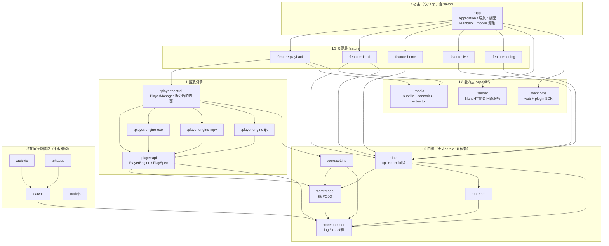
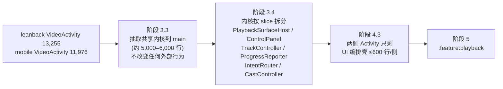
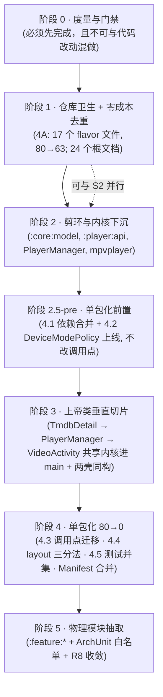

# WebHTV 架构与目录结构重构治理方案（Master Plan）

| 项 | 内容 |
|---|---|
| 文档状态 | 提案（Proposal），**本文档不授权任何代码改动** |
| 最新修订 | **2026-11-26 第四轮：4.1 / 4.2 已实施并验收**。4.1 = 依赖合并（commit `d2d3ad4`，autosize 例外见 §4.8.3）；4.2 = `device` 包 `DeviceModePolicy` 脚手架落地（4 文件 166 行，零调用点改动）。本文档同步订正：包名 `ui/kit` → `device`、取消"两个 flavor 实现"设计、4.1/4.2 批次行改为"已完成 + 实际验收口径"。**此前的 D2 决策记录**：放弃双 flavor 双 APK，改单 APK + 运行期自适应（ADR-0002），新增 §4.8 / §6.11 / §8.5，阶段 4 重排为"单包化 80→0"。 |
| 适用仓库 | `E:/gitwork/easytv`（WebHTV，`master`） |
| 治理范围 | 代码组织、模块边界、目录结构、flavor 双份实现、上帝类、度量与门禁、文档/仓库卫生 |
| 基线采样时点 | HEAD `91cdb8c`；工作区**除本文件外**干净（`git status --porcelain` 仅 1 条：本文件未跟踪） |
| 约束 | 文档本身只做规划与记录。已授权的代码落地批次：**4.1**（`app/build.gradle` 依赖合并，已提交 `d2d3ad4`）、**4.2**（`device` 包 4 个新增文件，可整体删除回滚）。其余批次均未动代码。 |
| 复现方式 | 见「附录 B：复现命令清单」，所有数字均可由命令行独立验证 |

> **阅读顺序建议**：决策者读 §1；工程负责人读 §1、§5、§6、§9；执行者读 §2、§4、§5、§8。

---

## 1. TL;DR / 治理结论

### 1.1 核心病灶（只有三条）

**病灶 1：没有任何一条「边界」是可执行的，因为一切状态都"静态可达"。**
包名、目录、命名、甚至 `androidx.*` 命名空间，全部只承担"文件放哪儿"的功能，不承担任何强制。证据：20 个顶层包之间存在 **52 对双向依赖**（§2.4）；`bean` 包（本应是数据层）反向依赖 `App` 32 次、`api` 17 次、`setting` 10 次、`db` 10 次（§2.4）；应用代码占用 `androidx.media3.mpvplayer` 命名空间共 **48 个文件 / 14,962 行**，且未出现在 `CLAUDE.md`、`README.md` 任何章节（§2.5）。
更底层的一条：**没有依赖注入边界，全局状态靠静态符号直接可达**——`setting.Setting.*` 静态成员引用 **628 处 / 112 个文件**（其中 78 个文件真正调用其读写方法）、`App.get()` **93 个文件**、`player.PlayerManager` **48 个文件**、`bean.History` **56 个文件**、`EventBus` **17 个文件**（§2.8）。这意味着任何 Gradle 模块抽取动作都会立刻在模块间形成编译期硬依赖，**模块化在静态耦合被治理之前无法启动**。

**病灶 2：同一份逻辑同时用三种机制表达，且三套都没收敛。**
- 构建期复制：`app/src/leanback/java` 与 `app/src/mobile/java` 有 **80 个同路径同名文件 / 58,466 行**（`wc -l` 口径），其中 **11 个文件逐字节完全相同（共 816 行）**、12 个文件的行集合完全相同，而这两个源集对 `main` 的覆写数 = **0**（§2.2）。
- 运行期分支：`Util.isLeanback()` 有 **232 个调用点**（§2.2.4）。
- 资源覆盖：`leanback` 与 `mobile` 各有约 130 个 layout，同名 85 个（§2.2.5）。
同一份"TV 与手机不同"的知识，在三个互不相干的地方各写一遍，于是每次改动都要"记住三个地方"——这就是"冗余"的真实来源，不是行数本身。

**病灶 3：没有度量，因此没有"停止条件"，于是所有重构计划都只是在写计划。**
仓库 18 个 commit，首提交信息是 `chore: repository snapshot - minimized WebHTV source`——**git 历史被压平，无法考古**（§2.7.3）。CI 只有 3 个 release 发布工作流，测试门禁是 10 个类硬白名单，没有 lint 门禁、没有度量门禁、没有依赖门禁（§2.7.1）。既有 `docs/refactoring/TMDB_DETAIL_ACTIVITY_REFACTORING_ROADMAP.md`（8 周 Delegate 拆分计划）撰写时目标文件 9,738 行，现在 **14,365 行（+47.6%）**，方法数 788 → 1,063，而该计划声称"Week 1 已完成 ✅"的 `delegate/` 包**在仓库中并不存在**，只留下一个 879 字节的 `ui/host/TmdbDetailHost.java` 接口（§3.5 有完整复盘）。

### 1.2 主策略

> **先立机制，再动代码；先剪环，再拆模块；用"垂直切片 + 状态下沉"替代"Delegate 横切"；每个批次都必须净减少行数。**

四条抓手，按优先级：

1. **机制先行（阶段 0，不可跳过）**：把可执行的度量脚本 + 债务白名单 + CI 门禁先落地，让"变差"在合并前就红。没有这一步，后面四个阶段都会重复旧路线图的结局。
2. **零设计成本去重（阶段 1）**：**17 个**低风险 flavor 双份文件（12 个 Jaccard=1.000，其中 11 个逐字节相同；再加 5 个 Jaccard ≥0.90）删一份并入 `main`，删除 24 个根目录流水账文档，归档旧治理计划与 `docs/` 流水账，声明/移除游离目录。这一批**不写任何新抽象**，只删东西，风险≈0，可直接把"双份文件数"从 **80 降到 63**。
3. **先解静态耦合，再剪环 + 内核下沉（阶段 2）**：顺序是**先**把 `Setting.*`（628 处 / 112 文件）接口化为可注入的 `SettingSource`、把 `App.get()`（93 文件）改为注入 `AppContext`——**否则每个模块都会被迫反向依赖上层，模块化在第一次 `git mv` 时撞墙**；**再**动"叶子能力"：`:core:model`（15 个纯 POJO）、`:player:api`（修 `PlayerEngine` 的依赖倒置）、`PlayerManager`（9,819 行/508 方法）按引擎拆解、`mpvplayer` 迁出自有命名空间。目标：静态调用点 628→≤450、`App.get()` 93→≤60、双向依赖 52→≤20。
4. **垂直切片（阶段 3–4）**：上帝类按 feature 垂直切（不是按"方法相似度"横切）；flavor 剩余 80 个文件在**阶段 4 单包化**中收敛到 `main`，设备差异改由 `DeviceModePolicy`（运行期三维判定，见 §4.8）承载，终态双份文件 **80 → 0**，而不是"保留 8 个真差异"。**4.1（依赖合并）与 4.2（谓词上线）前移到阶段 3 之前**，理由见 §4.8.7。

### 1.3 预期收益（可度量，非口号）

> **D2 已决策（见 §9）**：**放弃 leanback/mobile 双 flavor 双 APK，改为单 APK + 运行期设备形态自适应**。因此下表所有"flavor 双份文件数"的终态目标由原 `≤8` 收紧为 **`0`**，`isLeanback()` 调用点的终态由 `≤40` 收紧为 **`0`**（调用点迁移到 `DeviceModePolicy`，见 §4.8）。新增"APK 体积"与"单包化 CI 门禁"两行。

| 指标 | 当前 | 阶段 1 后 | 阶段 3 后 | 终态目标 |
|---|---|---|---|---|
| 全仓 Java 行数 | 577,187 | ≈565,000（-2%） | ≈520,000（-10%） | ≤450,000（-22%） |
| ≥1000 行 Java 文件数 | 55 | 55 | ≤20 | **0** |
| 最大单文件行数 | 14,365 | 14,365 | ≤2,000 | **≤800**（阶梯：2,000→1,200→800，见 §6.1） |
| flavor 双份文件数 | 80 | **63** | 63 | **0**（单包化后无 flavor 源集，见 §4.8） |
| 顶层包双向依赖对 | **52** | 52 | ≤20 | **0** |
| `Util.isLeanback()` 调用点 | 232 | 232 | 232 | **0（全部迁移到 `DeviceModePolicy`，见 §4.8.6）** |
| 构建变体数（`mode` 维度） | 2（leanback/mobile） | 2 | 2 | **1（仅保留 `abi` 维度）** |
| APK 体积（release，单 ABI） | 基线待实测 | 待实测 | 待实测 | **≤ max(leanback, mobile) × 1.08**（方法见 §4.8.3 / 附录 B #13） |
| 根目录散落文档 | 24 | 0 | 0 | **0** |
| `docs/` 文件数 | 503 | ≈330 | ≈280 | **≤150（含归档目录）** |
| 架构类 CI 门禁 | 0 | 3 | 5 | 5（硬阻断） |
| 单包化 CI 门禁 | 0 | 0 | **1（双入口/uses-feature 校验脚本）** | **2（+ 单包构建通过校验）** |

### 1.4 明确**不**做的事

1. **不做纯 Delegate 横向拆分**。旧计划把 14,365 行拆成 5 个 Delegate，自己给出的周目标合计 6,000 行、终态块合计 2,800 行、"总计 ~3,300 行"——三个数字互相矛盾（§3.5.3）。按这个切法，`TmdbDetailPlayerDelegate` 目标 2,000 行、`EpisodeDelegate` 1,500 行，**本身仍然是上帝类**，只是换了个名字。
2. **不做一次性 12 模块大爆炸拆分**。当前 52 对双向依赖 + 628 处静态可达下，任何 `:feature:*` 模块都无法编译——物理模块化的前提是逻辑边界已存在，而不是相反。
3. **不动 `third_party/**`、`*.lock.json`、已提交的 `.so`/assets、`nodejs/build.gradle` 的 `ANDROID_STL`**（§8.1）。
4. **不改 `com.github.catvod.crawler.Spider` 公共 API**——它是插件 ABI 契约（`CLAUDE.md:61`），改动即破坏存量 Spider 生态。
5. **不为了"看起来整洁"重排目录**。任何移动都必须在阶段 0 的度量下产生可验证的改善，否则不做。
6. **不手工编辑 `AGENTS.md`**——它是 `CLAUDE.md` 的镜像产物（`CLAUDE.md:3`）。
7. **不在本方案内做人天排期**（遵守 `CLAUDE.md:99` 的估算规则），一律用"批次 + 退出标准"组织。
8. **不保留两份并行的治理计划**。既有 `docs/refactor-governance-plan.md`（661 行，P0–P4）必须按 §1.6 归并归档，否则本方案自己就在制造它 §3.5 所批评的"文档驱动"病灶。

### 1.5 与旧路线图的本质区别

| 维度 | 旧计划（TMDB_DETAIL_ACTIVITY_REFACTORING_ROADMAP.md） | 本方案 |
|---|---|---|
| 起点 | 直接拆 1 个文件 | 先建度量与门禁，再动代码 |
| 切分维度 | 横向（按"方法类型"合成 Delegate） | 纵向（按 feature 切片 + 状态下沉） |
| 质量上限 | Delegate 2,000 行也算达标 | 单文件 ≤800 行，超限即红 |
| 验证 | "跑一下 LayoutTest" | 度量脚本 + ArchUnit + 行数净减校验，全部在 CI |
| 失败模式 | 无停止条件 → 文件反向增长 47.6% | 债务白名单只减不增，新增即阻断 |
| 对"不做事"的处理 | 未定义 | §1.4 明确 8 条禁行 |

### 1.6 与既有 `docs/refactor-governance-plan.md` 的关系

**前提事实**：仓库里**已经存在**一份 661 行的治理计划 `docs/refactor-governance-plan.md`（commit `39bd02b` 引入，`777e143` / `bc4fa96` 修订），内容是给 Agent 的 P0–P4 执行手册。本方案初稿**未提及它**，这是一个方法论错误——**仓库里并存两份重构计划，本身就是本方案 §3.5 所批评的"文档驱动"病灶**。本节负责把它归并清楚。

#### 1.6.1 为什么必须合并而不是并存

| 并存的具体危害 | 后果 |
|---|---|
| 两份计划对"先做什么"给不同答案（旧：P0→P1→P2→P3→P4；本方案：阶段 0→1→2→3→4→5） | Agent 按哪份执行？`CLAUDE.md:39` 的恢复流程会读到两份互相矛盾的"下一步" |
| 两份计划对同一文件给不同目标（旧：`TmdbDetailActivity` ≤6,500 行；本方案：≤600 行 + 6 个 ≤800 行 slice） | 达标判定失效 |
| 旧计划独占了两项**本方案无法自行重建**的资产（21 个既有失败清单、6226/21/3 测试基线） | 若旧文件被删/被遗忘，这两项数据永久丢失 |
| 旧计划有 6 条**环境硬事实**（见 1.6.3），本方案若不继承会重复踩坑 | 例如误用 `--offline`、误用 `timeout` 包裹 `gradlew` |

#### 1.6.2 逐阶段对照

| 旧计划 | 旧计划实质内容 | 本方案对应 | 处置 | 修正了什么 |
|---|---|---|---|---|
| **P0** 测试安全网 | 21 个既有失败基线；75 个 `*SourceTest` 加 `@Category`；`-PexcludeSourceTextTests` 参数；实现文本耦合地图 | **阶段 0**（度量门禁）+ **阶段 1.4**（源码文本断言分类治理，见 §2.9） | **吸收 + 修正** | ①旧 P0 的产出物是"文档里的地图"，本方案要求落成 `debt-baseline.json` 的机器可读字段；②旧 P0 只做 `@Category` 排除（把断言**关掉**），本方案要求按 A/B/C 三类**处置**（迁移/契约化/删除），因为"关掉"等于放弃保护 |
| **P1** 消除双端重复 | 从 443 个同名方法里挑纯逻辑上提到既有 `PlaybackActivity`；只合并逐字节相同的 2 个 dialog | **阶段 1.2**（4A 去重）+ **阶段 3.4**（VideoActivity 共享内核）+ **阶段 4**（flavor 收敛全部 80 个文件） | **吸收 + 修正** | ①旧 P1 只处理 `ui/dialog` 的 26 个同名文件，本方案覆盖全部 **80 个**双份文件；②旧 P1 "无条件按相似度合并"会误伤真分叉，本方案改为 **Jaccard 分桶 4A/4B/4C**（11 个字节相同→直接删；25 个 0.50–0.90→抽策略；38 个 <0.50→先改名分离再决定）；③旧 P1 只做"上提方法"，本方案要求**先抽共享内核再收敛外壳**（§4.6.4），因为 Jaccard 0.434 说明共享部分约 5,000–6,000 行，上提 443 个零散方法解决不了 |
| **P2** 拆 `TmdbDetailActivity` | 抽 4 个类（Presenter 2,500 / InlinePlayer 3,000 / EpisodeBinder 1,500 / RecommendationView 1,200），目标 **≤6,500 行** | **阶段 3.2**（6 个垂直 slice + facade） | **取代** | ①旧 P2 的目标值 6,500 行仍是上帝类（是本方案 ≤800 上限的 8 倍），且它抽出的 4 个类里 2 个本身 2,500–3,000 行，**等于把 God Class 拆成 God Component**；②旧 P2 按"Renderer/Presenter/Binder"横切，`inline*` 状态下沉问题未解决（§4.6.1）；③本方案目标：facade ≤600 + 6 slice 各 ≤800，合计 ≈3,800 行 |
| **P3** 收拢 `player/` 策略碎片 | 39 个 `Playback*` 按 4 组（AB/系统条件/遥测/内存）合并，目标 ≤15 个 | **阶段 2**（剪环）+ **§4.6.3**（`PlayerManager` 拆分）+ **§2.3**（包结构） | **吸收 + 修正** | ①旧 P3 的"合并成一个类"会让新类承载 5 类职责（如 `PlaybackAbExperiment` 合并 5 个类），本方案改为**按子域建子包**（`player/ab`、`player/telemetry`、`player/memory`…），保留类粒度、用包承担边界；②旧 P3 独立于模块化，本方案把它并入阶段 2 的解环（因为 `player↔setting` 72/26 必须一起处理） |
| **P4** 拆 `PlayerManager` | 抽 4 个类，保留 Facade，公开 API 不变，目标 **≤4,500 行** | **阶段 2.6**（5 个类） | **吸收 + 修正** | ①目标从 ≤4,500 收紧到 **≤1,000**（4,500 仍是上帝类）；②旧 P4 的"保留 Facade 且 API 不变"要求**保留**，本方案显式继承（§4.6.3 P5 facade ≤600 行）；③旧 P4 要求"P1–P3 全部完成后才启动"，本方案改为**依赖 `:player:api` 与 `SettingSource` 就绪**（因为真正的风险是依赖倒置，不是排期顺序） |
| 旧计划的**手写进度看板** | Agent 每次提交后手写表格 | **取消**，见 1.6.4 | **取代** | — |

#### 1.6.3 必须继承的 3 项资产 + 4 项环境事实

**资产 1：21 个既有失败测试清单 → 并入阶段 0 的基线（否则门禁一上线就红、然后被绕过）**

旧计划 §「既有失败清单」逐条列出了 21 个**属于基线、不是重构造成**的失败用例（含类名/用例名/类别）。若阶段 0 的门禁把"测试全绿"作为条件，第一批就会因这 21 个既有失败而变红——然后团队会去改门禁，而不是改代码。**这是门禁被废弃的标准路径**。

处置：阶段 0.4 的 `debt-baseline.json` 新增 `tests.known_failures`（21 条，逐条记录 `class` / `test` / `category`），CI 断言"当前失败集合 ⊆ known_failures"，并**统计通过数**：低于 `6,202` 才是回归。

> 21 个里有 **9 个本身就是 `*SourceTest` 源码文本断言**（旧计划原话）——这直接印证 §2.9：源码文本断言不是安全网，是负债。

**资产 2：测试基线数字 6226 / 21 failed / 3 skipped → 进 §7 度量表**

旧计划 P0.1 记录（2026-11-25 人工实测，`mobileArm64_v8aDebug`，耗时 8 分 10 秒暖缓存）：**6,226 tests completed / 21 failed / 3 skipped / 通过 6,202**。这是本仓库唯一一次全量测试实测，**不可重建**（重跑一次冷缓存 15–40 分钟）。

处置：写入 §7 新增的"测试基线"区块，并作为阶段 1.4 迁移源码文本断言时的**回归判定基线**（通过数不得低于 6,202）。

**资产 3：手写进度看板 → 取消，改由 `metrics.sh` 生成**

旧计划 §七要求 Agent 每次提交后手工维护一张 P0–P4 状态表。**本方案明确取消这个做法**，理由三条：

1. **手写看板必然漂移**：旧计划自身的看板写着「P0 🟡 进行中」，而其 P0.1 检查项已勾选完成、P0.2–P0.3 完全未开始——同一份文档内部状态就已经不一致。
2. **与"机器可读单一真相源"原则冲突**：本方案 §6.2 要求所有度量来自 `metrics.sh` 的 JSON。若同一事实既在 JSON 里又在手写表格里，两份必然分叉。
3. **手写看板无法阻止变差**：它只记录"做到哪了"，不校验"有没有变差"；而 `metrics.sh` 的基线对比两者都能做。

替代方案：`scripts/arch/progress.sh` 读取 `metrics.sh` 当前输出 + `debt-baseline.json`，生成 `docs/refactoring/PROGRESS.md`（**只读产物，不手工编辑**，文件头写 `<!-- AUTO-GENERATED, DO NOT EDIT -->`）。字段：每个批次 ID、退出标准是否达成（逐条布尔）、消耗的指标下降量、下一个未达成批次（恰好一个）。

**必须继承的 4 项环境事实**（旧计划实测得出，本方案直接沿用，不重复踩坑）：

| # | 事实 | 影响本方案的哪一步 |
|---|---|---|
| E1 | 单元测试**冷缓存 15–40 分钟**、增量 3–8 分钟；`:app:help` 仅 1–2 分钟 | 阶段 0 门禁必须**不跑 Gradle**（§6.3 已如此设计）；阶段 2/3 每批次只能跑**一个** flavor 的定向测试 |
| E2 | **禁止加 `--offline`**（`org.xerial:sqlite-jdbc` 不在本地缓存，会构建失败） | 附录 B 与所有验证命令不得带 `--offline` |
| E3 | **禁止用 `timeout` 包裹 `gradlew`**（Git Bash 下会静默崩溃、日志为空） | 所有长命令用 `run_in_background` + 轮询日志 |
| E4 | Git Bash 的 `xargs` 在本机损坏（`bc_ctl.arg_max >= LINE_MAX` abort） | 附录 B 全部改用 `find -exec ... +` 或 python 单行，**不得使用 `xargs`** |

#### 1.6.4 物理归并方案（唯一真相源）

| 项 | 决定 |
|---|---|
| 唯一真相源 | **本文件** `docs/refactoring/ARCHITECTURE_REFACTOR_MASTER_PLAN.md` |
| 旧文件 | `docs/refactor-governance-plan.md` → `docs/refactoring/archive/refactor-governance-plan-2026-11-25.md` |
| 归并时机 | **阶段 1.1 文档整理批次**（`git mv` 保留历史）。**本轮不执行**——本次修订只改本文件，不动任何其他文件 |
| 归档前置条件 | 1.6.3 的资产 1、2 必须已写入 `debt-baseline.json` 与 §7；资产 3 的替代脚本已落地。**三项未齐不得归档**，否则数据丢失 |
| 归档后处理 | 旧文件的 §"执行总控提示词"里的 Agent 纪律**并入 `CLAUDE.md` 的引用**（不重复写在本文件）；§"构建耗时实测"并入 E1–E4 表；其余章节作废 |
| 目录规则 | 归档文件**只读**，不得在其上追加内容（防止出现"第三份计划"） |

---


## 2. 现状量化诊断

### 2.1 规模基线

| 维度 | 文件数 | 行数 | 说明 |
|---|---|---|---|
| Java（全仓） | **2,697** | **577,187** | `app/src` 2,621 / 569,374；`catvod` 54 / 5,743；`quickjs` 16 / 1,407；`chaquo` 5 / 587；`nodejs` 1 / 76 |
| XML（`app/src`） | 1,129 | 74,187 | layout 三套并行（main 130 / leanback 129 / mobile 134） |
| docs | **503** | — | 11 MB 纯文档，其中 177 个 `C<数字>-*` 编号、123 个 `*beta-merge-review*` |
| 根目录散落 md/txt/log/patch | 24 | — | 含 `CODE_REVIEW_REPORT.md`、`CRASH_ROOT_CAUSE.md`、`stacktrace.txt`、`build-p7.log`、`fix-episode-gap-numbering.patch` |
| 未纳入构建的目录 | — | — | `ext/` 480 MB（未跟踪）、`third_party/` 129 MB、`serverless/` 17 MB（不在 `settings.gradle`）、`plans/`（已在 `.gitignore`） |

按源集（Java）：

| 源集 | 文件数 | 行数 | 占比 |
|---|---|---|---|
| `main` | 1,354 | 337,966 | 58.5% |
| `leanback` | 146 | 40,612 | 7.0% |
| `mobile` | 134 | 36,819 | 6.4% |
| `test` | 765 | 105,300 | 18.2% |
| `testMobile` | 108 | 23,734 | 4.1% |
| `testLeanback` | 64 | 15,001 | 2.6% |
| `androidTest` / `full` / `debug` | 46 / 1 / 2 | 余量 | — |

> 测试占比 34.7%（161,139 / 464,000 非测试行之外的对侧），**数量上不算差**，但测试形态高度集中于 `LayoutTest` 快照式断言（`VideoActivityLayoutTest` 4,182 行、`TmdbDetailActivityLayoutTest` 3,935 行），属于"锁死现状"而非"保护行为"。这一点直接决定了阶段 3 拆分必须**同时迁移测试**（§5.4 风险 R-3）。

大文件分布（Java，`app/src`）：

| 阈值 | 文件数 | 合计行数 | 占全部 Java 行数 |
|---|---|---|---|
| ≥1,000 行 | **55** | 141,368 | 24.8% |
| ≥2,000 行 | **15** | 85,463 | 15.0% |
| ≥3,000 行 | **8** | 67,714 | 11.9% |

**24.8% 的代码住在 2% 的文件里**——这是"复用性低"最重要的物理原因：任何想复用的逻辑都埋在一个 1 万行类的私有方法里。

### 2.2 反模式 A：flavor 双份实现（最贵的一条）

#### 2.2.1 结构性事实

```
find app/src/leanback/java -name '*.java' | wc -l   # 146
find app/src/mobile/java   -name '*.java' | wc -l   # 134
同路径同名交集                                        # 80 个文件
# 行数：`wc -l` = 58,466（本方案采用此值）；python 逐行读 = 58,468
#（差 2 行 = 两个文件末尾无换行符，属口径差不是数据错）
leanback 对 main 的同路径覆写                          # 0
mobile   对 main 的同路径覆写                          # 0
leanback 独有 / mobile 独有                            # 66 / 54
```

**0 覆写**是这个反模式最有力的证据：Android 源集合并机制的本意是"flavor 覆写 main 的少数差异文件"，本仓库却把 flavor 当成"第二套、第三套 main"在用。所以 `main` 不是公共层，而是"第三份代码"。

#### 2.2.2 相似度分布（80 个文件全量计算，三级口径）

**三个口径必须分开，混用会得出互相矛盾的数字**：

| 口径 | 定义 | 结果 |
|---|---|---|
| **L1 逐字节** | `open(a,'rb').read() == open(b,'rb').read()` | **11 个文件 / 816 行** |
| **L2 行序列** | 去掉每行首尾空白后按原顺序比较（含重复行） | 11 个（= L1，无额外命中） |
| **L3 行集合 Jaccard** | 去掉每行首尾空白、**再去掉纯注释行**（`//`、`*`、`/*` 开头）、去重成集合后算 `\|A∩B\|/\|A∪B\|`（下文"Jaccard"均指此） | **12 个 = 1.000**；均值 **0.584** |

> L3 会把"内容相同但重复行次数不同"的文件也算成 1.000，所以 1.000 的集合比字节比对多 1 个（`ui/adapter/QualityAdapter.java`，46 行，行集合相同但字节不同）。**分桶用 L3（对格式鲁棒），删文件前必须用 L1/L2 复核**——这就是 4A 里"11 个直接删 + 1 个需 diff"的来源。

| Jaccard（L3）区间 | 文件数 | 治理含义 | 批次 |
|---|---|---|---|
| = 1.000 | **12**（其中 L1 字节相同 11 个） | 纯复制，零设计成本 | **4A-1 / 4A-2** |
| 0.95 – 1.000（不含 1.0） | 4 | 近乎复制，读 diff 后合并 | 4A-2 |
| 0.90 – 0.95 | 1 | 同上 | 4A-2 |
| 0.85 – 0.90 | 6 | 可合并，需读 diff | 4B |
| 0.70 – 0.85 | 10 | 需抽基类/策略 | 4B |
| 0.50 – 0.70 | 9 | 已实质漂移 | 4B |
| **< 0.50** | **38** | 同名的两份**不同实现**，最危险 | **4C** |
| 合计 | **80** | — | — |

> **口径提醒**：桶边界取"含下界、不含上界"；若**不去注释**，`ui/dialog/UpdateDialog.java` 会从 0.70–0.85 掉到 0.50–0.70（0.7033 → 0.6989），两个桶变成 9 / 10。**合计恒为 80**，4B 小计恒为 25——只有桶内分布会随注释口径微移。本方案统一用"去注释"口径。

**4A 合计 17 个文件**（L1 字节相同 11 + L2/L3 复核 1 + 0.95–1.0 四个 + 0.90–0.95 一个），做完双份文件数 **80 → 63**。

**L1 逐字节相同的 11 个 / 816 行**（可直接删除 flavor 副本）：

| 行数 | 文件 |
|---:|---|
| 120 | `dlna/DLNACastManager.java` |
| 111 | `ui/dialog/AdRulePreviewDialog.java` |
| 104 | `ui/dialog/TimerDialog.java` |
| 97 | `dlna/DLNACast.java` |
| 93 | `ui/activity/ScanActivity.java` |
| 90 | `utils/Timer.java` |
| 66 | `ui/adapter/DeviceAdapter.java` |
| 47 | `ui/adapter/WordAdapter.java` |
| 42 | `ui/adapter/HotWordAdapter.java` |
| 27 | `service/DLNACastService.java` |
| 19 | `bean/CastVideo.java` |

**与旧计划的交叉验证**：既有 `docs/refactor-governance-plan.md` P1.3 独立测得"`ui/dialog` 下逐字节完全相同的只有 **2 个 / 215 行**"。本表在 `ui/dialog` 下的 L1 命中正是 `AdRulePreviewDialog`(111) + `TimerDialog`(104) = **215 行 / 2 个**——两份独立测量在子集上**完全吻合**。同时旧计划测得"leanback 34 / mobile 44 个弹窗，同名 26 个"，本方案实测 80 个双份文件中 `ui/dialog` 恰为 **26 个**，同样吻合。这说明分歧只来自**统计范围**（旧计划只看 `ui/dialog`，本方案看全部 80 个），不是数据错误。

**< 0.50 的 38 个**（同名不同实现，典型："我以为是同一件事，其实不是"）：

| Jaccard | 文件 | leanback / mobile 行数 |
|---|---|---|
| 0.099 | `ui/activity/HomeActivity.java` | 1,757 / 545 |
| 0.097 | `ui/dialog/SiteDialog.java` | 811 / 337 |
| 0.092 | `ui/activity/SearchActivity.java` | 620 / 132 |
| 0.064 | `ui/fragment/CollectFragment.java` | — |
| 0.055 | `ui/helper/SiteDialogTheme.java` | — |
| 0.155 | `ui/adapter/SiteAdapter.java` | 272 / 213 |
| 0.193 | `ui/dialog/EpisodeListDialog.java` | 676 / 390 |

`HomeActivity` 一个 1,757 行、一个 545 行，**名字一样、行为完全不同**——这不是"TV 与手机的差异"，这是两套产品逻辑被塞进了同一个类名里。

#### 2.2.3 最坏的一对：`VideoActivity`

| 项 | leanback | mobile | 口径 |
|---|---:|---:|---|
| 行数 | **13,255** | **11,976** | `wc -l` |
| 方法数（grep 口径） | 1,099 | — | `grep -cE '^\s{0,8}(public\|private\|protected)[^;=]*\('`（**过计**，含匿名类方法与多行声明） |
| 方法数（旧计划口径） | 709 | 851 | 旧 `refactor-governance-plan.md` 的方法名解析；**两口径不可混用** |
| 同名方法重合 | — | — | 旧计划口径 **443 个** |
| Jaccard（L3） | — | — | **0.434** |
| `import com.fongmi.*` 数量 | 172 | 166 | `grep -c '^import com.fongmi'` |
| **共享基类** | `extends PlaybackActivity` | `extends PlaybackActivity` | `main/.../PlaybackActivity.java`，**1,434 行，abstract** |

43.4% 的行相同，说明存在一个**真实存在的共享内核**（约 5,000–6,000 行）被写了两遍并各自演化；剩余 57% 的差异里，真正"必须按设备不同"的部分远小于此。这个类是全项目的**耦合枢纽**：71 个测试文件引用它。

> **一处重要事实（来自既有治理计划，本方案初稿遗漏）**：两个 `VideoActivity` **都已经 `extends PlaybackActivity`**（`main`，1,434 行，`PlaybackActivity.java:72`）。所以阶段 3.4 不是"从零建共享层"，而是**把重复实现上提到已存在的基类，并为真差异建立钩子**——这比从零设计便宜，也更容易被现有测试接受。
>
> **口径纪律**：本方案后续所有"方法数"一律以 `metrics.sh` 的 `method_counter: regex-v1` 为准；引用旧计划的 709/851/443 时必须标注来源，不得与本方案数字混算。

#### 2.2.4 运行期分支：`Util.isLeanback()`

```java
// app/src/main/java/com/fongmi/android/tv/utils/Util.java:436
public static boolean isLeanback() {
    return "leanback".equals(BuildConfig.FLAVOR_mode);
}
```

**先纠正一处易混的口径**（初稿曾把两个不同的东西并成一句，读者一扫即可证伪）：

| 事实 | 实测值 | 口径 |
|---|---:|---|
| `Util.isLeanback()` 的**调用点** | **232** | `grep -rn "isLeanback()" --include=*.java app/src | wc -l` |
| 直接引用 `BuildConfig.FLAVOR*` 的**位置** | **15** | 其中 `FLAVOR_mode` **12** 处、`FLAVOR_abi` 3 处 |
| `isLeanback()` 的实现 | 1 处 | `Util.java:436-438`：`"leanback".equals(BuildConfig.FLAVOR_mode)` |

准确表述是：**`Util.isLeanback()` 是一个把编译期常量包装成静态方法调用的薄封装，被 232 处消费；另有 15 处直接读 `BuildConfig.FLAVOR*`。合计 247 处消费同一份"这里是 TV 还是手机"的编译期知识。** 232 ≠ "232 处读 `BuildConfig`"，两者差一个数量级，初稿的错误在此修正。

于是三种机制的实际规模：

| 机制 | 位置 | 数量 | 编译期可判定 | 现状问题 |
|---|---|---|---|---|
| 源集复制 | `leanback`/`mobile` 源集 | 80 文件 / 58,466 行（其中 11 个逐字节相同） | 是 | 两份独立演化 |
| 常量分支 | `Util.isLeanback()` 封装 | **232 调用点**（另有 15 处直接读 `BuildConfig.FLAVOR*`） | 是（但写成分支） | 无法被编译器/IDE 检查遗漏 |
| 资源覆盖 | `res/layout` 等 | 同名 layout 85 个 | 是 | 缺布局时无告警 |

**同一条知识有三种表达方式，且没有一条规则说"什么情况用哪一种"** —— 这是 §3.2 根因的直接现场。

#### 2.2.5 资源层同样双份

| 目录 | res 文件数 | layout 数 | 与另一侧的 layout 同名数 |
|---|---|---|---|
| `main/res` | 655 | 130 | 与 leanback 3 / 与 mobile 8 |
| `leanback/res` | 354 | 129 | **与 mobile 85** |
| `mobile/res` | 352 | 134 | **与 leanback 85** |

leanback 与 mobile 的 layout 几乎完全平行（129 vs 134，同名 85），说明布局也是"复制两份再各改各的"，与 Java 层同步腐烂。

### 2.3 反模式 B：扁平包 + 命名当边界

`app/src/main/.../tv/` 下直接堆类的目录（Java 文件数）：

| 包 | 直接类数 | 行数 |
|---|---|---|
| `player/exo` | **90** | — |
| `ui/dialog` | **86** | — |
| `utils` | **73** | 13,575 |
| `bean` | **72** | 15,445 |
| `player` | **65** | 93,238（整包 322 文件） |
| `setting` | **50** | 12,356 |
| `androidx/media3/mpvplayer` | 48 | 14,962 |
| `ui/helper` | **36** | — |

**前缀伪分层**：`player/` 顶层 65 个类里有 **39 个以 `Playback*` 开头**：

```
PlaybackAutoContext / PlaybackAutoContextStore / PlaybackBufferingTracker
PlaybackCompatibilityRetentionPolicy / PlaybackDiagnosticCollector / PlaybackDiagnosticSession
PlaybackDiagnosticsSourcePolicy / PlaybackErrorClassifier / PlaybackExperimentCoordinator
PlaybackExperimentPolicy / PlaybackLightweightAssessmentPolicy / PlaybackMediaFactsCoordinator
PlaybackMediaFactsMapper / PlaybackMemoryCoordinator / PlaybackMemoryMonitor / PlaybackMemoryPolicy
PlaybackNetworkIdentityPolicy / PlaybackOwnershipKeys / PlaybackPanelResourceMonitor
PlaybackProfileAbAcceptancePolicy / PlaybackProfileAbCoordinator / PlaybackProfileAbIdentity
PlaybackProfileAbPolicy / PlaybackProfileAbStore / PlaybackResourceClassifier / PlaybackRoute
PlaybackRouteCapabilities / PlaybackRouteRegistry / PlaybackServiceReleasePolicy
PlaybackSpeedMeter / PlaybackStartupPolicy / PlaybackSystemConditionCoordinator
PlaybackSystemConditionMonitor / PlaybackSystemConditionPolicy / PlaybackTelemetry
PlaybackTelemetryCoordinator / PlaybackTelemetryMapper / PlaybackThroughputHistory / PlaybackTrace
```

从命名就能读出**至少 7 个子域**：Ab 实验（6 个）、遥测（4 个）、内存（3 个）、诊断（4 个）、路由（3 个）、系统条件（3 个）、策略/保留（3 个）。这些子域本该是包，现在靠前缀区分——于是 IDE 的"查找用法"、包级可见性、依赖分析全部失效。

同样的形态在 `ui/dialog`（86 个）、`player/exo`（90 个）重复出现。

### 2.4 反模式 C：52 对双向包依赖（物理模块化的真正障碍）

按 `import com.fongmi.android.tv.<pkg>` 统计的**双向**依赖对（两侧次数）：

| 依赖对 | 次数（A→B / B→A） | 说明 |
|---|---|---|
| `ui` ↔ `utils` | 340 / 2 | utils 反向依赖 ui 是硬错误 |
| `ui` ↔ `bean` | 192 / 1 | — |
| `player` ↔ `setting` | 72 / 26 | **设置层依赖播放层，播放层依赖设置层** |
| `api` ↔ `bean` | 70 / 17 | 数据模型与 API 层互指 |
| `player` ↔ `utils` | 52 / 5 | — |
| `playback` ↔ `bean` | 49 / 7 | — |
| `bean` ↔ `utils` | 29 / 24 | 双向且量级相当 |
| `db` ↔ `bean` | 18 / 10 | — |
| `ui` ↔ `web` | 14 / 13 | — |
| `bean` ↔ `gson` | 13 / 3 | 命名空间越界（自有包 `gson`） |
| …共 **52 对** | | |

**计数口径（必须与 `dep-graph.sh` / `debt-baseline.json` 保持一致，否则数字不可复现）**：

```text
范围：app/src/main/java/com/fongmi/android/tv 之下，按「顶层包」聚合（tv/ 根目录下的直属文件归为 (root)）
正则：^import\s+(?:static\s+)?com\.fongmi\.android\.tv\.(\w+)     # 取第 1 组为对端包名
排除：对端 == 自身包（包内自引用不计边）
成对：存在 a→b 且 b→a 时记 1 对（不按边数加权）
```

> **一处自我更正**：本方案初稿写作 **53 对**，系对脚本输出**人工计数错误**。用上述正则与团队独立口径（`import com\.fongmi\.android\.tv\.(\w+)\.`，要求包名后跟 `.`）分别复算，**两者均得 52 对，且集合完全一致**（`A-only` / `B-only` 均为空）。两口径的差别仅在"是否把 `import ...tv.App;` 这类**单类导入**当作包边"，但因 `App`/`R`/`BuildConfig` 等伪包没有反向边，**不影响成对数**。据此定稿为 52。

`bean` 的出边清单（说明它根本不是"数据层"）：

```
bean -> App      : 32
bean -> utils    : 29
bean -> api      : 17
bean -> gson     : 13   (自有实现)
bean -> impl     : 12
bean -> db       : 10
bean -> setting  : 10
bean -> playback : 7
```

三个直接的架构结论：

1. **`:core:model` 不能等于 `bean` 包**。72 个 `bean` 文件里 **55 个 import 了 Android 类型**，只有 **15 个**是"无 Android、无内部依赖"的纯 POJO。按包抽模块会在第一天就把 Android 依赖带进一个本该纯 JVM 的模块。
   - **口径（三个数必须分开说）**：`^import android`（**前缀匹配，含 `androidx.*`**）= **55**；`^import android\.`（**只算 `android.*`**）= **49**；纯 POJO 候选 = **15**（无 `android*`/`androidx*`、且无 `api|setting|db|impl|playback|utils|App` 依赖）。
   - **对论证有效的数是 55**：`androidx.*` 也是 Android 依赖，同样会把模块拖进 Android 生态。本方案初稿写 55 但标注为 "import android.*"，**标注与口径不符**（严口径应为 49），此处更正。
2. **`:player` 不能先于 `:setting` 抽出**。`player→setting` 72 次、`setting→player` 26 次，任何一方先模块化都会产生反向依赖（Gradle 会直接报循环任务图）。
3. **`bean→App` 32 次说明存在"全局单例逃逸"**：`App`（Application 子类）被当作服务定位器，任何抽取动作都会把 `App` 带进新模块。这是阶段 2 必须优先处理的"隐藏耦合"，它不是 import 数量问题，而是**可测试性为零**的问题。

### 2.5 反模式 D：上帝类（TOP 10 + 内部结构证据）

| 行数 | 方法数 | 文件 | 备注 |
|---|---|---|---|
| **14,365** | 1,063 | `app/src/main/.../ui/activity/TmdbDetailActivity.java` | 230 字段、2 个内部类、**0 个分区注释** |
| **13,255** | 1,099 | `app/src/leanback/.../ui/activity/VideoActivity.java` | 与 mobile 版 Jaccard 0.434 |
| **11,976** | — | `app/src/mobile/.../ui/activity/VideoActivity.java` | 同上 |
| 9,819 | 508 | `app/src/main/.../player/PlayerManager.java` | 三引擎胶水 + 全部播放状态 |
| 6,667 | — | `app/src/main/java/androidx/media3/mpvplayer/MpvPlayer.java` | 命名空间越界 |
| 4,182 | — | `app/src/testMobile/.../VideoActivityLayoutTest.java` | 用测试锁死上帝类 |
| 3,935 | — | `app/src/testMobile/.../TmdbDetailActivityLayoutTest.java` | 同上 |
| 3,515 | — | `ui/dialog/RemoteTrustDialog.java` | 一个对话框 3,515 行 |
| 2,894 | — | `ui/dialog/GitCloudDialog.java` | — |
| 2,742 | — | `ui/helper/TmdbUIAdapter.java` | — |
| 2,721 | — | `androidx/media3/mpvplayer/MpvHlsProxy.java` | 命名空间越界 |
| 2,553 | — | `ui/custom/TmdbHeaderView.java` | — |

**内部结构证据（`TmdbDetailActivity`）**：

- 字段 230 个。按名字前缀聚类：`inline*` **50 个实例字段**（`inlinePlayerUi`、`inlineControlController`、`inlinePlaybackPending`、`inlinePlaybackGeneration`…）+ **3 个 `INLINE_*` 静态常量**（`INLINE_SIDE_CONTROL_MARGIN_DP`、`INLINE_SIDE_CONTROL_FULLSCREEN_MARGIN_DP`、`INLINE_CONTROLS_HIDE_DELAY_MS`）；`tmdb*` 13 个、`source*` 7 个、`episode*` 7 个、`card*` 5 个、`season*` 3 个。
  - **口径**：`^\s+(private|protected|public)\s+.*\binline[A-Z]\w*\s*(=|;)` → **50**（此处 `\binline[A-Z]` 因大小写敏感而**不匹配** `INLINE_*` 常量）；若把 `INLINE_*` 也算入则为 53。**"状态字段"应取 50**，因为常量不承载状态。``grep -oE '\binline[A-Za-z0-9_]*' | wc -l`` = 529 是**标识符出现次数**（含全部使用点），不是字段数——三者不可混用。
- 方法 1,063 个。按前缀聚类：`inline*` 33 个、`focus*` 33 个、`tmdb*` 19 个、`ad*` 15 个、`episode*` 15 个、`source*` 13 个、`detail*` 8 个；**987 个方法没有可归类的业务前缀**。
- 用 `grep -nE '^\s*//\s*[-=]{3,}'` 搜索分区注释：**0 条**。一个 14,365 行的文件没有任何内部分区标记，意味着阅读者（和 AI）只能线性扫描。

`inline*` 那 **50 个状态字段**是关键：**内联播放子系统的全部状态住在 Activity 里**。这直接决定了 §4.6 的拆分方式——不是"把方法搬出去"（搬出去之后仍然读写 Activity 的字段），而是**把状态对象搬出去**（`InlinePlaybackSession` 拥有状态，Activity 只持有引用）。

**顺带记录一处命名空间侵吞**：`app/src/main/java/androidx/media3/` 下 48 个文件 / 14,962 行是**应用代码**（`MpvPlayer`、`MpvHlsProxy` 等），既不在 `third_party/`，也没有出现在 `CLAUDE.md` 的架构章节。它造成的实际后果是：任何"按包名理解代码"的行为（包括 IDE 的 "Go to declaration"、依赖分析、混淆规则审阅）都会误判这部分代码的归属。

### 2.6 反模式 E：文档与仓库卫生

1. **根目录 24 个流水账**：`CODE_REVIEW_REPORT.md`、`CRASH_ROOT_CAUSE.md`、`ROOT_CAUSE_ANALYSIS.md`、`STACK_TRACE_ANALYSIS.md`、`TMDB_FIX_PROGRESS.md`、`TMDB_FIX_SUMMARY.md`、`MOBILE_DETAIL_BUTTON_FINAL.md`、`stacktrace.txt`、`build-p7.log`、`fix-episode-gap-numbering.patch`… 这些是**过程产物**，被当成交付物提交。后果不是"不美观"，而是：根目录的 `README.md` / `CLAUDE.md` 是唯一权威入口，24 个同等权重的 md 让"哪份是当前真相"变得不可判定。
2. **`docs/` 扁平堆积 503 个文件 / 11 MB**：177 个 `C<数字>-*`（`C100`…`C110` 并行多个 `beta-merge-review-dev1/3/4/5-2026102x.md`），123 个含 `beta-merge-review`。这是**用文件系统当日志**。`CLAUDE.md:192` 其实已经规定了正确形态（"一个已启动的上游任务只对应一份 `docs/<TASK-ID>-<slug>.md`，不得另建 plan/assessment/按日期命名的并行文件"），但没有任何机制去执行它。
3. **游离目录**：`ext/` 480 MB（`git ls-files ext` = 0，未跟踪但存在于工作区，其中部分被 `.gitignore` 覆盖）、`serverless/` 17 MB（含 `webhtv-remote-go` / `webhtv-remote-rust`，**不在 `settings.gradle`**）、`plans/`（已 gitignore）。这些目录的存在让"仓库有多大、构建包含什么"无法回答。
4. **文档与配置三处不一致（"配置漂移"实例）**：同一个"应用标识"在三处取值不同，且没有任何一处引用另一处：

| 位置 | 取值 | 语义 |
|---|---|---|
| `app/build.gradle:35` | `namespace = 'com.fongmi.android.tv'` | 代码/R 类命名空间 |
| `app/build.gradle:41` | `applicationId "com.hjdhnx.android.easytv"` | 安装包唯一标识 |
| `CLAUDE.md:11` / `AGENTS.md:13` | "包名 `com.silent.android.webhtv`" | 权威文档声称的包名 |

`docs/` 下另有 **58 个文件**引用 `com.silent.android.webhtv`（本项目基线，不含本文件；本文件自身提及该字符串后计数为 59）。权威文档第一段的第一句就与实际构建脚本不符，说明**文档没有任何"被校验"的通道**——这正是 "文档驱动而非机制驱动"（§3.5）最直接的物证。

### 2.7 反模式 F：机制缺失

#### 2.7.1 CI 只有发布，没有质量

`.github/workflows/` 共 3 个：`android-release.yml`、`cnb-release-sync.yml`、`delayed-dev-promotion.yml`。前者含一个 `test` job，但测试范围是**硬编码白名单 10 个类**：

```
:app:testMobileArm64_v8aDebugUnitTest
  --tests 'com.fongmi.android.tv.player.danmaku.*'
  --tests 'com.fongmi.android.tv.UpdateChannelTest'
  --tests '...UpdaterFutureTest' / 'GithubTest' / 'GithubProxyTest'
  --tests '...AboutDialogLayoutTest' / 'UpdateDialogChannelVisibilityTest' / 'VodAdapterLayoutTest'
:app:testLeanbackArm64_v8aDebugUnitTest
  --tests '...UpdateDialogLayoutTest'
```

也就是说：**仓库里 937 个测试文件、144,035 行测试代码中，CI 只跑 10 个类**。而且：

- **没有任何 PR 级校验**：3 个 workflow 的触发器分别是 `workflow_dispatch` ×2（`android-release.yml:14`、`cnb-release-sync.yml:4`）与 `schedule` ×1（`delayed-dev-promotion.yml:7`，每小时 cron）——**连 `on: push` 都没有，更没有 `on: pull_request`**。也就是说质量校验在"提交后"乃至"手动发布时"才可能发生，而 PR 阶段完全裸奔。
- **没有任何架构守护测试**：全仓库搜不到 ArchUnit、`dependency-analysis`、`jdepend`、`Import-Linter` 类依赖（`grep -rn "archunit\|dependency-check\|dependency-analysis" --include=*.gradle --include=*.toml .` 为空）。
- 没有 lint 门禁、没有度量检查。`app/build.gradle:156` 的 `lint { disable 'UnsafeOptInUsageError', 'ExpiredTargetSdkVersion' }` 说明告警被系统性忽略。

**结论**：当前仓库里**所有质量规则都是"文档约定"，无一处由机器执行**。这是旧 Delegate 路线烂尾的机制性原因，也是本方案把"阶段 0 门禁"设为不可跳过前置的全部理由。

#### 2.7.2 R8 keep 全量（症状，不是愚蠢）

```proguard
# app/proguard-rules.pro:38
-keep class com.fongmi.android.tv.** { *; }
```

注释给出的理由是可理解的（Gson 无 `TypeToken` 的泛型擦除 + 无 `@SerializedName` 的字段名依赖，全局 keep 比逐个修补便宜）。但它同时意味着：**577,187 行代码 100% 保留、类名/字段名不可混淆**。这对治理方案有两个直接影响：

- 它是"任何类都可能被反射反序列化"的证明，因此**跨模块移动类会改变 JSON key 的稳定性来源**——阶段 5 必须为每个移动的类做序列化回归。
- 它是"边界从未存在"的又一处证据：只有不存在边界的代码才需要整体 keep。

**本方案不把"删除 keep 规则"列为动作**（风险 > 收益），而是把"新增类默认不进入 keep 白名单"作为 §6.5 的新增代码规则。

#### 2.7.3 git 历史不可考古

```
git log --oneline | wc -l          -> 18
git log --reverse --format='%ci'   -> 2026-11-25 10:27:52 +0800（首提交）
首提交信息                          -> chore: repository snapshot - minimized WebHTV source
TmdbDetailActivity 的提交数         -> 1
```

历史被压平为快照。结论：**"这个文件是怎么长到 14,365 行的"这个问题在仓库内已无法回答**，因此治理必须自建基线（阶段 0 的快照 JSON），不能依赖考古。

### 2.8 反模式 G：全局静态可达（无 DI 边界）——模块化的最大物理障碍

前面 52 对包级环解释的是"包怎么互相引用"，本节解释**为什么这些环无法通过搬文件解决**：因为状态不是被"传递"的，而是被"静态直接抓取"的。

**严格口径实测**（`app/src/main/java`，按真实类型引用统计；口径见下方说明）：

| 全局符号 | 类型 | 引用文件数 | 调用点数 | 典型形态 |
|---|---|---|---|---|
| `setting.Setting.*` | 静态工具类（键值读写门面） | **112**（其中 78 个调用方法） | **628** | `Setting.getSubtitle()`、`Setting.putDoh()` |
| `App.get()` | Application 单例 | **93** | — | `App.get().getFilesDir()`、`App.get().startActivity(...)` |
| `bean.History` | 领域对象（被当全局用） | **56**（import 42） | — | 直接 `History.find(...)` 静态查询 |
| `player.PlayerManager` | 服务定位器式对象 | **48** | — | `PlayerManager.get()` / 直接持有 |
| `EventBus` | 事件总线 | **17** | — | `EventBus.getDefault().post(...)` |
| `ui → player` 直接 import | 跨层 | **36**（`ui` 包内文件） | — | `import com.fongmi.android.tv.player.*` |

> **口径校准说明**：若用"文件内容含 `Setting`/`History` 子串"统计，会得到 245 / 92 这种数字——因为 `setting` 包下 50 个类里有 `DanmakuSetting`、`PlayerSetting` 等同名族，`History` 也会命中 `HistoryDao`、`HistoryActivity`、`PlaybackHistory`。本表统一采用**真实类型引用**口径（`import` 精确匹配 + 静态成员调用正则），因此数字比子串口径小，但对应的是**真正的耦合面**。`Setting.*` 的 **628 处静态成员引用**比"245 个文件"更能说明问题强度；其中 **78 个文件真正调用其读写方法**（其余仅引用 `DETAIL_STYLE_CINEMA` 这类常量），这 78 个文件就是批次 2.1 的注入改造对象。

**为什么这是"最大物理障碍"而不是"风格问题"**：

1. **静态可达让分层失去意义。** `bean` 可以直接 `App.get()`，于是"数据层"实际依赖 Application（§2.4 里 `bean→App` 32 次）。任何"把 `bean` 移进 `:core:model`"的动作，都会把 `App` 拖进模块依赖图 —— 而 `App` 又依赖 40+ 个第三方库。**抽一个 POJO 模块会拉进半个 APK。**
2. **静态可达让测试不可能便宜。** 想单测一个用到 `Setting.*` 的类，必须先起 Robolectric 造 Android 环境；这正是 937 个测试文件里大量 `LayoutTest`（Robolectric 重）而几乎没有纯 JUnit 领域测试的原因。
3. **静态可达让模块边界在编译期无法成立。** Gradle 模块之间的依赖是编译期硬边；只要 `:core:*` 里有一行 `Setting.getSubtitle()`，`:core` 就必须依赖 `:setting`，反之亦然 —— 这就是 `player↔setting`（72/26）与 `setting↔bean`（28/10）环的物理成因，也是"只靠搬文件无法解环"的证明。

**治理含义（已写入 §5 阶段 2 批次 2.1/2.2）**：`Setting` 必须先做**门面化 + 接口化**（引入 `SettingSource` 接口 + 保留 `Setting` 作为唯一实现的静态门面，让调用方逐步改为构造注入），才谈得上 `:core:setting` 与 `:player:api`；`App.get()` 必须先注入 `AppContext`。这两件事的顺序**不能颠倒，也不能延后到模块抽取阶段**——否则阶段 5 会在第一次 `git mv` 时撞墙。

### 2.9 反模式 H：测试断言的是源码文本，不是行为

> **本节重要性高于 §2.1–§2.8 的所有条目**：前面说的是"代码难以改动"，本节说的是"改动了立刻被测试打死"。它解释了旧路线图**为什么必然烂尾**，也决定了阶段 3 的执行方式。

#### 2.9.1 规模

**判定口径**（可复现）：
```bash
grep -rlE "readJava\(|readSourceFile\(|Files\.readString\(|readMainJava|MainJavaPath" \
  --include=*.java app/src/test app/src/testMobile app/src/testLeanback
```

| 源集 | 测试类数 |
|---|---:|
| `test` | 144 |
| `testMobile` | 48 |
| `testLeanback` | 26 |
| **合计** | **218** |
| 行数 | **44,150**（仅测试源集；含 `main` 的误命中为 44,254） |
| `@Test` 用例数 | **1,661** |

> **口径校准**：朴素正则跑全 `app/src` 会得到 **219**，第 219 个是 `main/java/.../title/MediaTitleCache.java:24`——它用 `Files.readString` 读的是 **JSON 缓存**，不是 Java 源码。**真断言测试类是 218**，门禁基线取 218。
> 另有一个**更宽口径**（含 `Files.readAllBytes` / `new String(Files...)`）得 **285 个**测试类，旧治理计划记为"289 个"（统计范围略有差异）。本方案用 218 这个**语义精确**的口径做门禁，因为宽口径会把"读任意文件"的测试也算进来。

**锁定面积最大的 4 个**（这些文件的任何结构调整都会引发批量误红）：

| 测试类 | 行数 | @Test | 锁定的生产文件 |
|---|---:|---:|---|
| `testMobile/.../VideoActivityLayoutTest.java` | 4,182 | **159** | `VideoActivity.java`（两侧） |
| `testMobile/.../TmdbDetailActivityLayoutTest.java` | 3,935 | **132** | `TmdbDetailActivity.java` |
| `testLeanback/.../TvFocusRingContractTest.java` | 1,499 | 27 | 布局/Activity 源码文本 |
| `testMobile/.../TmdbUIAdapterTest.java` | 1,335 | 61 | `TmdbUIAdapter.java` |

证据行（`TmdbDetailActivityLayoutTest.java:20`）：

```java
String source = readJava("com", "fongmi", "android", "tv", "ui", "activity", "TmdbDetailActivity.java");
String onResume = javaBlockAt(source, "protected void onResume()");
assertTrue("onResume must refresh the detail selection after an external VideoActivity returns", ...);
```

#### 2.9.2 这类测试的 3 个识别特征

| # | 特征 | 为什么危险 |
|---|---|---|
| 1 | **用路径拼出 `.java` 文件名并读取磁盘文本**（`readJava(...)` / `Files.readString(...)`） | 断言对象是"文件的当前文本"，不是"程序的行为" |
| 2 | **对字符串做 `contains` / `indexOf` / 正则匹配**，断言"某段代码形态存在" | 改缩进、改方法顺序、提取方法 → 断言失败，**行为完全没变** |
| 3 | **断言方法签名的文本形态、行号、方法调用顺序片段**（`javaBlockAt(source, "private void xxx()")`） | 拆分/重命名/搬移即失败；且这类断言会**随代码漂移而自然腐化**（无行为锚点） |

#### 2.9.3 为什么这条能推翻现有路线

1. **阶段 3 每搬一个方法、每拆一个 slice，都会红一批**。`TmdbDetailActivityLayoutTest` 有 **132 个用例**锁死 `TmdbDetailActivity.java` 的文本，而 §4.6.2 要把这个文件拆成 7 个类——**132 个用例会同时红**。这与"改坏了"无关。
2. **这解释了旧 roadmap 为什么烂尾**：它的验证方式是"跑一下 LayoutTest"。而这些测试锁的正是它要改的东西——**改不动是必然的**，于是文件反向增长 47.6%（§3.5）。
3. **这也解释了既有 21 个失败里有 9 个是 `*SourceTest`**：源码文本断言**本身已经在漂移**。它不是安全网，是负债——一个连自己都维护不住的"保护"，在重构时只会变成噪声。

#### 2.9.4 治理结论（已写入阶段 1.4）

**不要求一次重写 218 个类**，但要求在阶段 2/3 **之前完成分类**，且**每个 slice 批次内必须同步处置锁定它的测试**：

| 分类 | 判定 | 处置 |
|---|---|---|
| **A 可迁行为** | 断言的是"调用了什么、什么顺序、什么结果" | 迁移为对**纯对象/接口**的行为断言（§4.6 的 slice 是 POJO，天然可测） |
| **B 应变契约测试** | 断言的是"某个不变量/结构约束" | 改为对**类型/接口**断言（ArchUnit + 编译期），不匹配文本 |
| **C 无法迁移（纯锁现状）** | 断言的是"这段字面文本必须存在"，且没有行为语义 | **删除**，并在 ADR 记录"放弃了哪个保护" |

**硬性纪律**：**不允许"先留着以后再说"**——旧 roadmap 正是这样烂掉的（一边拆、一边被锁、最后放弃）。

### 2.10 诊断结论（一句话）

> 这个仓库的问题不是"代码多"，而是**每一处本该由机制承担的判断，都被降级成了人的记忆**：模式差异靠复制两份，边界靠命名前缀，状态靠 `Setting.*` / `App.get()` 静态抓取，**测试靠"断言源码文本"而非断言行为**（218 类 / 1,661 用例，§2.9），质量靠"看完整个 1.4 万行文件"，计划靠 md 里的待办清单。因此治理的顺序必须是**先把判断重新变成机制，再用机制去推动代码移动**——反过来的顺序（先动代码）已经被 `TMDB_DETAIL_ACTIVITY_REFACTORING_ROADMAP.md` 证明过一次，代价是 +47.6% 行数；而"带着 218 类源码文本断言去重构"更直接解释了它为什么**改不动**。

---

## 3. 根因分析

### 3.1 fork 上游 + 双端并行演进

`CLAUDE.md:11` 明确本仓库基于 `FongMi/TV` 二次开发。上游是"单 app 模块 + 双 flavor"的典型 Android TV 工程，`main` 里已存在大量 `isLeanback()` 分支。二次开发团队在此之上：

- **新增功能直接落在 `main` 的巨型 Activity 里**（TMDB 详情、WebHome、广告拦截、弹幕、KTV…），因为这些功能"要在两端都生效"，而唯一的"两端都生效"的写法就是往 `main` 的共享类里加方法。
- **遇到两端行为不同时，复制源集文件**（80 个双份），因为改 `main` 可能影响另一端的已发布行为。
- **遇到上游更新时，倾向复制而不是抽象**（§3.6）。

结果是 `main` 从"公共层"退化为"第三份实现"，flavor 从"差异覆盖"退化为"第二/第三份 main"。

### 3.2 三种模式差异化机制并存且无仲裁规则

§2.2.4 已经量化。根因不是"选错了机制"，而是**从来没选**：`CLAUDE.md:75-77` 只描述了"`app/src/main/` 是公共代码，flavor 按源集合并规则叠加"，没有任何一句说"什么差异用源集复制、什么差异用 `isLeanback()` 分支、什么差异用资源覆盖"。缺仲裁规则的直接后果就是同一差异被表达两三次（例如 `PiP.java` 在 leanback 与 mobile 各有一份，而 `Util.isLeanback()` 在 232 处判断——两者做的是同一件事）。

### 3.3 无模块边界 → 包成为唯一的分组手段

`settings.gradle` 只有 5 个模块，其中 4 个是运行时/原生支撑（`catvod`/`quickjs`/`chaquo`/`nodejs`），**业务代码 100% 在 `:app`**。当一个 Gradle 模块承载 569,374 行时：

- 编译器不会拒绝任何 import → 52 对双向依赖得以形成；
- 包私有（package-private）没有任何隔离价值，因为所有类最终在同一个模块、同一个 DEX 里；
- "分层"只能靠目录名宣称，无法被工具验证。

**包是备注，模块才是约束。** 这是 52 对双向依赖能长期存在而无人察觉的机制性原因。

**为什么"搬包成模块"这条路也走不通（比缺模块更前置的一条）**：因为状态是**静态可达**的，不是被传递的。`setting.Setting.*` 628 处调用点、`App.get()` 93 个文件、`bean.History` 56 个文件（§2.8）。只要 `:core:model` 里还有一行 `App.get()`，这个模块就必须依赖持有 `App` 的上层；只要 `:core:setting` 的实现里调用了 `PlayerManager`（`setting→player` 26 次），`:core:setting` 就必须依赖 `:player` —— 而 `player→setting` 72 次又要求反向依赖。**静态可达把"逻辑上的环"变成了"编译期无法拆开的硬边"**，所以 §5 把 `Setting` 门面化/接口化与 `App.get()` 注入（批次 2.1、2.2）放在所有模块抽取动作之前，而不是与之同期。

### 3.4 无门禁 → 度量不存在 → 增长不可见

`docs/refactoring/TMDB_DETAIL_ACTIVITY_REFACTORING_ROADMAP.md` 记录了 9,738 行、788 方法、151 字段、最高圈复杂度 37——**这些数字在仓库中没有任何自动产出通道**。它们是手写进 md 的。于是：

- 文件增长到 14,365 行时，没有任何红灯；
- 计划里的"退出标准：Activity 减少 200-300 行"没有任何脚本能验证；
- "成功指标：类行数 9738 → <2000" 在 47.6% 反向增长之后，也没有任何机制宣布它失败。

### 3.5 文档驱动而非机制驱动（旧路线图完整复盘）

#### 3.5.1 事实

| 项 | 旧计划记录 | 当前实测 | 变化 |
|---|---|---|---|
| `TmdbDetailActivity` 行数 | 9,738 | **14,365** | **+4,627（+47.5%）** |
| 方法数 | 788 | **1,063** | **+275（+34.9%）** |
| 字段数 | 151 | **230** | +79（+52.3%） |
| "Week 1 已完成 ✅" 的 `delegate/` 包 | 应存在 | **不存在** | 交付物消失 |
| 唯一残留 | — | `ui/host/TmdbDetailHost.java`（879 B，被 `TmdbDetailActivity:287` 实现） | 8 周计划 → 1 个接口 |

#### 3.5.2 四条失败原因（工程机制层面，不是"执行力不够"）

1. **缺度量基线**：目标值（<2,000 行 / <150 方法）是手写常量，无脚本产出、无趋势曲线。文件反向增长 47.5% 期间，计划文档仍显示"Week 1 完成 ✅, Week 2 待开始"。
2. **缺增长速度闸门**：没有"禁止在待重构文件里新增方法"的规则，于是 Week 2–8 期间的新需求（三态跳过片头、短剧倍速、LUT、AI 兜底、原源模式…）继续往同一个文件里加。**重构与新功能在同一个文件上赛跑，且新功能没有减速带**——这是所有"边拆边长"计划的共同死因。
3. **切分维度错了**：按"方法类型"横切（播放器/剧集/主题/数据 4 个 Delegate）。横切不改变**状态归属**——`inline*` 那 50 个状态字段仍然在 Activity 里，Delegate 通过 `host.getBinding()` / `host.getXxx()` 反向访问 Activity 的 230 个字段。结果不是"上帝类被拆散"，而是"上帝类 + 4 个需要 host 的巨型工具类"，耦合度不降反升（多了一层间接调用）。
4. **计划自身的目标就违反质量底线**：周目标 `PlayerDelegate ~2000 行`、`EpisodeDelegate ~1500 行`、`ThemeDelegate ~1200 行`——每个都在本方案 §6.1 的上限（≤800 行）的 1.5–2.5 倍。而"最终目标"块给出的是 `PlayerDelegate ~800 / Episode ~600 / Theme ~500 / Data ~400 / Activity ~500`，合计 2,800 行、加测试 2,500 行 = 5,300 行，却写成"**总计 ~3,300 行 (vs 原 9738 行)**"。**同一份文档里两套互相矛盾的目标，以及一处算错的减法**——这正是"文档驱动"的典型症状：文字看起来完整，但没有任何环节需要它自洽。

#### 3.5.3 对团队负责人判断的校准

负责人判断："缺度量基线、缺增长速度闸门、Delegate 只是把 God Class 拆成 God Delegate、没建立 feature 边界"。**四条全部成立**，本地复核补充两点：

- **补充 1（更严重）**：计划里**连"要建什么边界"都没定义**。它定义了 4 个 Delegate 的**职责描述**，但没有定义任何可执行的约束（无 ArchUnit、无模块、无包可见性、无依赖白名单）。所以即便 4 个 Delegate 全部完成，52 对双向包依赖一对都不会减少。
- **补充 2（可推翻的部分）**：负责人提到"没有建立 feature 边界"。实测更准确的说法是——**本仓库连"层"都没有建立，谈不上 feature 边界**。`bean`/`utils`/`setting`/`player` 之间的环说明分层还没发生。因此本方案把"剪环"（阶段 2）放在"feature 切片"（阶段 3）之前，顺序与"先建 feature 边界"的直觉相反。

### 3.6 上游同步压力反向鼓励复制

`CLAUDE.md:173-193` 规定上游合并是"评估 → 批准 → 分阶段实施"，且原生依赖有 4 个 lock 文件锁定 commit。在这样的约束下，**修改 `main` 里的上游遗留代码 = 增加未来合并冲突**，而**复制一份到 flavor 源集 = 零冲突**。于是"复制"成为对个人最省力、对仓库最昂贵的选择。这解释了为什么有 11 个文件被逐字节复制（§2.2.2）：那不是偷懒，是**在"上游可合并性"与"本地可维护性"之间，机制默认奖励了前者**。

> 治理含义：任何要求"合并回 main"的动作，都必须同时给出"如何不增加上游冲突"的答案（§5.3 的做法是：优先把本地新增能力抽成 `main` 里的**新类**，避免改写上游类的方法体）。

---

## 4. 目标架构设计

### 4.1 五条硬设计原则

| # | 原则 | 可执行定义 |
|---|---|---|
| P1 | **一条知识只有一种表达** | 同一处"TV/手机差异"不得同时出现在源集复制、`isLeanback()` 分支、双份资源中。仲裁规则见 §4.5.2 |
| P2 | **依赖只指向更稳定的层** | 依赖方向由 ArchUnit 强制；出现反向依赖时，被依赖方必须引入接口（依赖倒置），而不是允许环路 |
| P3 | **任何文件 ≤800 行、单类 ≤60 方法、包内直接类 ≤20** | 由 `scripts/arch/metrics.sh` 与 CI 校验；存量进债务白名单，只减不增 |
| P4 | **差异由策略对象承载，不由继承/复制承载** | flavor 差异 = 一个接口 + 两个实现（分别放在 `leanback` / `mobile` 源集），Activity/Fragment 只依赖接口 |
| P5 | **每次重构必须净减行数** | CI 校验 `sum(diff deleted) > sum(diff added)`；允许例外但必须在 PR 描述里给出理由并由 reviewer 显式放行 |

### 4.2 目标分层与依赖方向



**依赖规则（ArchUnit 逐条实现，见 §6.4）**：

| 规则 | 内容 |
|---|---|
| R-DEP-1 | `L(n)` 只能依赖 `L(<n)`；**禁止同层横向依赖**（`:feature:detail` 不得 import `:feature:playback`，需要共享时下沉到 `:media` 或 `:core:*`） |
| R-DEP-2 | `:core:*` **禁止** import `android.*` / `androidx.*`（`:core:model` 强制纯 JVM；`:core:setting` 允许 `android.content.SharedPreferences`，但禁止 `ui`/`player`） |
| R-DEP-3 | `:player:api` 不得 import 任何 `:player:engine-*`（接口不得引用实现——现状违反：`PlayerEngine.java:23-26` 直接 import `player.PlaybackRoute`、`player.PlaybackResourceClassifier`、`player.lut.MpvLutShader`） |
| R-DEP-4 | `:app` 的 flavor 源集**只能**放：Activity/Fragment/View 实现、`res/*`、策略实现类（`*PolicyImpl`）、`AndroidManifest` 片段。**禁止**在 flavor 源集放任何 `bean`/`utils`/`service` 逻辑类 |
| R-DEP-5 | 任何模块不得依赖 `:app`（含 `testFixtures`） |
| R-DEP-6 | `:catvod` 的 `com.github.catvod.crawler.**` 视为**冻结 ABI**：只能新增方法（default 实现），禁止签名变更/删除 |
| R-DEP-7 | `L0`/`L1` 禁止访问静态全局状态（`Setting.*`、`App.get()`、`EventBus.getDefault()`、静态 `find*`）——这是 §2.8 所述"模块化物理障碍"的解除条件 |
| R-DEP-8 | `:ui` 不得直接依赖 `:player:*` 实现，只能依赖 `:player:api` 暴露的类型 |

> **重要：模块清单是目标，不是起手式。** 阶段 5 之前 `:core:*`/`:player:*`/`:feature:*` 一律不存在；阶段 2 只创建 §4.3 表中"引入阶段 = 阶段 2"的 3 个模块。原因见 §4.3 的"先决条件"列——大部分模块的前置条件是"环已剪断"，而环要靠阶段 2 的动作去剪。

### 4.3 目标模块清单（含引入顺序与先决条件）

| 模块 | 职责 | 依赖 | 引入阶段 | 先决条件（当前不满足则不得创建） |
|---|---|---|---|---|
| `:core:common` | 日志、线程、io、时间、字符串 | 无（纯 JVM） | 阶段 2 | 从 `utils` 73 个类中筛出无 `android.*` 且无内部依赖的部分 |
| `:core:model` | 纯 POJO 数据 | `:core:common` | 阶段 2 | `bean` 中 **15 个**纯 POJO 先迁出；其余 57 个留在 `:data` |
| `:player:api` | `PlayerEngine`、`PlaySpec`、`PlayerCacheState`、值对象 | `:core:model`,`:core:common`, media3 AAR | 阶段 2 | **R-DEP-3 违规修复**：`PlayerEngine` 签名去掉 `PlaybackRoute`/`PlaybackResourceClassifier`/`MpvLutShader` |
| `:core:setting` | 设置键、读写、迁移 | `:core:model`,`:core:common` | 阶段 3 | **阶段 2.1 的 `SettingSource` 接口化已完成**；`setting↔player` 72/26 与 `setting↔bean` 28/10 解环；`player`/`api`/`bean` 侧已完成注入 |
| `:core:net` | OkHttp 封装、代理、证书 | `:core:common` | 阶段 3 | `utils↔bean` 24/29 解环（`utils` 内网络类迁出） |
| `:data` | `api` + `db` + 同步/远端 | `:core:model`,`:core:net` | 阶段 3 | `bean↔api` 70/17 解环；`App` 单例逃逸（32 次）改为构造注入 |
| `:media` | 字幕、弹幕、extractor、track | `:core:model`,`:player:api` | 阶段 4 | `subtitle↔player` 8/1、`service↔subtitle` 8/1 解环 |
| `:player:engine-*` | 三个引擎 | `:player:api` | 阶段 4 | `mpvplayer` 48 文件已迁出自有命名空间；`.so`/assets 的 `jniLibs` 配置按模块重写并通过 `scripts/verify_mpv_native_assets.sh` |
| `:player:control` | `PlayerManager` 拆分后的门面与状态机 | `:player:api`,`:core:setting` | 阶段 4 | `PlayerManager`（9,819 行/508 方法）已完成 §4.6.3 拆分 |
| `:server` | 内置 HTTP 服务、proxy | `:data`,`:core:net` | 阶段 4 | `server↔utils` 27/2、`server↔api` 13/2 解环 |
| `:webhome` | `web` + `plugin` SDK 与桥接 | `:data`,`:media` | 阶段 5 | `ui↔web` 14/13 解环；`WebTheme v2` schema 校验器可独立测试 |
| `:feature:*`（5 个） | 5 条业务线 | 各自 L2/L1/L0 | 阶段 5 | 阶段 3 的垂直切片完成；flavor 收敛（阶段 4）完成——**因为 library 模块默认不继承 `:app` 的 flavor 维度** |

**关于 flavor 与模块化的硬约束（必须写进 ADR）**：`:app` 的 `mode`（leanback/mobile）维度不会自动传播到 library 模块。若某个 feature 模块需要按 mode 差异化，只有两条路：(a) 该模块自己声明同名的 `mode` 维度（会导致变体数 ×2，构建时间与 CI 矩阵同步翻倍）；(b) 该模块保持 mode 无关，差异由 `:app` 的 flavor 源集注入策略实现（P4）。**本方案一律选 (b)**，这也是"flavor 收敛必须先于模块抽取"的根本原因——不能把 80 个双份文件搬进模块里。

### 4.4 目标目录树（before → after）

```
app/src/
├── main/java/com/fongmi/android/tv/
│   ├── (root)          App.java, Constant.java            ── 保留（Application 装配）
│   ├── bean/           72 类 / 15,445 行                   ── 迁出 → :data (:core:model 取 15 个 POJO)
│   ├── utils/          73 类 / 13,575 行                   ── 拆分 → :core:common + :core:net
│   ├── setting/        50 类 / 12,356 行                   ── 迁出 → :core:setting
│   ├── player/         322 类 / 93,238 行                  ── 拆分见 §4.6.3
│   │   ├── exo/        90 类                               ── → :player:engine-exo
│   │   ├── engine/     19 类（已有 PlayerEngine 抽象）      ── → :player:api + :player:engine-*
│   │   ├── ijk/ mpv/ iso/ lut/ karaoke/ codec/ cache/ ...  ── 按引擎归属拆分
│   │   └── Playback*   39 个平铺类                         ── → 7 个子包（ab/ telemetry/ memory/ diagnostic/ route/ condition/ policy）
│   ├── ui/             208 类 / 87,861 行                  ── 垂直切片 → :feature:*
│   │   ├── dialog/     86 类                               ── → :feature:* 各归其主 + :ui:kit（通用对话框）
│   │   ├── activity/   TmdbDetailActivity 14,365 行        ── 拆 6 个 slice，见 §4.6.2
│   │   └── ...
│   ├── web/ plugin/    34 + 30 类                          ── → :webhome
│   ├── server/         50 类                               ── → :server
│   └── playback/       41 类 / 6,774 行（观影记录领域）      ── → :data:playback（注意：与 player 包同名易混，见 CLAUDE.md:65）
├── androidx/media3/    48 类 / 14,962 行                   ── 【红线整改】迁出 → :player:engine-mpv，
│                                                              包名改为 com.fongmi.android.tv.player.mpv.core
├── leanback/java/      146 类 / 40,612 行                  ── 仅保留：Activity/Fragment/View/策略实现（目标 ≤40 文件）
└── mobile/java/        134 类 / 36,819 行                  ── 同上（目标 ≤35 文件）
```

迁移动作标注（每个动作在 §5 中有对应的批次与验证命令）：

| 动作 | 从 | 到 | 批次 | 前置 |
|---|---|---|---|---|
| M1 | **12 个 Jaccard=1.0 的 flavor 文件**（其中 11 个逐字节相同、1 个仅行集合相同） | 删除副本，仅留 `main` | 1.2 | 无 |
| M2 | **5 个近重复**（4 个 0.95–1.0 + 1 个 0.90–0.95） | 合并入 `main` | 1.3 | M1 |
| M3 | 根目录 24 个过程文档 | `docs/archive/2026/` 或删除 | 1.1 | 无 |
| M4 | `bean` 15 个纯 POJO | `:core:model` | 2.2 | 无 |
| M5 | `PlayerEngine` 依赖倒置 | `:player:api` | 2.3 | M4 |
| M6 | `androidx/media3/mpvplayer` 48 文件 | `:app` 内自有包 + 后续 `:player:engine-mpv` | 2.4 | proguard 规则同步 + 序列化回归 |
| M7 | `PlayerManager` 9,819 行 | `:player:control` + 3 引擎 | 2.5 | M5 |
| M8 | `TmdbDetailActivity` 14,365 行 | 6 个 slice + facade | 3.2 | 度量门禁（阶段 0） |
| M9 | `VideoActivity` 双份 25,231 行 | 共享内核 + 两个薄壳 | 3.3 → 4.3 | M8 经验复用 |
| M10 | 38 个低相似度 flavor 文件 | 公共内核 + 策略扩展点 | 4.2 | 阶段 3 完成 |
| M11 | 5 个 feature 模块 | 新建 Gradle 模块 | 5.1–5.5 | 阶段 4 完成 |

### 4.5 flavor 收敛策略

> **D2 已决策为单包化（§9）——本章的定位随之调整**：下文的 4A/4B/4C **Jaccard 分桶仍然有效**，因为它回答的是"两份文件该**怎么合并**"（直接删 / 抽策略 / 先改名分离）。但**收敛的终态变了**：原策略的终态是"保留 ≤8 个真差异文件、差异用 flavor 源集实现"，**单包化后终态是 0——几乎没有 flavor 源集，所有差异改由运行期 `DeviceModePolicy` 承载**。因此：
> - §4.5.2 的判定表 A（"纯 UI 结构差异 → 保留两份 flavor 实现"）与 B（"设备能力差异 → flavor 实现策略接口"）在**单包下不再产生 flavor 源集文件**，而是产生"`main` 里一份实现 + 运行期分支/策略选择"。
> - §4.5.3 的"80 → 63"仍是阶段 1 的中途值；4B/4C 的 63 个文件不再"收敛到 ≤8"，而是**继续并入 `main` 直到 0**。
> - 新增的**单包化专项设计**（形态判定谓词、布局三分法、Manifest 合并、依赖合并、调用点迁移）见 **§4.8**，它是本章的执行细化。

#### 4.5.1 目标形态

```
app/src/main/java/.../ui/detail/          ← 公共实现（唯一一份）
app/src/main/java/.../device/DeviceModePolicy.java        ← 策略接口（在 main，✅ 4.2 已落地）
app/src/main/java/.../device/FlavorDeviceModePolicy.java  ← 阶段 3 实现：读 flavor 编译期常量（✅ 4.2 已落地）
app/src/main/java/.../device/RuntimeDeviceModePolicy.java ← 阶段 4 实现：读系统能力（待落地，见 §4.8.2）
app/src/leanback/res/layout/...           ← 仅保留真正不同的布局
```

> **包名订正（4.2 实施时确定）**：接口原设计放在 `ui/kit`，实施时改为独立的 `com.fongmi.android.tv.device`。原因是 `player` 包后续也要消费该策略，放 `ui.kit` 会形成 `player → ui` 依赖，违反本方案 A3/A5 分层规则。同时**取消**"`TvDeviceModePolicy` / `MobileDeviceModePolicy` 两个 flavor 实现"的设计——阶段 3 仍双 flavor，一个读 `BuildConfig.FLAVOR_mode` 的 `main` 侧实现即可做到逐字节等价，没必要在 flavor 源集里各放一份（那正是本方案要消灭的双份模式）。

关键点：**Activity/Fragment 只依赖 `DeviceModePolicy` 接口，不再 import `Util.isLeanback()`**。

#### 4.5.2 判定规则（唯一仲裁表 —— 这一张表就是 §3.2 缺失的"仲裁规则"）

| 差异性质 | 判定信号 | 归属 | 表达机制 |
|---|---|---|---|
| **A. 纯 UI 结构**（布局层级、焦点序、遥控器键位、动画帧） | 差异集中 XML + `onKeyDown` + `requestFocus` | 各自 flavor | 源集 `res/` + flavor 内 View/Fragment 子类 |
| **B. 设备能力差异**（生物识别、扫码、PiP 窗口实现、Leanback 库） | 依赖 flavor 专属库（`biometric`/`leanback`/`zxing`） | 各自 flavor | 源集实现策略接口；库依赖用 `leanbackImplementation` / `mobileImplementation` |
| **C. 布局参数/尺寸/时长等标量差异** | 差异只有数字或布尔 | **`main`** | `DeviceModePolicy` 取值，**禁止**保留第二份文件 |
| **D. 交互流程差异**（如 TV 的"焦点卡片行"vs 手机的"滚动列表"） | 差异在**编排顺序**，而非 UI 构件 | `main` 定义流程骨架 + flavor 提供 `Step` 实现 | 模板方法/策略 |
| **E. 编译期能力开关**（`fullEdition` 等） | 由 Gradle property 控制 | `main` + 可选源集 | `BuildConfig` 常量（不是 flavor 复制） |
| **F. 已实质漂移的同名类**（Jaccard <0.5） | 两份已不是同一件事 | **先重命名分离**，再各自演进 | 见 §4.5.4 |

**禁令**（进 §6.5 新增代码规则）：
- ❌ 禁止在 flavor 源集新增 `bean` / `utils` / `db` / `service` / 领域逻辑类（R4 已定义，CI 校验目录白名单）。
- ❌ 禁止把"标量差异"写成第二份类。
- ❌ 禁止在 `main` 新增 `Util.isLeanback()` 调用点（基线 232，只减不增）。

#### 4.5.3 80 个文件的分批处置

| 批次 | 桶（Jaccard，去注释口径） | 文件数 | 处置 | 风险 |
|---|---|---:|---|---|
| **4A-1（前移到阶段 1.2）** | **= 1.000** | **12** | 删除 flavor 副本，保留 `main`。其中 **11 个逐字节相同**（`diff -q` 零输出，直接删）；1 个仅**行集合相同**（`ui/adapter/QualityAdapter.java`，46 行），`diff -u` 复核后删 | ≈0 |
| **4A-2（前移到阶段 1.3）** | 0.95 – 1.000 | 4 | 读 diff 后合并入 `main`，回填少量差异 | 低。逐文件独立提交，可单文件回滚 |
| **4A-2（前移到阶段 1.3）** | 0.90 – 0.95 | 1 | 同上 | 低 |
| **4A 小计** | — | **17** | — | 阶段 1 完成后双份文件数 **80 → 63** |
| 4B | 0.85 – 0.90 | 6 | 抽基类/策略 | 中 |
| 4B | 0.70 – 0.85 | 10 | 抽策略接口 + 两个实现 | 中 |
| 4B | 0.50 – 0.70 | 9 | 模板方法 + `Step` 扩展 | 中高 |
| **4B 小计** | — | **25** | — | — |
| **4C（最后）** | < 0.50 | **38** | **先改名分离**（`TvHomeActivity` / `MobileHomeActivity`），承认它们是两个功能；有共享价值的部分下沉为 `main` 的组件 | 高。必须先有阶段 3 的共享内核 |
| **合计** | — | **80** ✓ | — | — |

> **为什么把 4A 前移到阶段 1（对原始阶段划分的一处修正）**：**17 个低风险文件（12 个 Jaccard=1.000 —— 其中 11 个逐字节相同、1 个仅行集合相同；再加 4 个 0.95–1.0 与 1 个 0.90–0.95）是纯债务、零设计成本**。把它们留在"阶段 4"意味着阶段 2/3 期间这些文件会继续被修改（可能两次），并且"双份文件数 = 80"这个基线在 CI 里会掩盖真实的新增。尽早清零可以让门禁从第一天起就处在"新增即红"的严格档位。

#### 4.5.4 38 个低相似度文件的核心处理原则

对 `HomeActivity`（1,757 vs 545）、`SiteDialog`（811 vs 337）、`SearchActivity`（620 vs 132）这类：

1. **先重命名**（第一步，零逻辑改动）：`HomeActivity` → `TvHomeActivity` / `MobileHomeActivity`。这一步消灭了"同名不同物"的认知陷阱，并让 IDE 重构与代码搜索可靠。
2. **再识别共享部分**：把两份里语义相同的逻辑下沉到 `main` 的独立组件（如 `HomeFeedLoader`、`HomeSessionState`），组件与 UI 解耦、可单测。
3. **最后判定**：若下沉后两份各剩 <300 行且均为 UI 编排 → 保留两份（符合判定规则 A）；若剩 >300 行非 UI 逻辑 → 说明下沉不彻底，继续步骤 2。

### 4.6 上帝类拆分策略

#### 4.6.1 为什么拒绝纯 Delegate 横切

| 维度 | Delegate 横切 | 垂直切片 + 状态下沉 |
|---|---|---|
| 状态归属 | 仍在 Activity（230 字段） | 移入 slice 自己的状态对象 |
| slice 依赖宿主 | `host.getXxx()` 逐字段穿透 | 构造注入明确依赖 |
| 可单测性 | 仍需构造 Activity（Robolectric） | 纯对象，普通 JUnit |
| 新功能落点 | 仍写在 Activity 或加第 5 个 Delegate | 落进对应 slice 的子包 |
| 对包依赖环的影响 | **0**（都在同一包内） | 每切一个 slice 就能剪断一批 import |
| 行数上限 | 旧计划允许 2,000 行/Delegate | ≤800 行/slice，超出必须再切 |

**关键判据**：Delegate 模式把"一个类有 1,063 个方法"变成"一个类 + 4 个类各有 150–500 个方法"，总方法数不变、耦合边数增加（每加一个 Delegate 多一组 host 往返）。垂直切片把"1,063 个方法"重新分组为**6 个可独立构造的对象**，方法总数不变但**每个对象只有一个变化理由**。

#### 4.6.2 `TmdbDetailActivity`（14,365 行 / 1,063 方法 / 230 字段）拆分蓝图

| # | 目标子包与类 | 承接内容（有证据） | 状态对象 | 目标行数 |
|---|---|---|---|---|
| S1 | `ui/detail/inline/InlinePlaybackSession` | `inline*` **50 个状态字段** + `inline*` **33 方法**（`initFusionPlayer` 203 行、`showNativeEnhancedInlineEpisodes` 181 行、`toggleInlineFullscreen` 45 行等） | `InlinePlaybackState`（不可变值对象）+ `InlineControlView` 引用 | ≤700 |
| S2 | `ui/detail/episode/EpisodeListPresenter` + `SeasonSelectionModel` | `episode*` 7 字段 / 15 方法、`season*` 3 字段、`visibleEpisode*` 3 字段；与 `EpisodeAdapter`、`EpisodeListDialog`、季/集缓存逻辑 | `EpisodeSelection`（season, episode, source） | ≤600 |
| S3 | `ui/detail/theme/DetailThemeController` | `theme*`/`template*`/`cinema*` 方法（`applyDetailTheme` 58 行、`applyCinemaDetailTemplate` 49 行、`cinemaBackdropShade` 15 行） | `DetailThemeSpec`（值对象） | ≤500 |
| S4 | `ui/detail/data/TmdbDetailRepository` + `TmdbMatchDisambiguator` | `tmdb*` 13 字段 / 19 方法（`loadTmdbDetail`、`searchTmdb`、`rematchTmdb`、消歧并发常量、`disambiguation` 相关）；与 `TmdbUIAdapter`(2,742)、`TmdbHeaderView`(2,553) 的数据侧 | `TmdbMatch`（含 `mediaType`、`tmdbId`、来源优先级） | ≤650 |
| S5 | `ui/detail/focus/CardRowFocusNavigator` | `focus*` **33 方法** + `card*` 5 字段（`cardRowOrder`、`BACKDROP_SLIDE_*` 常量、`setMarginsDp/Px` 等被 89/52/41/37 处调用的工具方法） | `CardRowOrder`（有序行注册表） | ≤400 |
| S6 | `ui/detail/gesture/DetailInputRouter` | 手势/按键：`GestureDetector`、`PlayerGesture.Listener`、`onSingleTap`/`onDoubleTap`/`onSeeking`/`onSeekEnd`/`onVolume`/`onBright` | 无状态（纯路由） | ≤350 |
| S7 | `ui/activity/TmdbDetailActivity`（facade） | 生命周期、Intent 路由、6 个 slice 的装配、`TmdbDetailHost` 实现 | 持有 6 个 slice 引用 | ≤600 |

合计目标 ≈ **3,800 行**（对比 14,365，-73%），最大文件 700 行。方法总数预计从 1,063 降到 ≈900（合并重复的 `setMargins*`/`setHeight*` 家族）。

**执行纪律（防止变成新一轮漂移）**：

1. **状态先动，方法后动**：先把 50 个 `inline*` 状态字段搬进 `InlinePlaybackState`，编译通过但行为不变（`Activity` 里保留 getter 转发）。**这一步单独一个批次**，因为它是唯一有"状态所有权"风险的步骤。
2. **一次只切一个 slice**，切完立即把该 slice 用到的方法删除（不保留"以防万一"的私有副本）。旧计划 Week 2 的"每迁移 5–10 个方法"颗粒度太小，导致长期双份存在；本方案要求**一个 slice 在一个批次内完成删旧**。
3. **slice 之间禁止互相调用**，全部通过 facade 编排或共享的 `:core:*` 类型。
4. **禁止 slice 持有 `Activity`**：构造参数必须是最小接口（如 `Host` 提供 `Context`、`Lifecycle`、快照状态回调），不是 `TmdbDetailActivity`。
5. **【本方案最硬的一条】每个 slice 批次内，必须同步处置锁定该 slice 的源码文本断言**（§2.9）：能迁行为就迁（分类 A），能变契约就变（B），纯锁现状就删（C，记 ADR）。**禁止"先留着以后再说"**——旧 roadmap 正是这样烂掉的。`TmdbDetailActivityLayoutTest` 的 132 个用例是本批次最大的单点，必须在 S1 之前完成分类、在 S1–S6 中逐批消化。

#### 4.6.3 `PlayerManager`（9,819 行 / 508 方法）拆分蓝图

现状：`player/engine/` 已经存在正确方向的抽象（`PlayerEngine` 接口 + `ExoPlayerEngine` / `IjkPlayerEngine` / `MpvPlayerEngine` / `SystemPlayerEngine`），但 `PlayerManager` 仍然是一个 9,819 行的胶水层，同时承担：

| # | 目标 | 承接内容 | 目标行数 |
|---|---|---|---|
| P1 | `player/control/EngineRouter` | 引擎选择与切换（`PlaybackRoute`/`PlaybackRouteRegistry`/`PlaybackRouteCapabilities` + `Util.isLeanback()` 5 处判断） | ≤400 |
| P2 | `player/control/TrackSelector` | 音轨/字幕轨/清晰度选择与 `TrackSelectionParameters` | ≤500 |
| P3 | `player/control/PlaybackStateMachine` | 状态/错误分类/重试（`PlaybackErrorClassifier`、`PlaybackStartupPolicy`） | ≤600 |
| P4 | `player/control/ProgressReporter` | 进度/心跳/续播落地（与 `:data:playback` 交互） | ≤400 |
| P5 | `player/control/PlayerManager`（facade） | 对外 API、监听分发 | ≤600 |

**副作用收益**：`player↔setting`（72/26）的 72 次出边几乎全部集中在 `PlayerManager`，拆分后由 P2/P3/P5 显式持有 `SettingSource` 接口，解环成本从"改 322 个文件"降到"改 5 个类"。

#### 4.6.4 `VideoActivity`（13,255 / 11,976，Jaccard 0.434）

**顺序问题（关键）**：flavor 收敛与上帝类拆分在这里互为前提——不收敛则拆两份、不拆则无法收敛。解法是**先抽共享内核，再收敛外壳**：



步骤 1 的判据：**只搬"两边逐行相同或等价"的方法**（43.4% 相同行 + 变量重命名后的等价行）。判断方法：按方法体做 token 比对，相同即搬；不等价的一律不动。因为只搬相同部分，这一步**在功能上不可观测**，可用现有 71 个引用测试兜底。

### 4.7 一个具体的"依赖倒置修复"示例（作为全仓范本）

现状违规（`app/src/main/java/com/fongmi/android/tv/player/engine/PlayerEngine.java:23-26`）：

```java
import com.fongmi.android.tv.player.AudioPlaybackDiagnostics;
import com.fongmi.android.tv.player.PlaybackRoute;              // 实现在 player 根包
import com.fongmi.android.tv.player.PlaybackResourceClassifier; // 实现在 player 根包
import com.fongmi.android.tv.player.lut.MpvLutShader;           // MPV 专属实现
```

接口依赖了三个具体实现类（其中一个还是 MPV 专属），因此 `PlayerEngine` 无法进入 `:player:api`。修法（阶段 2.4）：

1. `PlaybackRoute` / `PlaybackRouteCapabilities` → 提升为 `:player:api` 中的值对象 `EngineRoute`（不可变，仅数据）。
2. `PlaybackResourceClassifier` 的使用点 → 改为接口 `ResourceFacts`，由 `:player:control` 提供实现。
3. `MpvLutShader` → 从接口签名中移除（LUT 属于引擎实现细节，通过 `Effect` 列表传递）。

验证：`bash gradlew :app:compileLeanbackArm64_v8aDebugJavaWithJavac` + ArchUnit 规则 R-DEP-3。

### 4.8 单包化设计（ADR-0002）

> **决策依据（用户原话，直接引用）**：「可以只出一个包（运行期判断设备形态，装到电视上走 TV 布局、装到手机走触屏布局），不需要分别发给不同用户，只是习惯了横屏版本装电视上，竖屏版本装手机上，你能够只保留一个版本，自适应横屏竖屏就完全省事儿了啊」
>
> **据此关闭 §9 D2：采用选项 B（单 APK + 运行期设备形态自适应）**，放弃 leanback/mobile 双 flavor 双 APK。被否选项与否决理由见 §9。

#### 4.8.1 先纠正一个会导致线上事故的认知：设备形态 ≠ 朝向

用户把"电视 vs 手机"表述成"横屏 vs 竖屏"。**这个等号在实现层是错的**，必须作为本 ADR 的核心论证写清：

- **反例（真实高频场景）**：用户在**手机横屏看视频**（几乎 100% 的观影姿势）。若判定谓词写成 `Configuration.orientation == ORIENTATION_LANDSCAPE → 走 TV UI`，则该用户会被切成 TV 界面——`androidx.leanback` 的 `VerticalGridView` / `ItemBridgeAdapter` 接管列表，焦点寻路由 D-pad 驱动，**触屏用户既滑不动列表、也点不到卡片**（leanback 控件默认不响应 touch scroll，焦点依赖物理遥控器）。这不是"布局略丑"，而是**核心观影路径不可用**。
- **唯一能区分"电视横屏"与"手机横屏"的信号是设备形态，不是朝向**：
  - `PackageManager.hasSystemFeature(PackageManager.FEATURE_LEANBACK)`（即 `android.software.leanback` 系统能力）
  - `UiModeManager.getCurrentModeType() == Configuration.UI_MODE_TYPE_TELEVISION`
  - 二者任一为真 → 电视；手机横屏时两者均假，**方向再横也不会误判**。

**三维判定谓词（唯一权威，ADR-0003 固化）**：

| 维度 | 信号 | 决定什么 | 禁止用它决定什么 |
|---|---|---|---|
| ① 设备形态 | `FEATURE_LEANBACK` ∨ `UI_MODE_TYPE_TELEVISION` | 是否走 TV UI（焦点体系 / leanback 控件 / banner） | —— |
| ② 窗口尺寸等级 | `smallestScreenWidthDp`、`WindowSizeClass` | 列数、密度、字号、是否分栏 | 是否电视 |
| ③ 朝向 | `Configuration.orientation` | **仅**布局方向（`-land` 限定符、是否横屏全屏） | **绝不能单独决定走哪套 UI** |

> **仓库现状（证明"运行期自适应"不是改个 if）**：`Util.isLeanback()`（`Util.java:436`）实现是 `"leanback".equals(BuildConfig.FLAVOR_mode)`，其底层的 flavor 类 `Product.getDeviceType()`（`app/src/leanback/java/com/fongmi/android/tv/Product.java:9` 返回 `0`、`app/src/mobile/java/com/fongmi/android/tv/Product.java:14` 返回 `1`）是**编译期常量**。它**没有任何运行时判定能力**——leanback APK 里恒真、mobile APK 里恒假，因为两个值来自两份不同的 `Product.java`。所以单包化不是"把 if 条件换掉"，而是**新建一个真正读系统能力的运行时谓词**，再替换掉全部消费点。

**关键风险量化——这 232 个分支从未被交叉测试过**：现状下每台设备只跑一侧——TV 装 leanback 包 → `isLeanback()` 恒真，phone 分支是死代码；手机装 mobile 包 → 恒假，TV 分支是死代码。单包化后，一个**误判的谓词**会把"从没在手机上跑过的 TV 分支"接进手机（反之亦然），这是本项目历史上从未发生的组合。所以**谓词正确性高于一切**，这就是 ADR-0003 单列"禁止用朝向代替形态"的原因。

#### 4.8.2 `DeviceModePolicy` 接口（完整签名建议）

放在 `main` 的 `com.fongmi.android.tv.device` 包（成为公共契约）；实现类分两阶段换骨（见下表）。**调用方只依赖接口，不再 import `Util.isLeanback()`**。

> **✅ 4.2 已落地的实际范围（2026-11-26）**：接口只含 `mode()/isTv()/isPhone()/isTablet()/wantsFocusNavigation()/wantsTouchScroll()/isWideScreen(Context)/static current()` 八个成员，**不含**下表初稿里的 `gridColumnCount*` / `screenLayout` / `densityScale`——前者依赖两份签名不同的 `Product.java`（leanback `getColumn()` vs mobile `getColumn(Context)`），在 `main` 侧无法同时编译；后两者分别依赖 4.4 的 layout 三分法与 4.1 的 autosize 处置。提前定义只能写成 `throw new UnsupportedOperationException()`，会给后续批次留假接口。这三个方法随 4.2b（`Product` 合入 main）与 4.4 一并补齐。
>
> 文件：`device/DeviceMode.java`(16) + `device/DeviceModePolicy.java`(53) + `device/FlavorDeviceModePolicy.java`(36) + 契约测试(61)。

```java
package com.fongmi.android.tv.device;

public enum DeviceMode { TV, PHONE, TABLET }

/** 布局选择键常量：调用方声明"我要哪个界面"，由 policy 决定具体 layout 资源 id。 */
public @interface ScreenKey { int HOME=1, DETAIL=2, PLAYER=3, SETTING=4, LIVE=5, COLLECT=6; /*…*/ }

public interface DeviceModePolicy {
    // —— ① 形态 ——
    DeviceMode mode();
    default boolean isTv()    { return mode() == DeviceMode.TV; }
    default boolean isPhone() { return mode() == DeviceMode.PHONE; }

    // —— 交互范式（TV 焦点 vs 触屏）——
    boolean wantsFocusNavigation();   // true=TV：requestFocus / D-pad / leanback 控件
    boolean wantsTouchScroll();       // true=手机/平板：RecyclerView / NestedScrollView

    // —— ② 尺寸与密度 ——
    int     gridColumnCount();                 // 首页/列表列数
    int     gridColumnCount(Style style);      // 带 Style（矩形/椭圆/横图）
    float   densityScale();                    // 字号/间距缩放
    boolean isWideScreen();                    // smallestScreenWidthDp >= 600

    // —— 布局选择（替代 flavor 的双份 layout）——
    @LayoutRes int screenLayout(@ScreenKey int key);                 // 命中则返回 tv/phone 变体
    @LayoutRes int screenLayout(@ScreenKey int key, @LayoutRes int fallback);
}
```

判定实现（`DeviceModeResolver`，**全仓唯一读系统能力的地方**）：

```java
static DeviceMode resolve(Context ctx) {
    UiModeManager um = ctx.getSystemService(UiModeManager.class);
    boolean tvUiMode = um != null && um.getCurrentModeType() == Configuration.UI_MODE_TYPE_TELEVISION;
    boolean leanback = ctx.getPackageManager().hasSystemFeature(PackageManager.FEATURE_LEANBACK);
    if (tvUiMode || leanback) return DeviceMode.TV;              // ① 形态：唯一权威
    int swdp = ctx.getResources().getConfiguration().smallestScreenWidthDp;
    return swdp >= 600 ? DeviceMode.TABLET : DeviceMode.PHONE;   // ② 尺寸等级
    // 注意：orientation 不参与 mode() 判定（ADR-0003）
}
```

**两阶段实现（接口不变，实现换骨）——这是"阶段 3 可先于单包化"的关键设计**：

| 阶段 | `DeviceModePolicy` 实现 | `Util.isLeanback()` | 行为等价性 |
|---|---|---|---|
| 阶段 3（**仍双 flavor**） | `FlavorDeviceModePolicy`：`return "leanback".equals(BuildConfig.FLAVOR_mode) ? TV : PHONE;` | 保留原实现 | 与现状**逐字节等价** |
| 阶段 4（单包后） | `RuntimeDeviceModePolicy`：`DeviceModeResolver.resolve(appContext)` | 改为转发 `policy.isTv()` | 需人工双端回归（§4.8.6） |

> 这样阶段 3 就能按"**一份**自适应实现"的目标去拆 `VideoActivity`，而实现内部暂时仍是 flavor 常量——**拆分方向正确、行为零变化、可回滚**。

#### 4.8.3 依赖合并方案与体积预算

现状（`app/build.gradle:241-245`，仅 5 行 flavor 专属依赖，实测）：

```groovy
leanbackImplementation libs.leanback            // androidx.leanback
leanbackImplementation libs.androidautosize
leanbackImplementation libs.zxing.android.embedded
mobileImplementation  libs.biometric
mobileImplementation  libs.zxing.android.embedded
```

各库在三个源集的使用文件数（实测，`grep -rl`）：

| 库 | leanback | mobile | main | 合并后影响 |
|---|---:|---:|---:|---|
| `androidx.leanback` | **27** | 0 | 1 | 进 `implementation`，全量入包 |
| `com.google.android.material` | 38 | 39 | 99 | 三源集都已用，本就全量 |
| `androidx.biometric` | 0 | 1 | 0 | 进 `implementation`，手机专用 |
| `com.google.zxing` | 1 | 1 | 2 | **同名库**，合并为一条 |
| `androidx.autosize` | 1 | 0 | 0 | **例外：保持 `leanbackImplementation`**（原因见下方"autosize 例外"） |

**合并动作**：把 5 行改为 3 条 `implementation` + 1 条保留的 flavor 依赖（`zxing` 去重）：

```groovy
implementation libs.leanback
implementation libs.biometric
implementation libs.zxing.android.embedded      // 原 leanback + mobile 各一条，去重
leanbackImplementation libs.androidautosize     // 例外：不并入，原因见下
```

> **该动作已执行（2.5-pre，2026-11-26）**：`app/build.gradle` 已按上式改完并验证——两变体 `assembleMobileArm64_v8aDebug` / `assembleLeanbackArm64_v8aDebug` 均 BUILD SUCCESSFUL；mobile 的 `merged_manifest` 中 `autosize-init-provider` 计数 = 0、leanback = 1；mobile APK 的 `classes*.dex` 中 `me/jessyan/autosize` 字符串命中 = 0、leanback = 38；`mobileArm64_v8aDebugCompileClasspath` 已含 `androidx.leanback:leanback:1.2.0`（这正是 2.5-pre 的硬目标）。回归测试 `testMobileArm64_v8aDebugUnitTest` 通过数 6,202，失败 20 条全部落在既有 21 条基线内，0 新增。

#### autosize 例外：它不是"TV 专用的普通依赖"，而是带全局副作用的自动初始化库

初稿把 `androidautosize` 与其它 flavor 依赖同等对待（"进 `implementation`，TV 专用"），**这是错的**，被 2.5-pre 的实测推翻。证据链（AAR 反编译 + 合并清单实测）：

| 证据 | 内容 |
|---|---|
| AAR 清单 | `AndroidAutoSize-1.2.1.aar` 声明 `<provider android:name="me.jessyan.autosize.InitProvider" android:authorities="${applicationId}.autosize-init-provider" android:multiprocess="true"/>` |
| `InitProvider.onCreate()` | 无条件调用 `AutoSizeConfig.getInstance().setLog(true).init(application).setUseDeviceSize(false)`，**没有 meta-data 探测、没有开关判断** |
| `AutoSizeConfig.init()` | `Application.registerComponentCallbacks(...)` + `registerActivityLifecycleCallbacks(new ActivityLifecycleCallbacksImpl(new WrapperAutoAdaptStrategy(new DefaultAutoAdaptStrategy())))` → **对每个 Activity 全局套用密度缩放** |
| 兜底设计宽 | `init()` 在 `getMetaData()` 之前先赋默认值：**竖屏 360dp / 横屏 1080dp**（`sipush 360` / `sipush 1080` → `putfield mDesignWidthInDp`，伴随 640/1920） |
| meta-data 位置 | `design_width_in_dp` / `design_height_in_dp` **只在 `app/src/leanback/AndroidManifest.xml:28/32`**，`main` 与 `mobile` 清单均无 |
| 崩溃点 | `getDesignWidthInDp()` / `getDesignHeightInDp()` 内 `Preconditions.checkArgument(width > 0, "you must set design_width_in_dp ...")` → 缺配置时是 **`IllegalArgumentException`**，不是降级 |

**后果**：一旦并入 `implementation`，手机变体启动即注册全局缩放回调；由于手机清单没有 `design_width_in_dp`，横屏时会按 **1080dp** 设计宽重算密度 → 手机 UI 整体缩小。而且 `assemble`、`checkDuplicateClasses`、`aarMetadata` **全部绿灯**，构建期发现不了。

**阶段 4.1 的正确处理顺序（三步，缺一不可）**：
1. 在 `app/src/main/AndroidManifest.xml` 用 `tools:node="remove"` 摘掉 `me.jessyan.autosize.InitProvider`（阻止自动初始化）；
2. **把 `design_width_in_dp` / `design_height_in_dp` 两条 meta-data 从 leanback 清单迁到 main 清单**（否则 `BaseActivity` 里 `AutoSizeCompat` 一调用就 `IllegalArgumentException` 崩溃）；
3. 在 `Application`/`DeviceModePolicy` 中**仅当 `isTv()` 为真时手动调用** `AutoSizeConfig.getInstance().init(this)`；完成后再把依赖并入 `implementation`。

**验收必须用三层证据**（构建通过不算数，这是本项目第一次实测到的"编译全绿但运行期错"案例）：
```bash
# ① 合并清单
grep -c "autosize-init-provider" app/build/intermediates/merged_manifest/mobileArm64_v8aDebug/*/AndroidManifest.xml   # 期望 0
grep -c "autosize-init-provider" app/build/intermediates/merged_manifest/leanbackArm64_v8aDebug/*/AndroidManifest.xml # 期望 1
# ② 字节码（防"provider 摘了但类还在包里"）
unzip -o -q <apk> "classes*.dex" && grep -c "me/jessyan/autosize" classes*.dex   # mobile 期望 0 / leanback >0
# ③ 编译类路径
bash gradlew -q :app:dependencies --configuration mobileArm64_v8aDebugCompileClasspath | grep -c "AndroidAutoSize"  # 期望 0
```

**NoClassDefFoundError 风险的真实边界（必须说清）**：依赖**全量 `implementation` 合并后，所有类都在 APK 里，运行期不会 `NoClassDefFoundError`**——风险不在"类找不到"，而在**"在手机上实例化了 TV 视图/资源"导致的行为错乱与资源缺失**（如手机布局里没有 `VerticalGridView` 需要的东西）。因此：

- **推荐**：全量 `implementation` + **`DeviceModePolicy.isTv()` 守卫**——TV 专属 Activity/Presenter（27 个 leanback 文件所用的 `Presenter`/`VerticalGridView`/`HorizontalGridView`/`ItemBridgeAdapter` 等）**只在 `isTv()` 为真时实例化**。守卫点由 `DeviceModePolicy.isTv()` 统一提供，等价于现状 flavor 隔离。
- **不推荐**：用 `compileOnly libs.leanback` 省体积——那会让"类不在包里"变成真的 `NoClassDefFoundError` 风险，且在手机端一旦有反射/资源引用就崩。**体积换稳定性，值得**。

**体积预算与测量方法**：

| 项 | 方法 | 预算 / 阈值 |
|---|---|---|
| 现状基线 | 分别构建 `assembleLeanbackArm64_v8aRelease` / `assembleMobileArm64_v8aRelease`，`ls -l` 记 APK 字节数 | 记录为 `apk_leanback_bytes` / `apk_mobile_bytes`（**当前无基线，待实测**） |
| 单包目标 | 构建 `assembleArm64_v8aRelease`（去 `mode` 维度后） | **≤ max(leanback, mobile) × 1.08**（增速 ≤8%） |
| `androidx.leanback` 自身体积 | `unzip -l` 解 AAR，或 `apkanalyzer apk summary` 前后差 | 量级预估数百 KB（**待实测**） |

> 若超预算，允许的压缩手段（按优先级）：①R8 对 leanback 控件正常 shrink（当前 `-keep class com.fongmi.android.tv.**` 只 keep 自有包，**不** keep `androidx.leanback`，所以 leanback 会被正常裁剪，实际增量可能很小——**这是好消息，务必实测验证**）；②把 leanback 控件封装进 `main` 的唯一 TV 入口类，避免全量引用；③重新评估 `compileOnly`（放弃，风险高）。

#### 4.8.4 Manifest 合并方案（含"装不上"红线）

现状实测：`main/AndroidManifest.xml` **224 行、0 处 LAUNCHER**；`leanback` **302 行**（4 个 `uses-feature` 全带 `required="false"`、`android:banner`、2 个 `activity-alias` 各带 `LAUNCHER`+`LEANBACK_LAUNCHER`）；`mobile` **206 行**（2 个 `activity-alias` 各带 `LAUNCHER`、16 处 `screenOrientation`）。三份的启动入口全在 flavor，`main` 没有任何入口。

| 合并项 | 处理 | 红线 / 说明 |
|---|---|---|
| `<uses-feature android:software.leanback>` | 加入 `main`，**必须显式 `android:required="false"`** | **默认值是 `true`**——漏写会让 Play 只把包分发给 Android TV，**手机用户直接装不上**。这是本方案唯一可能导致"用户装不上应用"的点，列为最高级风险（§8.3 T9） |
| `<uses-feature android.hardware.touchscreen>` | 加入 `main`，**必须 `android:required="false"`** | 默认 `true` 会过滤掉无触屏的电视盒子 → **TV 用户装不上** |
| `microphone` / `camera` | 加入 `main`，`required="false"`（leanback 现状即如此） | 与现状一致，避免新增过滤 |
| `android:banner="@mipmap/ic_banner"` | 移到 `main` 的 `<application>` | TV 桌面要求 banner；手机忽略，无害 |
| 启动入口 | **一个** `activity-alias`（`HomeActivityCurrent`）的 `intent-filter` 内**同时**声明 `LAUNCHER` 与 `LEANBACK_LAUNCHER` | leanback 现状**已经这么做**（`leanback/AndroidManifest.xml:107-111`），是现成范本。同一组件两端各只出现一个图标。**待实测**：Android TV 标准 launcher 上确认 HOME 图标不重复（TV 某些 launcher 会同时列 `LAUNCHER` 应用） |
| 图标切换 alias（`HomeActivityHistory`，`enabled="false"`） | 保留 `activity-alias` + 运行期 `PackageManager.setComponentEnabledSetting` 切换 | 现状已有该机制，合并时**不得破坏 enabled 切换逻辑** |
| `android:screenOrientation`（mobile 16 处 `fullUser`） | 统一写 `fullUser` 进 `main`；**TV 的"强制横屏"改由基类 `onCreate` 里 `isTv() && setRequestedOrientation(LANDSCAPE)`** | 朝向不能靠 manifest 静态区分（同一清单服务两种设备），必须在运行期按 `DeviceModePolicy` 设置 |

**验证**：用 `aapt dump badging` 对比单包前后（命令见附录 B #14），确认 `uses-feature` 全为 `required='false'`、`launchable-activity` 只 1 个、`leanback-launchable-activity` 存在。

#### 4.8.5 85 组同名 layout 冲突的三分法处置

实测：`layout/` 直属文件 **main 130 / leanback 129 / mobile 133**；leanback 与 mobile **同名 85 组**；leanback 独有 **44**、mobile 独有 **48**（85+44=129 ✓、85+48=133 ✓）。**leanback 有 0 个限定符目录；mobile 有 `layout-land`(2) / `layout-sw600dp`(1) / `layout-sw600dp-land`(1)**——说明现存做法是"**复制整个文件**"而非"用限定符表达差异"。

**判定流程（可执行，先机器后人工）**：对 85 组逐对跑归一化比对（命令见附录 B #15）：

1. `xmllint --c14n` 后 sha256 相同 → 归 **①**（结构等价，可直接删一份；此类甚至可并入阶段 1 的 L1 去重）。
2. c14n 不同，但**根标签相同、且直接子节点标签序列相同、diff 仅落在 `@dimen` / `@style` / 数值属性** → 归 **①**（抽 `dimens`/`style`）。
3. **根标签不同 或 子节点标签集合不同** → 人工归 **②** 或 **③**。

| 类 | 差异性质 | 判定信号 | 处置 | 示例 |
|---|---|---|---|---|
| **①** | 纯尺寸/朝向差异 | 结构等价，仅数值/朝向不同 | 合并为**一份** + `layout-land` / `layout-sw600dp` 限定符 + `values-tv` / `values-phone` 尺寸 | 仅间距/字号不同的 `activity_*` |
| **②** | **结构差异**（TV 焦点卡片行 vs 手机滚动列表） | 根容器不同（`VerticalGridView`/`HorizontalGridView` vs `RecyclerView`/`NestedScrollView`），或层级显著不同 | **改名共存** `xxx_tv.xml` / `xxx_phone.xml` + `DeviceModePolicy.screenLayout(ScreenKey.X)` 返回对应 id | `activity_home`（`HomeActivity` 结构完全不同，Jaccard 0.099） |
| **③** | 仅容器不同 | 子节点完全相同，仅外层包裹不同（`ScrollView` vs `NestedScrollView`、是否多包一层 `FrameLayout`） | 合并**一份** + `ViewStub` / `<include>` 变体 + 运行期决定是否 inflate 包装 | `fragment_collect` |

**硬纪律**：**不许出现"同一 ScreenKey 的两份 XML 都叫 `xxx.xml`"**——②类的 `_tv`/`_phone` 后缀是强制的，否则单包里 `res/layout` 只能留一份、必然有人被静默覆盖。CI 用 `screenLayout()` 的键集合 vs `res/layout/*_tv|*_phone` 做一致性校验。

#### 4.8.6 232 个 `isLeanback()` 调用点的迁移顺序（含行为漂移防线）

调用点分布（实测，合计 232，与 §2.2.4 口径一致）：

| 源集 | 调用点 | 迁移批次 |
|---|---:|---|
| `main` | **196** | 4.3-a / 4.3-b / 4.3-c（按包分批） |
| `leanback` | 2 | 随所在文件并入 `main`（4.3-c） |
| `mobile` | 3 | 随所在文件并入 `main`（4.3-c） |
| `test`(5) + `testMobile`(20) + `androidTest`(6) | 31 | 4.5（测试源集合并）时一并改为对 `DeviceModePolicy` 的假值注入 |

**为什么必须单独一批、且要截图/行为对比验证**：把 `isLeanback()` 从**编译期常量**改成**运行时查询**，任何"依赖它做静态初始化 / 常量折叠"的地方都会行为变化。**已排查的好消息**：`grep` 显示**没有 `static final ... = isLeanback()` 的常量缓存（0 命中）**，只有局部变量赋值（如 `boolean leanback = Util.isLeanback();`），每次调用重新求值，改运行期**不会**改变语义。因此漂移风险的真正来源不是"折叠"，而是 **§4.8.1 的误判桥接**——只要谓词正确，232 处逐个替换的行为与现状一致。

**迁移顺序（每批可独立回滚）**：

1. **4.3-a（低风险，先做）**：`ui/dialog/*`、`ui/adapter/*` 等**纯局部判断**——只影响尺寸/文案/对话框样式。逐文件把 `Util.isLeanback()` 换成 `policy.isTv()`（`policy` 从 `Application`/基类注入）。验证 = 双端截图逐屏对比。
2. **4.3-b（中风险）**：`ui/activity/*`、`ui/fragment/*`——影响布局选择与焦点。验证 = 关键路径录屏 + `*LayoutTest` 通过。
3. **4.3-c（高风险，最后）**：`player/*`（5 处，热路径）、`setting/*`、`Product.java`（列数/规格计算，**与 `getDeviceType()` 编译期常量耦合最深**）。验证 = 真机 3 引擎 × 起播/跳转/切轨 + 网格列数截图。
4. **收尾**：`Util.isLeanback()` 改为 `return AppContext.get().deviceModePolicy().isTv();` 的薄转发（保留以兼容未迁移点），并加 CI 门禁"新增 `isLeanback()` 调用点为 0"，最终删除该方法。

**热路径例外**：`DeviceModePolicy` 的 `RuntimeDeviceModePolicy` 必须**缓存 `DeviceMode`（`resolve()` 只在进程启动与 `onConfigurationChanged` 时算一次）**，避免 4.3-c 的播放热路径每帧探测系统服务（`hasSystemFeature` 有 IPC 开销）。

#### 4.8.7 单包化 × 阶段 3 上帝类拆分的先后结论（关键排序）

**先回答团队负责人直接提的问题：`VideoActivity` 单包化后是"一个共享内核 + 两个薄壳"还是"一份自适应实现"？**

> **终态 = 一份自适应实现**：`main` 里**一个** `VideoActivity`（≤600 行外壳）+ 共享内核 + 由 `DeviceModePolicy` 分流的 UI 装配。"两个薄壳"**只是阶段 3.4 的过渡中间态**，不是终态——因为单包里**物理上不可能存在两份同 FQN 的 `VideoActivity`**（Gradle 变体合并后同名类只能留一份）。两壳的差异本质是"UI 装配 + 焦点配置"，完全可由 `DeviceModePolicy.screenLayout(key)` + `wantsFocusNavigation()` 表达，**不需要两个类**。
>
> 那么为什么不直接在阶段 3.4 一步做成"一份自适应实现"？因为把 13,255 + 11,976 两份合成一份是 25,231 行量级的动作，**必须分批**（§4.6.4）。分批的合理切法：阶段 3.4 抽**共享内核**（约 5,000–6,000 行等价逻辑）到 `main`，两个 flavor `VideoActivity` 缩成**≤600 行的薄壳且差异点全部改走 `DeviceModePolicy`**；到 4.3 时两壳已同构，合并成一个 `main/VideoActivity` 退化为**机械去重**（删掉重复的外壳装配），而不是重写。

**排序结论：4.2（`DeviceModePolicy` 上线）必须先于阶段 3.4；4.1（依赖合并）建议一并前移（成本≈0）；4.3 / 4.4 / 4.5 与 Manifest 结构化合并、flavor 维度删除，留在阶段 3 之后。**

**理由**：

1. **4.2 必须先于阶段 3.4（方向原因，决定"拆出来能不能复用"）**：若先拆、后建谓词，阶段 3.4 的两个薄壳会各自读 `Util.isLeanback()` / flavor 常量的**散装钩子**，并以"两侧各 ≤600 行"作为退出标准；到 4.3 合并时，要把两套散装钩子统一成一套 `DeviceModePolicy` 调用，等于**把差异逻辑重写一遍**。先建谓词（4.2 只是新增接口 + `FlavorDeviceModePolicy`，**零调用点改动、零行为变化、可整体 revert**），阶段 3.4 就让两壳的差异点统一走 `DeviceModePolicy`——此时 4.3 才是机械合并。
2. **4.1 一并前移（成本≈0，且解除 `main` 侧写 TV 代码的阻塞）**：只要把"带 `isTv()` 分支、引用 `androidx.leanback` 控件的 UI 装配"放进 `main`（4.3 合并时必然如此，因为终态是 `main` 里的一个自适应类），`main` 就**必须**有 `androidx.leanback` 的编译类路径——而当前只有 `leanback` flavor 有。把 5 行 `leanbackImplementation/mobileImplementation` 改成 `implementation` 是**零成本、可单行回滚**的动作，没有任何理由不提前。
3. **4.3 / 4.4 / 4.5 必须在阶段 3 之后（依赖原因）**：它们依赖"拆分后的类已存在"——`VideoActivity` 两壳同构之后，才谈得上合并成一个 `main` 类并删掉 flavor 两侧（4.3 真正的删文件）、才谈得上按 `ScreenKey` 重组 85 组 layout（4.4）、才能把 `testLeanback`+`testMobile` 合并进 `test`（4.5）。

**一句话顺序：谓词先立（4.1/4.2，纯新增、可回滚）→ 阶段 3 按"内核进 `main` + 两壳同构"拆 → 单包收尾（4.3 合成一个自适应壳 / 4.4 layout / 4.5 测试 / 4.6 删 flavor）。**

> **与团队负责人判断的一致性**：负责人判断"4.1/4.2 要先于阶段 3"——**成立**。本节补充两点使其更可执行：①"两个薄壳"仅指阶段 3.4 的过渡态，**终态是一份自适应实现**，避免把过渡态当目标去验收；②4.1 的强理由不是"设计方向"，而是"`main` 侧的 `androidx.leanback` 编译类路径"这一编译期硬约束。

---

## 5. 分阶段路线图

### 5.0 阶段编排



| 阶段 | 主题 | 批次 | 可观测产出 |
|---|---|---|---|
| 0 | 机制 | 0.1–0.5 | 度量脚本 + 基线 JSON + 3 条 CI 门禁 + 债务白名单 |
| 1 | 卫生 + 测试安全网分类 | 1.1–1.6 | 根目录文档清零；旧治理计划归档；双份文件 **80→63**；218 个源码文本断言测试类完成 A/B/C 分类；docs 503→≈330 |
| 2 | 静态可达治理 + 剪环 | 2.1–2.6 | `Setting` 接口化（628→≤450 静态调用点）、`App.get()` 93→≤60；双向依赖 52→≤20；`:core:model` `:player:api` 落地；`PlayerManager` 9,819→≤3,000 |
| **2.5-pre** | **单包化前置（前移自阶段 4）** | **4.1 + 4.2** | **flavor 专属依赖合并为 `implementation`（5 行→4 行）；`DeviceModePolicy` 接口 + `FlavorDeviceModePolicy` 上线，调用点零改动、行为零变化** |
| 3 | 切片 | 3.1–3.4 | 最大文件 14,365→≤2,000；≥1000 行文件 55→≤20；`VideoActivity` 拆为"共享内核 + 两个**只依赖 `DeviceModePolicy`** 的薄壳"（为 4.3 合并成一个自适应壳做准备） |
| 4 | **单包化** | 4.3–4.5 + Manifest 合并 + flavor 维度删除 | 双份文件 **63→0**；`isLeanback()` 232→0；85 组 layout 三分法完成；`testLeanback`+`testMobile` 并入 `test`；单包构建通过 |
| 5 | 模块化 | 5.1–5.5 | 模块 5→15；ArchUnit 白名单 = ArchUnit 全规则 |

---

### 阶段 0 · 度量与门禁（**先决条件，不可跳过**）

**目标**：在动任何业务代码之前，让"变差"这件事在合并前可见、可阻断。这是对旧路线图失败原因 1、2 的直接修复。

| 批次 | 动作 | 产出文件 |
|---|---|---|
| 0.1 | 写度量脚本：文件行数/方法数/字段数/包体量/大文件分布，输出稳定排序的 JSON | `scripts/arch/metrics.sh`、`docs/refactoring/baseline/metrics-baseline.json` |
| 0.2 | 写依赖分析脚本：包级 import 矩阵、双向依赖对、环列表 | `scripts/arch/dep-graph.sh`、`docs/refactoring/baseline/deps-baseline.json` |
| 0.3 | 写重复扫描脚本：`leanback ∩ mobile` 同路径文件 + Jaccard；`main` 覆写检测 | `scripts/arch/dup-scan.sh`、`docs/refactoring/baseline/dup-baseline.json` |
| 0.4 | 生成债务白名单：55 个 ≥1000 行文件、52 对双向依赖、80 个双份文件、232 个 `isLeanback()` 调用点、**218 个源码文本断言测试类**、**21 个既有失败用例**（继承自旧治理计划，见 §1.6.3），各自冻结为"只允许变小"的基线 | `docs/refactoring/baseline/debt-baseline.json` |
| 0.5 | 接入 CI：新增 `architecture-guard` workflow（不跑 Gradle，纯脚本，<90 秒），对白名单做"只减不增"校验 + 行数净减校验 | `.github/workflows/architecture-guard.yml` |

**验证方式（可执行）**：

```bash
bash scripts/arch/metrics.sh   --json-out /tmp/m.json
bash scripts/arch/dep-graph.sh --json-out /tmp/d.json
bash scripts/arch/dup-scan.sh  --json-out /tmp/u.json
# 与 baseline 比对；任一指标比基线更差即 exit 1
bash scripts/arch/guard.sh --baseline docs/refactoring/baseline --current /tmp/m.json,/tmp/d.json,/tmp/u.json
echo $?   # 期望 0
```

**回滚方式**：这些文件全部是新增文件（脚本 + JSON + workflow），回滚 = `git revert` 单个提交，对业务代码零影响。

**风险**：
- R0-1：脚本用 `grep`/`awk` 统计方法数会有误差（本方案自身统计就有口径差：`grep` 口径 1,063 vs 正则口径 1,147）。**缓解**：脚本内部固定一种口径，并把"口径版本"写进 baseline JSON；不追求绝对准确，只追求**同口径趋势**。
- R0-2：CI 90 秒预算。**缓解**：脚本只做文本统计，不解析 AST、不启动 JVM。

**退出标准**：
1. 三个脚本对当前 HEAD 输出的数字与本方案 §2 的表格**在 ±2% 内一致**（若不一致，先修脚本口径，不修表格）。
2. `architecture-guard` 在 PR 上成功运行并能在人为新增一个 1,000 行文件时变红。
3. `debt-baseline.json` 可被工程师人工阅读并解释每一条。

---

### 阶段 1 · 仓库卫生 + 零成本去重

**目标**：消灭"零设计成本"的债务，并把根目录恢复到"一眼可知真相"。

| 批次 | 动作 | 涉及 | 验证 |
|---|---|---|---|
| 1.1 | **文档整理**：①根目录 24 个过程文档归档或删除（`stacktrace.txt`、`build-p7.log`、`fix-episode-gap-numbering.patch` 直接删）；②`docs/` 分层：新建 `docs/archive/2026/`、`docs/tasks/`、`docs/adr/`、`docs/refactoring/archive/`，把 177 个 `C<数字>-*` 与 123 个 `beta-merge-review` 迁入 archive（`git mv` 保留历史）；③**旧治理计划归档**：`docs/refactor-governance-plan.md` → `docs/refactoring/archive/refactor-governance-plan-2026-11-25.md`（前置条件见 §1.6.4：资产 1/2/3 必须已落地，否则不得归档） | 根目录 + `docs/` | `ls *.md *.txt *.log *.patch` 只剩 `README.md` `CLAUDE.md` `AGENTS.md` `LICENSE.md`；根 `docs/` 直接文件 ≤30；`docs/refactoring/archive/` 内有旧计划且**只读** |
| 1.2 | **4A-1 零风险去重**：删除 **12 个 Jaccard=1.000** 的 flavor 副本并入 `main`（其中 **11 个逐字节相同、共 816 行**，`diff -q` 零输出可直接删；第 12 个 `QualityAdapter` 仅行集合相同，须先 `diff -u` 确认）；每文件一个独立提交 | `app/src/{leanback,mobile}/java` | `diff -q` 逐文件确认；`bash gradlew :app:assembleLeanbackArm64_v8aDebug :app:assembleMobileArm64_v8aDebug` 通过 |
| 1.3 | **4A-2 近重复合并**：**5 个**文件（4 个 0.95–1.0 + 1 个 0.90–0.95）逐文件 `diff -u` 复核后合并 | 同上 | 同上 + 对应测试 |
| **1.4** | **【前置·P0】源码文本断言分类与迁移**（详见 §2.9.4）：①跑清单脚本产出 218 个类的 A/B/C 分类表；②先处理**锁定 `TmdbDetailActivity` / `VideoActivity` / `PlayerManager` 的 4 个重灾类**（159 + 132 + 61 + 27 = 379 个用例）；③落地 `-PexcludeSourceTextTests` 参数作为**过渡开关**（沿用旧计划 P0.2 的设计：JUnit4 `@Category` + `tasks.withType(Test)` + `useJUnit{}`，**不得用 `useJUnitPlatform{}`**）；④CI 基线记录 218 | `app/src/test*` + `app/build.gradle` | 见下方专项验证块 |
| 1.5 | `docs/` 归档细化与索引：`docs/README.md` 建立索引；`docs/adr/README.md` 编号规则 | `docs/` | 索引覆盖所有子目录 |
| 1.6 | 游离目录处置：`ext/`（480 MB，未跟踪）移出工作区或加完整 `.gitignore` 段；`serverless/` 在 `settings.gradle` 中**显式声明"不参与构建"的注释**或移入 `serverless/README.md` 说明；确认 `plans/` 已 gitignore | 根目录 | `git status --porcelain` 干净；含 `ext/` 的 `du -sh` 不再出现于仓库根 |

#### 为什么 1.4 必须前置到阶段 2/3 之前（而不是"以后再说"）

| 若不前置 | 后果 |
|---|---|
| 阶段 3 拆 `TmdbDetailActivity` | **132 个用例同时红**，与"是否改坏行为"无关；团队无法区分真回归与误红 |
| 阶段 2.6 拆 `PlayerManager` | 旧计划实测"13 个源码文本断言锁定它"，同样批量误红 |
| 阶段 3.4 抽 `VideoActivity` 共享内核 | **159 个用例**锁两侧文本，最坏情况整批放弃 |
| 团队心理 | 连续几批"全红"之后必然放弃重构——这就是旧 roadmap 的真实死因 |

**注意 1.4 只要求"分类完成 + 重灾类处置"，不要求 218 个类全部重写**。其余类在**触碰它们的批次内**处置（纪律见 §4.6.2 执行纪律 5）。

**1.4 专项验证方式**：

```bash
# 清单与分类（脚本化，不跑 Gradle）
bash scripts/arch/source-text-tests.sh --list --json-out /tmp/st.json
grep -rlE "readJava\(|readSourceFile\(|Files\.readString\(|readMainJava|MainJavaPath" \
  --include=*.java app/src/test app/src/testMobile app/src/testLeanback | wc -l   # 218

# 过渡开关生效性（先验配置，再验运行时）
bash gradlew :app:help -PexcludeSourceTextTests -q
bash gradlew :app:testMobileArm64_v8aDebugUnitTest -PexcludeSourceTextTests
# 交叉验证：失败数应从 21 降到约 12（旧计划实测锚点），对不上说明分类错了

# 全量结果必须与基线一致（这是"加注解没改变行为"的证明）
bash gradlew :app:testMobileArm64_v8aDebugUnitTest
```

**验证方式**：

```bash
bash scripts/arch/metrics.sh  | grep -E "total_lines|files_over_1000"
bash scripts/arch/dup-scan.sh | grep -E "dup_files"
bash gradlew :app:assembleLeanbackArm64_v8aDebug
bash gradlew :app:assembleMobileArm64_v8aDebug
bash gradlew :app:testLeanbackArm64_v8aDebugUnitTest --tests '*Timer*'   # 抽查被合并的文件
```

**回滚方式**：1.2/1.3 每文件独立提交 → `git revert <sha>`；1.1/1.5 用 `git mv` 反向迁回；1.4 的分类只是新增脚本与 `@Category` 注解，回滚 = 删注解（**不涉及断言内容**）；1.6 只动未跟踪目录。

**风险**：
- R1-1：被合并的 flavor 文件里藏着"只有一侧有的 3 行小差异"（行集合相同 ≠ 字节相同）。**缓解**：1.2 里 11 个是**逐字节相同**（`diff -q` 零输出），第 12 个 `QualityAdapter` 仅行集合相同、必须先 `diff -u`；1.3 的 5 个一律读 diff。两批**不得合并提交**。
- R1-2：文档归档破坏现有文档间的相对链接。**缓解**：归档时保留原文件名，仅改目录，并在 `docs/README.md` 建立索引；不在同一批次内重命名。
- R1-3：`ext/` 移出可能影响本地打包脚本（`scripts/build_*`）。**缓解**：先 `grep -rn "ext/" scripts/ | sort` 清点引用，只动"未跟踪且无脚本引用"的部分。

**退出标准**：
1. 双份文件数 80 → **≤63**（4A 的 17 个已处置）。
2. 根目录 md/txt/log/patch = 4（README/CLAUDE/AGENTS/LICENSE）；旧治理计划已归档且 `debt-baseline.json` 已含 `tests.known_failures`。
3. `docs/` 直接文件数 ≤30。
4. **源码文本断言分类表已产出**（218 个类逐条 A/B/C），4 个重灾类（379 用例）处置计划已写明；`-PexcludeSourceTextTests` 可用且失败数从 21 降到 ≈12。
5. 两个 flavor 的 debug 构建通过、全量测试通过数与基线 6,202 一致。

---

### 阶段 2 · 静态可达治理 + 剪环 + 内核下沉

**目标**：先消灭"静态可达"这一物理障碍（§2.8），再把 52 对双向依赖降到 ≤20 对，并让 3 个"叶子能力"具备模块化条件。

> **批次顺序说明**：2.1（`Setting`）与 2.2（`App`）是**一切模块抽取的硬前置**。道理很直接：Gradle 模块依赖是编译期硬边，只要 `:core:*` 里还有一行 `Setting.getSubtitle()` 或 `App.get()`，该模块就必须反向依赖持有它们的上层，"环"就从逻辑问题变成编译不通过。所以这两批**不得与模块抽取合并、不得延后**。

| 批次 | 动作 | 先决 | 验证 |
|---|---|---|---|
| **2.1** | **`Setting` 门面化 + 接口化**：①抽出 `SettingSource` 接口（键定义 + `get/put/delete` 语义）；②`Setting` 退化为静态薄转发器，内部委托给唯一实例（当前 `SharedPreferences` 实现）；③按下表把**下层包**对 `Setting.*` 的静态调用改为**构造注入 `SettingSource`**；④`ui` 层静态调用**保留**（`Setting` 门面最终将随 `:core:setting` 下沉到 UI 之下，UI 的静态调用变成合法的**向下**依赖，见下表后的说明） | 无 | `grep -rhoE "\bSetting\.[a-zA-Z_]+" app/src/main/java \| wc -l` 从 **628** 只降不增，本批目标 **≤450**；`player` 包内 `Setting.*` 静态调用 **26 处 / 5 个文件**（`PlayerHelper`、`ExoUtil`、`ExoHlsAdblockDataSource`、`IntroSkipKinds`、`IntroSkipPlayback`）→ **0**；`player` 包对 `setting` 包的 import 文件数 37 → ≤10（`*Setting` 配置类可保留，`Setting` 门面静态调用必须清零）；`bash gradlew :app:compileLeanbackArm64_v8aDebugJavaWithJavac` |
| **2.2** | **`App` 单例逃逸治理**：把 `bean→App`(32)、`utils→App`(17)、`api→App`(16)、`player→App`(34) 的调用改为注入 `AppContext` 接口；`App` 保留为唯一实现 | 2.1 | ArchUnit 规则：`core.*` 与 `bean` 不得 import `App`；`App.get()` 文件数从 **93** 只降不增 |
| 2.3 | 抽出 `:core:model`：15 个纯 POJO 从 `bean` 迁入（应先重命名包为 `model`，避免与 `bean` 混淆） | 2.1、2.2 | 模块内 `grep -rn "import android" \| wc -l` = 0；单测可纯 JVM 跑 |
| 2.4 | 抽出 `:player:api`：修 `PlayerEngine` 依赖倒置（§4.7）后迁入接口 + 值对象 | 2.3 | ArchUnit R-DEP-3 通过 |
| 2.5 | `androidx/media3/mpvplayer` 48 文件迁至 `com.fongmi.android.tv.player.mpv.core`（保留原相对结构）**——与 2.1–2.4 无耦合，可并行** | 无 | `grep -rn "androidx.media3.mpvplayer"` 仅剩 proguard 已更新；proguard 两条 keep 规则同步改写；`bash gradlew :app:assembleLeanbackArm64_v8aRelease -PfastRelease=true` |
| 2.6 | `PlayerManager` 按 §4.6.3 拆为 5 个类（拆分后由 P2/P3/P5 显式持有 `SettingSource`，`player→setting` 的 72 次出边随之消失） | 2.4、2.1 | 度量脚本 `max_file_lines` 从 14,365（第二高）→ 9,819 → 本次目标 ≤1,000；`bash gradlew :app:testMobileArm64_v8aDebugUnitTest --tests 'com.fongmi.android.tv.player.*'` |

**`Setting.*` 静态调用的真实分布（决定改造顺序的关键数据）**：

| 包 | 调用点 | 文件 | 处置 |
|---|---|---|---|
| `ui` | **367** | 40 | **保留静态调用**（门面随 `:core:setting` 下沉后即为合法向下依赖；`ui` 内部再逐步改注入，属阶段 4 之后的可选项） |
| `utils` | 48 | 6 | 改注入（`utils` 会并入 `:core:common`，不能依赖 `:core:setting`） |
| `player` | **26** | 5 | 改注入（随批次 2.6 一并处理） |
| `server` | 23 | 5 | 改注入 |
| `bean` | 21 | 5 | **改为由调用方传值**——`bean` 读全局设置是设计错误，不是注入能解决的 |
| `api` | 20 | 5 | 改注入 |
| `setting` 包内部 | 18 | 5 | 保持（同层） |
| `web` | 17 | 5 | 改注入 |
| `playback` | 13 | 6 | 改注入 |
| 合计（非 `ui`） | **186** | — | 全部消除后 628 - 186 = **442**，即为本批 ≤450 目标的来源 |

> **为什么 `ui` 的 367 处可以不改（关键概念区分）**：静态调用本身不是问题，**方向**才是问题。`ui` 在最上层，静态调用一个"将住在 `:core:setting` 里"的门面，形成的是一条**向下**依赖边，Gradle 完全允许。真正制造环的是**下层包**（`player`/`api`/`bean`/`utils`/`server`）对 `Setting` 的静态依赖——因为 `Setting` 的实现又需要播放器能力（`setting→player` 26 次），两者互为上下层。所以 2.1 的实质不是"消灭静态调用"，而是**把 186 处上下颠倒的依赖边翻正**，工作量比"改 628 处"小 70%。

**2.1 的具体做法（因为它决定后续所有成本，单独展开）**

```
现状：45 个 *Setting 类 + 1 个 Setting 静态门面 → 628 处 `Setting.xxx()` 静态调用
目标：
  :core:setting
    ├── SettingSource              (interface: get/put/delete/keys)
    ├── SettingKeys                (键常量，纯字符串，零依赖)
    └── SettingDefaults            (默认值表)
  :app (过渡期)
    ├── setting/Setting            (静态门面，唯一职责：转发到 SettingSource 单例)  ← 保留，兼容存量
    └── setting/SharedPrefsSettingSource  (implements SettingSource)
调用方（数字 = `Setting.*` 引用处数 / 涉及文件数，见 §2.8 分布表）：
    player/*    → 构造注入 SettingSource（26 处 / 5 文件，随 2.6 一起改）
    utils/*     → 改为由上层传入（48 处 / 6 文件；utils 要并入 :core:common，不能反向依赖 :core:setting）
    server/*    → 构造注入（23 处 / 5 文件）
    bean/*      → 改为由调用方传入的值（21 处 / 5 文件；bean 不应读设置，这是设计错误）
    api/*       → 构造注入（20 处 / 5 文件）
    web/*       → 构造注入（17 处 / 5 文件）
    playback/*  → 构造注入（13 处 / 6 文件）
    ui/*        → 继续用静态门面（367 处 / 40 文件，过渡），新增调用被 CI 阻断
```

**为什么不是"直接把 `Setting` 搬成模块"**：`Setting` 有 628 处静态调用点，且 `setting→player` 26 次（设置项默认值要读播放器能力）。直接搬家会把 `Setting` 的实现连同 `PlayerManager` 一起拖进新模块。**"先接口化、再注入、最后搬家"是唯一不需要一次性改 628 处的路径**，也是本批次与旧路线图最本质的区别：**用接口吸收存量，而不是用批量改写承担风险**。

**具体解环手法（按依赖对方的"稳定性"排序，优先做最便宜的一类）**：

1. **迁移**（最便宜）：被依赖的东西本身放错了包。例：`utils→ui` 2 次，检查后大概率是某个 util 里有个 `import ...ui.R` 或引用了某个 UI 常量 → 把该常量移到 `main` 的资源/常量类。**成本：改 2 个文件。**
2. **接口倒置**（中等）：反向依赖的一方只需少量能力。例：`setting→player` 26 次，抽出 `PlayerFacts` 接口放在 `:core:setting` 侧，`player` 实现；`player→setting` 72 次由 2.1 的 `SettingSource` 注入消解。**成本：新增 1–2 个接口 + 改 26 处调用点。**
3. **下沉/上提**（最贵）：双方都真的需要同一个东西 → 把它移到更下层（`bean↔utils` 24/29、`api↔bean` 70/17 属于此类）。**成本：从 `utils` 里筛出无 Android 依赖的部分，与 `bean` 的 POJO 部分一起放进 `:core:common` / `:core:model`。**

**回滚方式**：2.1/2.2 是**新增接口 + 逐步替换调用点**，回滚 = 把某个包的调用点改回静态调用（每包独立提交，可单包回滚），接口与实现保留不删；2.3/2.4 的模块抽取可以通过"把文件搬回 `:app` + 删除模块目录 + `settings.gradle` 去掉一行"回滚；2.5 是纯包名迁移，`git revert` 即可；2.6 每个拆出的类独立提交。

**风险**：
- R2-1：2.5 的包名迁移的实际影响面（**已逐条核实，与初稿结论不同，此处更正**）：

  | 检查项 | 实测 | 命令 |
  |---|---:|---|
  | 字符串字面量引用（`"androidx.media3.mpvplayer..."`） | **0** | `grep -rn '"androidx\.media3\.mpvplayer' --include=*.java app/src | wc -l` |
  | 反射（`Class.forName` 相关） | **0** | `grep -rn "Class\.forName" --include=*.java app/src | grep -i mpv | wc -l` |
  | **生产代码 import 该包** | **14 行 / 8 文件** | 见附录 B #6 |
  | **测试代码引用**（同包测试类） | **51 文件**（在 `app/src/test/java/androidx/media3/mpvplayer/` 下） | 同上 |
  | proguard keep 规则 | **2 条**（`app/proguard-rules.pro:19-20`） | — |

  **结论**：**无反射风险（这是关键，说明迁移不会在运行期炸）**，但**不是"零改动"**——需同步改 **14 行生产 import（8 个文件）** + **51 个测试文件的包路径** + 2 条 proguard。属**纯机械改动、可 grep 全覆盖**，风险仍为低，但不能按"0 处引用"来排批次。
- R2-2：2.2 的 `AppContext` 注入是机械改动（`App.get()` 出现在 **93 个文件**）。**缓解**：只改"跨层"调用点（`bean`/`utils`/`api`/`player`），不动 `ui` 层；`App` 保留静态 `get()` 供 `ui` 层过渡使用，并在 §6.5 中禁止新增。
- R2-3：2.6 会触碰播放核心，属于"抗抖动/并发/生命周期"类别（`CLAUDE.md:141` 要求更严验证）。**缓解**：拆分后必须做一次真机播放回归（3 个引擎 × 起播/跳转/切轨/切集），不接受仅编译通过。
- **R2-4：2.1 是"语义搬运"，最容易静默改坏默认值。** 628 处调用点里，很多依赖 `Setting` 内部对"未设置"的兜底（如 `getSubtitle()` 返回 `-1`）。接口化过程中如果某个默认值从"实现内兜底"变成"接口默认"，会改变行为且**编译不报错**。**缓解**：①`SettingKeys` + `SettingDefaults` 必须是纯常量表，先由脚本从现有 `Setting.java` 机械导出并逐条 diff；②每改一个包，跑该包的既有单测；③`SharedPreferences` 读写前后做一次"键集合快照对比"，键的增删必须是零。

**退出标准**：
1. `Setting.*` 静态调用点 ≤450 且 `player` 包内为 0；`App.get()` 引用文件数 ≤60。
2. 双向依赖对 ≤20（脚本产出）。
3. `:core:model` 与 `:player:api` 存在，且 ArchUnit R-DEP-2 / R-DEP-3 通过。
4. `app/src/main/java/androidx/` 目录不存在。
5. `PlayerManager` ≤1,000 行；`player` 包体量从 93,238 行降到 ≤85,000。

---

### 阶段 3 · 上帝类垂直切片

**目标**：最大文件从 14,365 行降到 ≤2,000；≥1000 行文件从 55 降到 ≤20。

| 批次 | 动作 | 验证 |
|---|---|---|
| 3.1 | 建立切片的"空壳"：6 个子包 + 类骨架 + facade 装配。**此批次不搬任何方法**，只让编译通过、行为零变化 | 两个 flavor 构建 + 全部现有 `*LayoutTest` 通过 |
| 3.2 | **状态下沉**：把 `inline*` 50 个状态字段搬入 `InlinePlaybackState`，Activity 保留只读转发 getter | 同上；`grep -cE "^\s{4}(private\|protected\|public)\s+.*\binline[a-z]\w*\s*(=\|;)" TmdbDetailActivity.java` 从 **50 → 0** |
| 3.3 | 逐个 slice 搬方法并删除旧方法（S1→S6，每个 slice 一个批次） | 每批次后跑 `TmdbDetailActivityLayoutTest`（3,935 行）+ `metrics.sh` 记录行数下降 |
| 3.4 | `VideoActivity` 共享内核抽取（§4.6.4 步骤 1）：只搬两侧等价方法；**同时把两侧的差异点改写为调用 `DeviceModePolicy`**（不再直接读 `Util.isLeanback()`/flavor 常量），为 4.3 合并成一个自适应壳做准备 | `testMobile/VideoActivityLayoutTest`（4,182 行）+ `testLeanback/VideoActivityLayoutTest` 通过；两侧行数各降 ≥4,000；两侧残留的 `Util.isLeanback()` 调用点为 0（全部改 `policy.isTv()`） |

**验证方式**：

```bash
bash scripts/arch/metrics.sh | grep -E "max_file_lines|files_over_1000"
bash gradlew :app:testMobileArm64_v8aDebugUnitTest   --tests '*TmdbDetailActivityLayoutTest*'
bash gradlew :app:testLeanbackArm64_v8aDebugUnitTest --tests '*TmdbDetailActivityLayoutTest*'
bash gradlew :app:testMobileArm64_v8aDebugUnitTest   --tests '*VideoActivityLayoutTest*'
bash gradlew :app:assembleLeanbackArm64_v8aDebug
```

**回滚方式**：每个 slice 一个独立提交；3.1 的空壳批次可整体 revert（无行为变化）；3.2 的风险最高，故单独提交并可单独 revert。

**风险**：
- R3-1：**测试耦合**。58 个测试文件引用 `TmdbDetailActivity`、71 个引用 `VideoActivity`，其中大量是 `LayoutTest` 直接 `findViewById` 断言。切片后视图 id 不变则测试仍可过，但**任何把 UI 构造搬进 slice 的动作都可能破坏它们**。**缓解**：切片**只搬逻辑不搬 View 构造**——View 仍由 Activity 的 `binding` 持有并注入给 slice（`InlineControlView` 作为参数传入，不在 slice 内 `inflate`）。
- R3-2：**行为回归不可观测**。`TmdbDetailActivity` 覆盖内联播放/续播/AI 兜底/原源模式等复杂交互，没有端到端测试。**缓解**：每批次指定 1 条人工回归脚本（3–5 个操作路径），由执行者在真机上走一遍并留下记录；这是本方案唯一接受的人工验证环节，因为它无法用单测替代。
- R3-3：**再次漂移**（旧计划的死因）。**缓解**：阶段 0 的门禁在这里发挥作用——"待重构文件新增方法数必须为 0"由 `guard.sh` 检查；同时约定阶段性代码冻结窗口（该文件在批次内不接受新功能 PR）。

**退出标准**：
1. `metrics.sh`：`max_file_lines` ≤2,000；`files_over_1000` ≤20。
2. `TmdbDetailActivity` ≤600 行，且 6 个 slice 各自 ≤800 行。
3. 双份 `VideoActivity` 各 ≤8,000 行，两者共享内核在 `main`（基类 `PlaybackActivity` 承担上提）；两侧差异点全部改走 `DeviceModePolicy`，为 4.3 合并成**一个** `main/VideoActivity` 自适应壳做好准备（见 §4.8.7）。
4. 三份 LayoutTest 全绿；人工回归记录已归档到 `docs/tasks/`。
5. **`TmdbDetailActivityLayoutTest` 的用例数从 132 降到 ≤15，且剩余全部为行为断言**（不得保留"断言源码文本"形态）——这是 §2.9 的验收口径，无此条则本阶段不算完成。

---

### 阶段 4 · 单包化（80 → 0）

**目标**：**双份文件 63 → 0**；`isLeanback()` 232 → 0；85 组同名 layout 按三分法处置完毕；`testLeanback`+`testMobile` 并入 `test`；最终**删除 `mode` flavor 维度，只保留 `abi` 维度**，产出**单一 APK**。设计依据见 §4.8（ADR-0002）。

> **前置已前移**：4.1（依赖合并）与 4.2（`DeviceModePolicy` 上线）在**阶段 3 之前**完成（见 §5.0 的"阶段 2.5-pre"与 §4.8.7）。本阶段从此二者已完成的状态起步，故下表从 4.3 开始；4.1/4.2 的定义仍列于此以便完整追溯。

| 批次 | 动作 | 退出判据 | 回滚 |
|---|---|---|---|
| **4.1**（**前移至阶段 3 前**） | **依赖合并**（✅ 已完成 2026-11-26，commit `d2d3ad4`）：`app/build.gradle` 的 5 行 flavor 依赖改为 **3 条 `implementation`（`leanback` / `biometric` / `zxing` 去重）+ 1 条保留的 `leanbackImplementation libs.androidautosize`**——autosize 是例外，原因与处置见 §4.8.3「autosize 例外」 | 两变体 `assemble*Debug` 通过；mobile 合并清单 `autosize-init-provider`=0、leanback=1；mobile dex 中 `me/jessyan/autosize`=0 处；`mobile*CompileClasspath` 含 `androidx.leanback:1.2.0`；`testMobile*UnitTest` 通过数 ≥6,202 且 0 新增失败 | 改回 5 行 |
| **4.2**（**前移至阶段 3 前**） | **谓词上线**（✅ 已完成 2026-11-26）：新增 `device/DeviceMode.java`(enum)、`device/DeviceModePolicy.java`(接口 + `static current()`)、`device/FlavorDeviceModePolicy.java`（读 flavor 常量）+ 契约测试。**未改任何调用点**，4 个类当前无调用方（预期死代码） | 双变体 `assemble*Debug` 通过；`testMobile*UnitTest --tests 'com.fongmi.android.tv.device.*'` 与 `testLeanback*UnitTest --tests '…device.*'` **两侧都跑**且 6/6 通过（只跑 mobile 会漏掉"`mode()` 恒返回 PHONE"这类单向错误）；`Util.isLeanback()` 源码未变 | 删除 4 个新增文件即可（零调用点改动） |
| **4.3** | **232 调用点分批迁移**（§4.8.6）：4.3-a `ui/dialog`+`ui/adapter` → 4.3-b `ui/activity`+`ui/fragment` → 4.3-c `player`+`setting`+`Product.java`。每批把 `Util.isLeanback()` 换为注入的 `policy.isTv()`；`RuntimeDeviceModePolicy` 在 4.3-c 后替换 `FlavorDeviceModePolicy` | 每批后 `grep -rn isLeanback` 下降；双端截图对比；`VideoActivity` 两侧 `isLeanback()`=0 | 每批独立提交，`git revert` 单批；`policy` 实现可切回 `FlavorDeviceModePolicy` |
| **4.4** | **85 组 layout 三分法**（§4.8.5）：①纯尺寸/朝向 → 合并 + `layout-land`/`layout-sw600dp` + `values-tv`/`values-phone`；②结构差异 → `xxx_tv.xml`/`xxx_phone.xml` + `DeviceModePolicy.screenLayout(key)`；③仅容器 → 合并 + `ViewStub`/`include` | 85 组全部归档到三分法；`res/layout` 无"同 ScreenKey 双同名"；每个 ScreenKey 的 `screenLayout()` 有测试 | 每对 layout 独立提交 |
| **4.5** | **测试源集合并**（`testLeanback` 64 类 + `testMobile` 108 类 → `test`）：先处理包路径/类名冲突，再迁移 31 处测试内 `isLeanback()` 调用（改为对 `DeviceModePolicy` 注入假值）；同步 §2.9 的 218 类源码文本断言的 A/B/C 处置 | `test` 单源集可编译；用例总数 ≥ 合并前（64+108 的类不丢失）；单测通过数 ≥ 6,202 | 逐目录 `git mv` 迁回原源集 |
| **4.6** | **Manifest 合并 + 删除 flavor 维度**（§4.8.4）：`uses-feature` 全部 `required="false"` 移入 `main`；`banner` 移入 `main`；单一 `activity-alias` 同时声明 `LAUNCHER`+`LEANBACK_LAUNCHER`；`screenOrientation` 改运行期；删除 `leanback/java`、`mobile/java`、`leanback/res`、`mobile/res` 与 `flavorDimensions`/`productFlavors` 的 `mode` 维度 | **单包构建通过**：`bash gradlew :app:assembleArm64_v8aRelease`；`aapt dump badging` 校验（附录 B #14）；真机双端安装冒烟 | 恢复 `mode` 维度 + 从 `main` 拆分回源集（此批风险最高，必须独立提交、单文件粒度） |

> **批次排序的硬约束**：4.6 必须**最后**——它在物理上删除 flavor 源集，只有 4.3（调用点）、4.4（layout）、4.5（测试）都完成后，`leanback`/`mobile` 源集里才不再有"运行时还需要的差异"，此时删除才不至于把功能删掉。

**验证方式**：

```bash
bash scripts/arch/dup-scan.sh | grep dup_files            # 目标 0
grep -rn "isLeanback()" --include=*.java app/src | wc -l  # 目标 0
grep -rn "BuildConfig\.FLAVOR_mode" --include=*.java app/src | wc -l  # 目标 0
# 单包构建（删除 mode 维度后，只有 abi 变体）
bash gradlew :app:assembleArm64_v8aRelease -PfastRelease=true
# 商店过滤红线校验（附录 B #14）：确认 uses-feature 全 required='false'、入口唯一
aapt dump badging app/build/outputs/apk/full/release/*.apk 2>/dev/null \
  | grep -E "uses-feature|launchable-activity|leanback"
# 体积预算（附录 B #13）
ls -l app/build/outputs/apk/*/release/*.apk
```

**风险**：
- R4-1：TV 端与手机端的**视觉/交互回归**无法自动化。**缓解**：4.4 每收敛一对 layout、4.3 每迁移一批调用点，必须在 **TV 模拟器（横屏）+ 手机模拟器（横屏 + 竖屏）**各截图/录屏留档（`docs/tasks/<id>/screenshots/`）。**特别验证"手机横屏"不得进入 TV UI**（§4.8.1 反例）。
- R4-2：38 个 <0.50 文件里存在"其实就该是两份"的情况（如 `HomeActivity` 1,757 vs 545）。**缓解**：单包下它们不再是"两个 flavor 类"，而是"一个类内的两条 `isTv()` 分支"或"共享内核 + 两个 `DeviceUiStrategy` 实现"。**仍允许保留两套 UI 逻辑，但必须在同一 `main` 类内以 `DeviceModePolicy` 分流**——禁止再用源集复制。
- R4-3：热路径（`player` 内 5 处）性能。**缓解**：`RuntimeDeviceModePolicy` 缓存 `DeviceMode`（进程启动 + `onConfigurationChanged` 时计算一次），避免每帧 `hasSystemFeature` IPC；实测热路径无回退。
- R4-4：4.5 测试合并后**用例命名冲突 / 包同名类**（64+108 个测试类来自两个源集，可能有同 FQN）。**缓解**：合并前先 `find ... | sed 's#.*/##' | sort | uniq -d` 找出同名类，逐一改名或加 `Tv`/`Mobile` 前缀；218 个源码文本断言的连带失败按 §2.9.4 的 A/B/C 分类处置，**不得整批删除**。

**退出标准**：
1. 双份文件 **0**；`leanback`/`mobile` 源集目录不存在；`mode` flavor 维度已删除，`./gradlew tasks` 无 `leanback*`/`mobile*` 变体。
2. `isLeanback()` 调用点 **0**（方法本身删除或退化为 `policy.isTv()` 的空转发且无调用者）；`BuildConfig.FLAVOR_mode` 引用 0。
3. 85 组 layout 全部按三分法处置，`DeviceModePolicy.screenLayout()` 覆盖所有 `ScreenKey` 且有单测。
4. **单包 release 构建通过**；`aapt dump badging` 确认：`uses-feature` 全 `required='false'`、`launchable-activity` = 1、`leanback-launchable-activity` 存在、`banner` 存在。
5. 单包 APK 体积 **≤ max(原 leanback, 原 mobile) × 1.08**；真机 TV（遥控器）+ 手机（触屏，横竖屏各一）双端冒烟通过。
6. `test` 单源集单测通过数 ≥ 6,202；218 个源码文本断言类按 A/B/C 完成处置（剩余 ≤60）。

---

### 阶段 5 · 物理模块抽取

**目标**：模块数 5 → 约 15；ArchUnit 规则从"白名单"变成"全量生效"。

| 批次 | 模块 | 先决 |
|---|---|---|
| 5.1 | `:core:setting`、`:core:net`、`:data` | 阶段 2 的环已剪至 ≤20 |
| 5.2 | `:media`（subtitle/danmaku/extractor）、`:server` | 5.1 |
| 5.3 | `:player:engine-exo` / `:player:engine-mpv` / `:player:engine-ijk` / `:player:control` | 阶段 2.5/2.6 + `.so`/assets 的 `jniLibs` 按模块重写 |
| 5.4 | `:webhome`（web + plugin） | 5.2（依赖 `:data`、`:media`） |
| 5.5 | `:feature:detail` / `:feature:playback` / `:feature:home` / `:feature:live` / `:feature:setting` | 阶段 3、4 完成（这是硬前提，见 §4.3 注释） |
| 5.6 | R8 keep 收敛：新增类采用 `@Keep` 精确标注 + `@SerializedName` 全覆盖，逐步把 `-keep class com.fongmi.android.tv.** { *; }` 缩小到模块级 | 每个模块独立评估 + 序列化回归 |

**验证方式**：

```bash
bash gradlew :app:assembleLeanbackArm64_v8aRelease -PfastRelease=true
bash gradlew :app:assembleMobileArm64_v8aRelease -PfastRelease=true
bash gradlew :app:testLeanbackArm64_v8aDebugUnitTest :app:testMobileArm64_v8aDebugUnitTest
bash scripts/verify_mpv_native_assets.sh --require-elf
bash scripts/arch/dep-graph.sh | grep -E "cycles|bidirectional"   # 目标 0
```

**回滚方式**：每个模块独立提交，模块抽取失败 = `git revert` 该提交（`settings.gradle` + 目录 + 依赖声明三处一起回滚）。**永远不要把多个模块放进同一个提交**。

**风险**：
- R5-1：多模块 + 双 flavor + 双 ABI = 变体数可能翻倍，构建时间线性上升。**缓解**：模块一律不声明 `mode` 维度（§4.3 约束 b）；ABI 维度只在 `:app` 与 `:player:engine-*` 声明。
- R5-2：`.so`/assets 归属变化可能破坏 `System.load` 的绝对路径逻辑（`app/build.gradle:97-108` 已把重 native 包外置，`ExternalCoreLoader` 依赖路径约定）。**缓解**：5.3 之前先读 `player/ExternalCoreLoader.java` 与 `scripts/verify_mpv_native_assets.sh`，并把"路径约定不变"作为验收项。
- R5-3：`:catvod` 被多个模块依赖后，其 `Spider` 接口的每次变更都变成跨模块 ABI 变更。**缓解**：R-DEP-6 冻结规则 + `catvod` 只允许新增 `default` 方法。

**退出标准**：
1. 模块数 ≥12，且 `dep-graph.sh` 报告的模块级环 = 0。
2. ArchUnit 全部规则（非白名单）通过。
3. release 构建通过，`verify_mpv_native_assets.sh --require-elf` 通过。
4. 构建时长回落到基线的 ≤130%（记录在 baseline JSON 的 `build_time`）。

---

## 6. 治理机制与门禁（本方案的灵魂）

> 旧路线图失败的根本原因是"没有机制"。本章的每一条都必须落到脚本、CI 或提交检查上，否则不算落地。

### 6.1 硬指标（数值上限）

| 指标 | 存量基线 | 新增代码上限 | 校验方式 |
|---|---|---|---|
| 单文件 Java 行数 | 55 个 ≥1,000（最大 14,365） | **新增 ≤400**；**存量白名单阶梯收紧：≤2,000（阶段 2）→ ≤1,200（阶段 3）→ ≤800（阶段 4 起，即终态）**，全程只减不增 | `metrics.sh` |
| 单类方法数 | 1,063 | **≤40** | `metrics.sh` |
| 单类字段数 | 230 | **≤20** | `metrics.sh` |
| 单方法行数 | 203 | **≤60** | `metrics.sh`（含注释行） |
| 包内直接类数 | 90（`player/exo`） | **≤15** | `metrics.sh` |
| 顶层包体量 | 93,238（`player`） | **≤15,000** | `metrics.sh` |
| 包级双向依赖对 | 52 | **0** | `dep-graph.sh` |
| flavor 双份文件 | 80 | **0** | `dup-scan.sh` |
| `Util.isLeanback()` 调用点 | 232 | **0**（存量只减） | `grep` 白名单 |
| `Setting.*` 静态成员引用 | 628（112 文件） | **0**（存量阶梯下降：≤450 → ≤150 → ≤50） | `metrics.sh` |
| `App.get()` 引用文件数 | 93 | **0**（存量只减） | `metrics.sh` |
| `ui → player` 直接 import 文件数 | 36 | **0** | `dep-graph.sh` |
| 单次重构提交行数净变化 | — | **必须为负**（`deleted > added`） | `git diff --numstat` |
| 源码文本断言测试类 | **218**（44,150 行 / 1,661 用例） | **0**（存量只减；不得新增） | `source-text-tests.sh` |

**单文件行数上限的唯一口径（消除三处矛盾）**：

初稿在 §1.3 / §4.6 / §6.1 出现过三个不同数字（终态 800 / slice 800 / 白名单 2,000），读者无法判断终态到底是哪个。**统一为以下一条阶梯，全文唯一判定标准**：

| 对象 | 上限 | 生效时点 |
|---|---|---|
| **新增文件** | **≤400 行** | 立即（阶段 0 门禁上线即有） |
| **存量白名单**（`debt-baseline.json` 冻结的 55 个 ≥1,000 文件） | **≤2,000**（只减不增） | 阶段 0–2 |
| 同上 | **≤1,200** 且条目 ≤20 | 阶段 3 退出 |
| 同上 | **≤800** 且条目 ≤8 | 阶段 4 退出 |
| **终态** | **≤800，白名单为空** | 阶段 5 退出 |
| slice / 新增类（含 §4.6.2 的 6 个 slice、`PlayerManager` 拆出的 5 个类） | **≤800**（facade ≤600） | 阶段 3 起 |

> **一句话**：**800 是终态硬上限，2,000 只是"阶段 0–2 容忍存量"的临时闸门**——不是二选一，是同一条阶梯上不同阶段的刻度。`§4.6.2 ≤800/slice` 是"新增 ≤400"的**显式放宽例外**（slice 承接搬迁代码），已在本表登记，不属于规则冲突。

### 6.2 度量脚本契约

统一输出 JSON（顺序稳定，便于 diff），最小 schema：

```json
{
  "schema_version": 1,
  "commit": "91cdb8c",
  "captured_at": "2026-11-26T12:00:00+08:00",
  "tool_versions": { "method_counter": "regex-v1" },
  "totals": { "java_files": 2697, "java_lines": 577187, "xml_lines": 74187 },
  "distribution": { "over_1000": 55, "over_2000": 15, "over_3000": 8 },
  "extremes": { "max_file_lines": 14365, "max_file": "…TmdbDetailActivity.java", "max_methods": 1063 },
  "packages": [ { "name": "player", "files": 322, "lines": 93238 } ],
  "flavor": { "dup_files": 80, "dup_lines": 58466, "avg_jaccard": 0.583 },
  "deps": { "bidirectional_pairs": 52, "cycles": [["bean","api"],["player","setting"]], "ui_to_player_files": 36 },
  "tests": {
    "total_cases": 6226, "failed": 21, "skipped": 3, "passed": 6202,
    "known_failures_count": 21,
    "source_text_locks": 218,
    "source_text_lock_cases": 1661
  },
  "tests": {
    "baseline": { "total": 6226, "passed": 6202, "failed": 21, "skipped": 3,
                  "flavor": "mobileArm64_v8aDebug", "recorded": "2026-11-25" },
    "known_failures": 21,
    "source_text_locks": 218
  },
  "offenders": {
    "isLeanback_callsites": 232,
    "androidx_namespace_files": 48,
    "setting_static_callsites": 628,
    "setting_static_files": 112,
    "setting_static_method_call_files": 78,
    "app_get_files": 93,
    "player_manager_files": 48,
    "bean_history_files": 56,
    "eventbus_files": 17
  }
}
```

**要求**：`offenders` 里的每一项在 `debt-baseline.json` 有对应数组，CI 校验"当前集合 ⊆ 基线集合"。这就是"只减不增"的实现方式——新增一个 1,000 行文件、新增一对环、新增一个双份文件、**新增一处 `Setting.*` 或 `App.get()` 静态可达**，都会因为"不在基线里"而失败。

### 6.3 CI 门禁设计

新增 `.github/workflows/architecture-guard.yml`（**不跑 Gradle**）：

| 步骤 | 命令 | 失败条件 | 耗时预算 |
|---|---|---|---|
| 1 | `bash scripts/arch/metrics.sh --json-out m.json` | — | <20 s |
| 2 | `bash scripts/arch/dep-graph.sh --json-out d.json` | 出现基线外的双向/环 | <30 s |
| 3 | `bash scripts/arch/dup-scan.sh --json-out u.json` | 出现基线外的双份文件；`main` 被 flavor 覆写 | <10 s |
| 4 | `bash scripts/arch/guard.sh` | 任一指标劣于基线；本次 diff 行数净增（重构分支上） | <5 s |
| 5 | `bash scripts/arch/archunit-gate.sh`（阶段 5 起） | ArchUnit 规则失败 | 由 Gradle 承担 |

**关键设计**：门禁 1–4 是纯文本脚本，**90 秒内必定跑完**，因此可以设为 required check 而不拖慢 PR。这与"跑全套 Gradle 矩阵"有本质区别——后者永远会因为太慢而被绕过（这也是 `android-release.yml` 只跑 10 个测试类的原因）。

**单元测试门禁（2026-11-26 补齐）**：`scripts/arch/test-gate.sh` 把"失败 N 条能不能接受"变成机器判定——`passed ≥ passed_floor` **且** 失败集合 ⊆ `known_failures`。它读 `app/build/test-results/` 的 XML，秒级完成，可放进 PR 门禁（前提是 CI 能跑 Gradle）。已实测：从 `known_failures` 删一条即变红，证明不是只看总数的橡皮章。`leanback` 变体目前仅报告，需用 `--record-leanback` 建立基线后才严格判定。

**lint 门禁**：把 `app/build.gradle:156-160` 的 `lint { disable ... }` 收敛为"`disable` 列表进白名单，新增 disable 项需 ADR"。不要求一次清空所有告警。

### 6.4 依赖守护

**ArchUnit（阶段 2 起，`test` 源集，纯 JVM 跑）规则清单**：

| ID | 规则 | 对应原则 |
|---|---|---|
| A1 | `com.fongmi.android.tv.core..` 不得依赖 `android..` / `androidx..`（`core:setting` 例外：允许 `android.content`） | R-DEP-2 |
| A2 | `..player.api..` 不得依赖 `..player.engine..` / `..player.control..` | R-DEP-3 |
| A3 | `..core..` / `..data..` 不得依赖 `..ui..` | P2 |
| A4 | `..bean..`（迁移期）不得依赖 `..ui..` / `..App` | 2.2 |
| A5 | 分层：`ui → player/media/data → core`（用 `layeredArchitecture()`） | P2 |
| A6 | 类名规范：实现 `*Policy` 的类必须无状态（无实例字段） | P4 |
| A7 | 不得在 `main` 内新增 `Util.isLeanback()` 调用（用自定义规则 + 源码扫描） | P1 |
| A8 | `..core..` / `..data..` / `..player.api..` 不得访问静态全局状态（`Setting.*`、`App.get()`、`EventBus.getDefault()`、`History.find*`）——只能通过构造注入的接口 | P2 / §2.8 |
| A9 | `..ui..` 不得新增对 `..player..` 的直接依赖（存量 36 个文件进白名单），必须经 `:player:api` 或 `:feature:playback` 暴露的接口 | P2 |

**Gradle 侧约束**：阶段 5 起，每个模块的 `build.gradle` 依赖必须显式枚举（`implementation project(':core:model')`），禁止 `api project(...)` 传递扩大公开面——`app/build.gradle:199-201` 已有同类注释（quickjs 用 `implementation` 而不改 `api`），说明这条纪律在本仓库已有先例，只需推广。

**禁止环路**：Gradle 在模块级天然拒绝环形依赖（构建期报错），所以 52 对包级环在阶段 5 会自动变成"编译不过"。因此**阶段 2 必须先剪环，否则阶段 5 无法启动**——这条依赖关系已在 §4.3 的"先决条件"列中显式写出。

### 6.5 新增代码规则（提交时评审 + CI 校验）

| ID | 规则 | 校验 |
|---|---|---|
| C1 | 新文件 ≤400 行；新类 ≤40 方法；新方法 ≤60 行 | `metrics.sh` |
| C2 | 禁止在 flavor 源集新增 `bean`/`utils`/`service`/`db`/领域逻辑类（只允许 Activity/Fragment/View/`*PolicyImpl`/`res`） | 目录白名单脚本 |
| C3 | 禁止在 `main` 新增 `Util.isLeanback()` 调用点；需要模式差异时用 `DeviceModePolicy` | `grep` 白名单 |
| C4 | 禁止新增 `androidx.*` / `java.*` / `kotlin.*` 命名空间下的应用代码 | `dup-scan.sh --check-namespace` |
| C5 | 禁止新增双向包依赖（提交前用 `dep-graph.sh --diff` 自查） | `dep-graph.sh` |
| C6 | 新增可被 Gson 反序列化的类，必须写 `@SerializedName` 并有 round-trip 单测；**不得**为此扩大 `proguard-rules.pro` 的 keep 范围 | 人工评审 + 单测 |
| C7 | 新增 `public` 类必须有 Javadoc 说明其"所属层"与"允许被谁依赖" | 人工评审 |
| C8 | 一个 PR 只做一件事：重构 PR 不得夹带功能改动，功能 PR 不得顺手重构 | 人工评审 + diff 行数净向校验 |
| C9 | 新增类**不得**直接访问静态全局状态（`Setting.*` / `App.get()` / `EventBus.getDefault()` / 静态 `find*` 查询），必须构造注入接口实现 | `metrics.sh` 调用点白名单 + 人工评审 |
| C10 | 新增跨层调用必须走接口；禁止为"方便"把上层类型 import 进下层（如 `player` 里 import `ui.*`） | `dep-graph.sh --diff` |
| **C11** | **禁止新增读取 `.java` 源码文本的测试**（`readJava(` / `readSourceFile(` / `readMainJava` / `MainJavaPath`）；需要验证结构约束时用 ArchUnit 或行为断言 | `grep -rn "readJava(\|readSourceFile(" app/src/test*` 白名单校验，基线 **218**，只减不增 |
| C11 | **禁止新增"读取 `.java` 源码文本"的测试**（`readJava(` / `readSourceFile(` / `Files.readString(…*.java)` / `readMainJava`）。新测试必须断言**行为或类型契约**；需要约束结构时用 ArchUnit（§6.4）而非文本匹配 | `grep -rlE "readJava\(|readSourceFile\(|readMainJava" app/src/test*` 与基线 218 比对，**只减不增** |

### 6.6 ADR 制度

- 目录：`docs/adr/`，命名 `ADR-0001-<slug>.md`，只增不改（被取代时新 ADR 标注 `Supersedes: ADR-0001`）。
- 必须写 ADR 的决策：新建/合并 Gradle 模块、flavor 判定规则变更、跨层类型移动、`proguard` keep 变更、`catvod` 接口变更、引入新依赖、放弃某个批次。
- 模板（最小）：`Context` / `Decision` / `Alternatives` / `Consequences` / `Rollback`。
- **ADR 与任务文档的分工**（沿用 `CLAUDE.md:192` 的既有约定）：任务过程写在 `docs/tasks/<TASK-ID>-<slug>.md`，**决策**写在 ADR；两者不重复。本方案初版的 6 条候选议题如下（**编号已按 §6.11 的权威清单重新排定，本列表仅作为"候选议题池"保留；最终编号与状态以 §6.11 为准**）：
  - flavor 差异化仲裁规则（§4.5.2 表）→ **并入 §6.11 的 ADR-0002 / ADR-0003**
  - 拒绝纯 Delegate 横切，采用垂直切片（§4.6.1）→ §6.11 **ADR-0005**
  - library 模块不声明 `mode` 维度，差异由 `:app` flavor 注入策略（§4.3）→ §6.11 **ADR-0006**
  - `androidx.media3.mpvplayer` 迁出自有命名空间 → §6.11 **ADR-0007**
  - `Setting` 门面化与 `SettingSource` 接口化（先接口吸收存量，再批量注入，禁止一次性改 628 处）→ §6.11 **ADR-0008**
  - 禁止静态服务定位器（`App.get()` 过渡期豁免范围与退出条件）→ §6.11 **ADR-0009**

### 6.7 docs 归档与命名规则

| 目录 | 用途 | 规则 |
|---|---|---|
| `docs/adr/` | 架构决策 | `ADR-NNNN-slug.md`，只增不改 |
| `docs/tasks/` | 任务过程（唯一一份/任务） | `<TASK-ID>-<slug>.md`（沿用 `CLAUDE.md:191-192` 的任务族编号：`E*`/`P*`/`C*`） |
| `docs/integration/` | 对外契约（Spider、代理、直播等） | 保持现状（这些是真正的参考文档） |
| `docs/refactoring/` | 本方案 + baseline + 差异登记 | 只增不改（baseline 用时间戳文件） |
| `docs/archive/<year>/` | 过程流水账 | 原文件名迁入，禁止再往里写新文件 |
| `docs/` 根 | 索引 | 只允许 `README.md`（索引）+ 上述子目录 |

**禁令**：禁止 `xxx-beta-merge-review-dev3-20261023.md` 这类"日期 + 分支 + 序号"的并行文件；同一个上游任务只允许一份任务文档（这正是 `CLAUDE.md:192` 已经规定、但从未被执行的规则）。

### 6.8 根目录整洁规则

允许存在于仓库根的**全部**文件：

```
README.md  CLAUDE.md  AGENTS.md  LICENSE.md
build.gradle  settings.gradle  gradle.properties  gradlew  gradlew.bat
.gitignore  .gitattributes  local.properties(忽略)
```

目录：`app/ catvod/ chaquo/ nodejs/ quickjs/ gradle/ scripts/ docs/ third_party/ webhome-devkit/ .codex/ .githooks/ .github/ other/`
其余一律进 `docs/archive/`、`scripts/`、`third_party/`，或删除。CI 校验：根目录文件数 ≤ 12（不含点文件）。

### 6.9 债务白名单机制（"只减不增"的实现）

`docs/refactoring/baseline/debt-baseline.json` 结构：

```json
{
  "large_files":    { "…/TmdbDetailActivity.java": 14365, "…/VideoActivity.java(leanback)": 13255 },
  "cycles":         [["bean","api"], ["player","setting"]],
  "dup_files":      ["ui/dialog/ThemeDialog.java", "…"],
  "isLeanback_calls": { "…/PlayerManager.java": 5, "…/DanmakuSetting.java": 2 },
  "namespace_files": ["…/mpvplayer/MpvPlayer.java"],
  "tests": {
    "known_failures": [
      { "class": "CacheTotalLimitApplyContractTest", "test": "bothLimitEntriesShareThePlaybackApplyPath", "category": "源码断言" },
      { "class": "TmdbDetailActivityLayoutTest", "test": "colorfulDetailDoesNotKeepPlaybackServiceBoundBetweenEpisodeLaunches", "category": "布局" }
    ],
    "_known_failures_total": 21,
    "_baseline_passed": 6202,
    "source_text_locks": { "_total": 218, "_test": 144, "_testMobile": 48, "_testLeanback": 26 }
  },
  "tests": {
    "_note": "既有失败不是回归；源码文本断言类只减不增",
    "known_failures": [ { "class": "…PlayerPlaybackRegressionSourceTest", "test": "…", "category": "源码断言" } ],
    "baseline": { "total_cases": 6226, "failed": 21, "skipped": 3, "passed_floor": 6202 },
    "source_text_locks": 218
  },
  "static_globals": {
    "_note": "记录每个文件对全局静态符号的引用次数；新增文件出现引用即红",
    "Setting":          { "…/player/PlayerManager.java": 31, "_total_callsites": 628, "_total_files": 112 },
    "App.get()":        { "_total_files": 93, "exempt": ["ui/**"] },
    "EventBus.getDefault()": { "_total_files": 17 },
    "bean.History":     { "_total_files": 56 }
  }
}
```

CI 规则：当前集合必须 **⊆ 白名单**，且每个条目的数值必须 **≤ 白名单数值**。重构提交导致条目消失时必须同步从白名单删除（防止白名单腐烂成永久豁免）。

**`tests` 段的特殊规则（这是门禁能不能活下来的关键）**：

1. **`known_failures` 是"允许失败"，不是"期望失败"**：CI 断言 `当前失败集合 ⊆ known_failures`，**并且断言通过数 ≥ 6202**。少了这个条件，重构期间任何新增失败都会被"反正有 21 个失败"掩盖。
2. **不允许 `known_failures` 增长**：新增一条必须由 reviewer 在 PR 中显式说明"这是环境问题而非回归"，并附对应 issue。
3. **`source_text_locks` 只减不增**（基线 218）：阶段 1.4 分类过程中每处置一个类就同步下调；阶段 3 结束时必须 ≤150，阶段 5 结束 ≤30。

**豁免（`exempt`）机制**：`ui/**` 允许在过渡期继续使用 `App.get()` 与 `Setting.*`（UI 层由 Android 框架托管生命周期，注入成本最高、收益最低）。豁免是**有退出条件的**：阶段 4 结束后，若 `ui` 层仍持有 >20 个 `App.get()` 文件，必须由 ADR 记录保留理由，否则阶段 5 视为未达标。**豁免不是永久许可，是有期限的技术债。**

### 6.10 三条必须同时成立的"机制闭环"

单条规则都能被绕过，所以本方案要求三条同时成立，缺一条则门禁失效：

| 环节 | 机制 | 若无此环的下场 |
|---|---|---|
| **可见** | `metrics.sh` 输出 + 基线 JSON + 每次 PR 的指标 diff 评论 | 没人知道自己在让仓库变差（旧路线图的处境） |
| **可阻** | CI required check，红即不可合并 | 知道了也照合（`lint { disable ... }` 的处境） |
| **可退** | 每个批次独立提交 + 白名单同步删除 + 明确回滚命令 | 一旦变差就没人敢动，规则被整体废弃 |

### 6.11 ADR 清单（权威编号表）

> 本节是**唯一权威的 ADR 编号来源**。§6.6 的"候选议题池"按本节编号归位。ADR 文件落实在 `docs/adr/ADR-NNNN-<slug>.md`，本节只登记"编号 ↔ 议题 ↔ 状态 ↔ 依据章节"。**编号一经分配不复用**（被取代用 `Supersedes:` 标注，不重排）。

| ADR | 标题 | 状态 | 依据章节 | 一句话决策 |
|---|---|---|---|---|
| **ADR-0001** | **先立机制，再动代码**（度量与门禁先行） | 已定稿 | §1.2、§5 阶段 0、§6 | 任何代码移动前，`metrics.sh`+`guard.sh`+CI required check 必须先在 PR 上变红过一次；无机制的批次不得启动 |
| **ADR-0002** | **单包化：单 APK + 运行期设备形态自适应**（放弃 leanback/mobile 双 flavor 双 APK） | 已定稿（D2 决策） | §4.8、§9 D2、§5 阶段 4 | 一个 APK，`DeviceModePolicy` 按设备形态选 UI；终态双份文件 80→0；用户明确"不需要分别发给不同用户" |
| **ADR-0003** | **设备形态判定谓词：三维，禁止用朝向代替形态** | 已定稿 | §4.8.1、§4.8.2 | 形态 = `FEATURE_LEANBACK ∨ UI_MODE_TYPE_TELEVISION`；尺寸用 `smallestScreenWidthDp`；朝向**只**决定布局方向。杜绝"手机横屏→TV UI"事故 |
| **ADR-0004** | **flavor 收敛先于模块抽取** | 已定稿 | §4.3 注释、§5 阶段 4→阶段 5 | library 模块不继承 `:app` 的 flavor 维度；先把 80 个 flavor 文件收敛进 `main`，再抽 `:feature:*` 模块，否则模块里留两份实现 |
| **ADR-0005** | 拒绝纯 Delegate 横切，采用垂直切片 + 状态下沉 | 已定稿 | §4.6.1、§4.6.2 | 上帝类按 feature 切、状态对象搬出，不做"4 个 Delegate 各自 2,000 行"的横切 |
| **ADR-0006** | library 模块不声明 `mode` 维度，差异由 `:app` 注入策略 | 已定稿（随 ADR-0002 简化） | §4.3、§4.8.2 | 模块保持 mode 无关；ADR-0002 后差异进一步收敛为运行期 `DeviceModePolicy`，不再有 flavor 注入 |
| **ADR-0007** | `androidx.media3.mpvplayer` 迁出自有命名空间 | 已定稿 | §2.5、§5 阶段 2.5、R2-1 | 48 文件 / 14,962 行迁到 `com.fongmi.android.tv.player.mpv.core`；已核实 0 反射、0 字符串引用 |
| **ADR-0008** | `Setting` 门面化 + `SettingSource` 接口化 | 已定稿 | §2.8、§5 阶段 2.1 | 先接口吸收 628 处存量，再按包注入；禁止一次性改 628 处 |
| **ADR-0009** | 禁止静态服务定位器（`App.get()` 过渡期豁免与退出条件） | 已定稿 | §2.8、§5 阶段 2.2、§6.9 豁免 | 下层包改注入 `AppContext`；`ui/**` 过渡期豁免，阶段 4 后 >20 文件须 ADR 说明 |

**前四条是本轮（D2 决策）必须落地的核心 ADR，各自的"最小 Context / Decision / Alternatives / Consequences"摘要**：

- **ADR-0001（先立机制）**：*Context* 旧 roadmap 在无度量、无门禁下把文件从 9,738 行养成 14,365 行（+47.6%）而无人报警（§3.5）。*Decision* 阶段 0 先行，`metrics.sh`/`dep-graph.sh`/`dup-scan.sh`/`guard.sh` + `debt-baseline.json` + CI required check 先上线。*Alternatives*：先动代码再补门禁（被旧 roadmap 证伪）。*Consequences*：短期多花一个阶段，但后续每批都有"变差即红"的停止条件。*Rollback*：门禁全是新增文件，`git revert` 单提交。
- **ADR-0002（单包化）**：*Context* 仓库用双 flavor 产出双 APK，80 个双份文件 / 58,466 行、85 组同名 layout 并行腐烂；用户明确单包即可（原话见 §4.8 顶部）。*Decision* 单 APK + 运行期 `DeviceModePolicy`。*Alternatives*：A 长期保留双 flavor（成本高、终态 80→≤8 仍双份）；C 仅改目录不单包（治标）。*Consequences*：依赖全量入包（体积风险，§4.8.3）、Manifest 需 `required=false`（装不上风险，§4.8.4）、232 调用点迁移（行为风险，§4.8.6）。*Rollback*：4.3–4.6 各批独立提交、单文件粒度。
- **ADR-0003（谓词三维）**：*Context* 用户把"电视/手机"理解成"横屏/竖屏"，但手机横屏是常态，按朝向判定会把触屏用户推进 TV 的遥控器焦点体系。*Decision* 形态用 `FEATURE_LEANBACK ∨ UI_MODE_TYPE_TELEVISION`，尺寸用 `smallestScreenWidthDp`，朝向仅定布局方向。*Alternatives*：按 `Configuration.orientation`（错，反例见 §4.8.1）；按屏幕宽度单一阈值（把平板误判为 TV）。*Consequences*：谓词实现必须缓存（热路径 IPC）。*Rollback*：谓词集中在一个 `DeviceModeResolver`，改判定逻辑只改一处。
- **ADR-0004（收敛先于模块）**：*Context* library 模块不继承 `:app` 的 `mode` flavor 维度（§4.3）。*Decision* 先把 flavor 文件收敛进 `main`（阶段 4），再抽 `:feature:*`（阶段 5）。*Alternatives*：在 feature 模块各自声明 `mode`（变体数 ×2、CI 矩阵翻倍，被否）。*Consequences*：阶段 4 是阶段 5 的硬前置；ADR-0002 后此约束进一步简化为"运行期策略"。*Rollback*：模块抽取本身按模块独立提交。

---


## 7. 度量基线与目标值（总表）

| 指标 | 当前值 | 阶段 0–1 | 阶段 2 | 阶段 3 | 阶段 4 | 阶段 5（终态） |
|---|---|---|---|---|---|---|
| 全仓 Java 行数 | 577,187 | ≈565,000 | ≈545,000 | ≈520,000 | ≈500,000 | **≤450,000** |
| Java 文件数 | 2,697 | 2,697 | ≈2,690 | ≈2,620 | ≈2,550 | ≈2,500 |
| ≥1,000 行文件数 | 55 | 55 | 52 | **≤20** | ≤15 | **0** |
| 最大文件行数 | 14,365 | 14,365 | ≤9,819 | ≤2,000 | ≤1,200 | **≤800** |
| 最大单类方法数 | 1,063 | 1,063 | ≈600（PlayerManager 508） | ≤300 | ≤150 | **≤60** |
| flavor 双份文件数 | 80 | **≤63** | 63 | 63 | **≤8（单包化进行中，中间态）** | **0**（单包后无 flavor 源集，见 §4.8） |
| flavor 双份行数 | **58,466**（`wc -l`；python 逐行读会得 58,468） | ≈57,700 | ≈57,700 | ≈40,000 | **≤2,500** | **0** |
| 顶层包双向依赖对 | **52** | 52 | **≤20** | ≤12 | ≤8 | **0** |
| 源码文本断言测试类数（C11） | **218** | **≤150**（重灾 4 类已处置） | ≤140 | **≤100** | ≤60 | **0**（全部为行为/契约断言） |
| 单测通过数下限 | **6,202** | 6,202 | 6,202 | 6,202 | 6,202 | ≥6,202（不得回退） |
| 顶层包体量最大值 | 93,238（`player`） | 93,238 | ≤85,000 | ≤40,000 | ≤30,000 | **≤15,000** |
| 包内直接类数最大值 | 90（`player/exo`） | 90 | 90 | ≤40 | ≤25 | **≤15** |
| `Util.isLeanback()` 调用点 | 232 | 232 | 232 | 232 | **≤40** | **0**（全部迁移到 `DeviceModePolicy`，见 §4.8.6） |
| `Setting.*` 静态成员引用 | **628**（112 文件） | 628 | **≤450** | ≤300 | ≤150 | **≤50** |
| `App.get()` 引用文件数 | **93** | 93 | **≤60** | ≤40 | ≤20 | **0** |
| `ui → player` 直接 import 文件数 | **36** | 36 | ≤36 | ≤30 | ≤20 | **0** |
| `bean.History` 引用文件数 | 56 | 56 | ≤56 | ≤40 | ≤25 | **≤10** |
| `androidx.*` 应用代码文件 | 48 / 14,962 行 | 48 | **0** | 0 | 0 | 0 |
| Gradle 模块数 | 5 | 5 | 7 | 7 | 7 | **≥12** |
| docs 文件数 | 503 | **≤330** | ≤330 | ≤300 | ≤280 | **≤150** |
| 根目录散落文档 | 24 | **≤4** | ≤4 | ≤4 | ≤4 | ≤4 |
| 架构类 CI 门禁数 | 0 | **3** | 3 | 4 | 4 | **5** |
| 单包化 CI 门禁数（双入口/uses-feature/单包构建） | 0 | 0 | 0 | 0 | **1** | **2** |
| APK 体积（release，单 ABI） | 基线待实测（§4.8.3 给出测量方法） | 待实测 | 待实测 | 待实测 | **≤ max(leanback,mobile) × 1.08** | ≤ max(leanback,mobile) × 1.08 |
| CI 覆盖测试类数 | 10 | 10 | 10 | ≈30（切片相关） | ≈60 | 全量（分片） |
| 单元测试行数 | 144,035 | 144,035 | ≈145,000 | ≈150,000 | ≈152,000 | **≥160,000** |

> **注意 1**：`≥1,000 行文件数` 与 `最大文件行数` 在阶段 2 之前几乎不动——因为阶段 1 只删 flavor 副本（不动 `main` 里的上帝类），阶段 2 才动 `PlayerManager`。这是有意的：**先让门禁可信，再让数字变好**。
>
> **注意 2**：静态可达类指标（`Setting.*` / `App.get()` / `ui→player`）在阶段 2 的改善幅度**刻意保守**。理由：它们是"减一点就少一条编译期硬边"的指标，但每次下降都要改几十到几百个调用点，一次性打到底会让单个批次大到无法评审、无法回滚。**宁可多两批，不要一批到底。** 真正的归零发生在阶段 5 模块抽取时——因为那时 Gradle 会替你强制。
>
> **注意 3（单文件行数上限的唯一权威表述）**：**新增代码 ≤400 行**；**存量白名单随阶段收紧 2,000 → 1,200 → 800**；**终态 ≤800**。§1.3、§4.6、§6.1 与本表口径完全一致，若任何一处出现其它数值，以本条为准。
>
> **注意 4（D2 单包化对若干终态值的影响）**：§9 D2 已决策为**单 APK + 运行期自适应**，因此 `flavor 双份文件数` 与 `flavor 双份行数` 的终态由原 `≤8 / ≤2,500` 收紧为 **`0 / 0`**（不存在 flavor 源集即不存在双份）；`Util.isLeanback()` 终态由 `≤40` 收紧为 **`0`**（编译期常量在单包下已不可用，必须全部改为运行期谓词）。阶段性中间值（≤8 / ≤40）保留为**阶段 4 进行中的检查点**，不是终态。`Gradle 模块数 ≥12` 不受影响——单包化只删除 `mode` 维度，不删除模块。**APK 体积为新纳入的度量项**，当前无基线，测量方法与预算见 §4.8.3 与附录 B #13。

### 7.1 测试基线（继承自 `docs/refactor-governance-plan.md`，唯一一次全量实测，不可重建）

| 项 | 数值 | 说明 |
|---|---:|---|
| 测试任务 | `:app:testMobileArm64_v8aDebugUnitTest` | 2026-11-25 人工实测，冷缓存 8 分 10 秒 |
| 总用例 | **6,226** | — |
| 失败 | **21** | **属基线，不是回归**（清单见 `debt-baseline.json.tests.known_failures`） |
| 跳过 | **3** | — |
| 通过 | **6,202** | **门禁下限：低于此值才是回归** |

> 为什么必须写进本方案而不是"去看旧文件"：旧文件将在阶段 1.1 归档为只读；而 6,226/21/3 这组数字是**唯一一次全量实测**，重跑代价 15–40 分钟（冷缓存），且仓库已无历史可比。丢失它等于丢失阶段 1.4 与阶段 3 的回归判定基准。

---

## 8. 风险清单与红线

### 8.1 绝对禁动项（改动需用户显式批准 + 单独 ADR）

| 对象 | 原因 | 依据 |
|---|---|---|
| `third_party/**`（含 4 个 `*-lock.json`、`mpv-native-overrides`、`exo-*-native`、`maven`） | 原生依赖的唯一真相来源，改动即失去可重现构建 | `CLAUDE.md:47,89` |
| 已提交的 `.so` / `.a` / `assets/mpv-libs/**` | 只能由锁定脚本重建，手改会破坏 ABI | `CLAUDE.md:65` |
| `scripts/build_*native*.sh`、`scripts/verify_mpv_native_assets.sh` | 原生重建链路 | `CLAUDE.md:46-47` |
| `nodejs/build.gradle` 的 `ANDROID_STL` | 会抢占 `libc++_shared.so` soname，导致 `libmpv.so` 加载失败 | `CLAUDE.md:57` |
| `AGENTS.md` | 由 `.githooks/pre-commit` 从 `CLAUDE.md` 镜像生成 | `CLAUDE.md:3` |
| `webhome-devkit/skills/upstream-integration-governor/**` | 权威 Skill 的字节级镜像 | `CLAUDE.md:85,177` |
| `com.github.catvod.crawler.Spider` 签名 | 插件 ABI 契约，存量 Spider 依赖 | `CLAUDE.md:61` + R-DEP-6 |
| `app/proguard-rules.pro:38` 的 `-keep class com.fongmi.android.tv.** { *; }` | **不得在重构中顺手删除**；只能由阶段 5.6 通过 `@SerializedName` 覆盖后逐模块收缩 | §2.7.2 |
| `applicationId` / `signingConfigs` / `versionCode` | 发布链路 | `app/build.gradle:41-45,121-130` |
| `Setting` 的**键字符串**与**默认值语义** | 键名即用户数据的持久化标识，改动等于静默丢弃存量用户配置；默认值改动会改变"未设置"时的行为 | §2.8 的 2.1 批次（`SettingKeys`/`SettingDefaults` 必须机械导出 + 零键增删校验） |

### 8.2 fork 上游同步冲突风险

| 风险 | 机制 | 缓解 |
|---|---|---|
| 把上游类的方法体改写（如 `PlayerManager`、`VideoActivity`）会增加未来 `fongmi-sync` 合并冲突 | 阶段 2/3 的主战场恰好是上游类 | **优先"抽出新类"而非"改写旧类"**：新逻辑进新类（`:player:control/*`、`ui/detail/*`），旧类只做删除与转发。删除行比改写行的合并冲突更小（`git` 对纯删除的处理优于对改写） |
| 上游结构变化会撞上已迁出的文件 | 上游若重构 `PlayerManager`，本地已拆成 5 个类 | 接受：迁移后的类成为"本地新增"，冲突降为"上游改了什么 + 本地已删"，处理成本低于"双向改写" |
| 上游更新引入新的 `androidx.media3.*` 类，与本次命名空间整改冲突 | 阶段 2.5 | 整改后本地不再占用 `androidx.*`，反而**消除**了一类冲突 |

**统一要求**：任何触碰上游类的批次，必须在提交信息里记录"被触及的上游文件清单"，并写入 `docs/upstream-*` 的兼容性评估台账（沿用 `CLAUDE.md:190` 的评估文档）。

### 8.3 技术风险

| ID | 风险 | 影响 | 缓解 |
|---|---|---|---|
| T1 | 度量脚本口径不稳定（方法计数的 regex 口径在本方案里就有 1,063 vs 1,147 的差异） | 门禁误报/漏报 | 固定口径版本号写入 baseline；只比较同口径趋势；关键指标（文件行数）用 `wc -l` 这类无歧义口径 |
| T2 | 阶段 3 的状态下沉（50 个 `inline*` 状态字段）可能引入并发/生命周期 bug | 播放异常 | 单独提交 + 真机回归 + 优先"搬字段不搬逻辑"，让行为差异最小化 |
| T3 | `PlayerManager` 拆分触碰"抗抖动/并发/原生生命周期"类别 | 起播/跳转回归 | 按 `CLAUDE.md:141` 提高验证等级：3 引擎 × 起播/跳转/切轨/切集；不接受仅编译通过 |
| T4 | flavor 收敛引入视觉回归 | UX 质量 | `res` 限定符优先于代码分支；逐对截图留档 |
| T5 | 多模块化导致构建时间翻倍 | 开发效率 | 模块不声明 `mode` 维度；ABI 维度只放 `:app` 与引擎模块；`build_time` 进 baseline |
| T6 | 门禁过于严格导致团队绕过（改成告警） | 前功尽弃 | 门禁 1–4 保证 <90 s；提供 `guard.sh --diff` 供本地自查；白名单机制让存量不阻塞 |
| T7 | 阶段 1 删除"看起来有用"的过程文档，实际有人依赖 | 信息丢失 | 只删除"内容已被代码/git 记录覆盖"的（日志、stacktrace、patch）；其余 `git mv` 到 `docs/archive/` |
| **T8（最高）** | **源码文本断言测试面 218 类 / 1,661 用例**（其中 4 个重灾类 379 用例锁死 `TmdbDetailActivity`/`VideoActivity`/`TmdbUIAdapter`/焦点契约）。重构期必然大规模误红 | 若按"红了就是改坏了"处理，会在前 2–3 个批次内触发回滚，随后团队放弃重构——**这正是旧 roadmap 的真实死因**（§2.9、§3.5） | ①阶段 1.4 强制前置：重灾类必须在阶段 2/3 触碰前处置完毕；②每批次提交信息必须写明"本批处置了哪几个源码文本断言（A 迁/B 契约/C 删）"；③C 类删除须在 ADR 记录放弃了哪项保护；④C11 规则禁止新增（基线 218 只减不增） |

### 8.4 组织风险（最真实的一条）

| 风险 | 表现 | 缓解 |
|---|---|---|
| 重构与新功能继续在同一文件赛跑 | 旧路线图的死因；`TmdbDetailActivity` 在 8 周内 +47.5% | 阶段 0 门禁 + 批次内代码冻结窗口 + "重构 PR 不夹带功能"（C8） |
| "文档写完就算完成" | 本仓库已有 503 个 docs 文件、24 个根文档，而代码未改善 | 本方案的每个批次都有**退出标准 + 可执行验证命令**；没有通过 `guard.sh` 的批次不算完成 |
| 一人重构、多人加功能 | 单人重构速度 < 多人新增速度 | 把门禁设为**所有 PR 生效**（不只重构分支）：新增代码受 C1–C8 约束，从源头降低增量 |

### 8.5 单包化专项风险（ADR-0002，按严重度排序）

| 级别 | ID | 风险 | 影响 | 缓解 / 验证 |
|---|---|---|---|---|
| **最高** | **S1** | **商店过滤（`uses-feature` 的 `required` 配错）→ 用户装不上** | `android.software.leanback` 或 `android.hardware.touchscreen` 若漏写 `required="false"`（**默认值是 `true`**），Play/应用商店会把包过滤掉——前者过滤掉全部手机（手机没 leanback 能力）、后者过滤掉全部无触屏电视。这是本方案**唯一可能导致"用户根本装不上应用"**的点 | ①合并清单时**每条 `uses-feature` 显式写 `required="false"`**（§4.8.4）；②CI 用 `aapt dump badging` 校验（附录 B #14），断言输出无 `uses-feature:'android.software.leanback'`（不带 `required='false'`）的 required 形态、且 `required='false'` 全覆盖；③发布前在 Play 商店"设备目录"预览，确认 phone/tablet/TV 三类都在支持列表 |
| **高** | **S2** | **TV 认证/上架要求不满足**（banner、LEANBACK_LAUNCHER、无 touchscreen 强制） | Android TV / 各 TV 商店要求：`android:banner`、`<category LEANBACK_LAUNCHER>`、`uses-feature touchscreen required=false`。缺任一则 TV 商店拒审或不出现在 TV 桌面 | ①`banner="@mipmap/ic_banner"` 移入 `main/AndroidManifest.xml`；②单一 `activity-alias` 同时声明 `LAUNCHER`+`LEANBACK_LAUNCHER`（leanback 现状范本）；③`aapt dump badging` 确认 `leanback-launchable-activity` 存在、`banner` 存在；④真机 TV 桌面冒烟 |
| **高** | **S3** | **编译期常量 → 运行时查询导致行为漂移**（232 处） | `isLeanback()` 从 flavor 常量变成运行期谓词后，误判会把"从未在手机上跑过的 TV 分支"接进手机（§4.8.1）。**注：已排查无 `static final` 常量缓存（0 命中），折叠风险低，主风险是谓词误判** | ①谓词严格三维、禁止朝向（ADR-0003）；②分批迁移（§4.8.6），每批在 TV 模拟器 + 手机横/竖屏三形态录屏对比；③`RuntimeDeviceModePolicy` 缓存 `DeviceMode`，热路径不受影响；④先建谓词再拆上帝类（§4.8.7） |
| 中 | **S4** | **APK 体积增长**（`androidx.leanback` 全量入包） | 单包 = leanback 包 + mobile 独有（biometric）+ autosize，体积可能超过任一原包 | ①基线测量 + 预算 ≤ max×1.08（§4.8.3、附录 B #13）；②**R8 对 `androidx.leanback` 正常 shrink**（现有 keep 只覆盖 `com.fongmi.android.tv.**`，leanback 会被裁剪，实际增量可能很小——待实测）；③超预算则封装 TV 入口类减少引用面 |
| 中 | **S5** | **测试源集合并后的用例命名冲突 + 218 源码文本断言连带失败** | `testLeanback`(64) + `testMobile`(108) 合并进 `test` 可能有同 FQN 测试类；其中大量源码文本断言在类搬移/合并后批量误红 | ①合并前 `find ... | sed 's#.*/##' | sort | uniq -d` 找同名类，逐一改名/加前缀；②218 类按 §2.9.4 的 A/B/C 处置，**不得整批删除**；③单测通过数 ≥ 6,202 作为硬门禁 |
| 中 | **S6** | **Manifest `screenOrientation` 静态声明无法区分设备** | mobile 现状 16 处 `fullUser`，TV 需固定横屏；单包下清单是共享的，无法静态区分 | 清单统一 `fullUser`；TV 的强制横屏改由基类 `onCreate` 里 `if (policy.isTv()) setRequestedOrientation(LANDSCAPE)` 运行期设置（§4.8.4） |

> **S1 为何是最高级而非"高"**：其余风险最坏结果是"UI 不对/性能差/测试红"，只有 S1 的最坏结果是"**用户搜不到、装不上这个 App**"——它绕过了所有运行期验证，且在真实分发前完全不可见。**发布链路必须把 `aapt dump badging` 的 `uses-feature` 校验设为发布前的硬门禁，而不是"看一眼"。**

---

## 9. 待确认事项（需用户拍板）

以下 6 项会显著改变方案的成本与形态，**D2 已决策**，其余 5 项未确认前不建议进入阶段 2。

### D1. 是否允许拆 Gradle 模块（改变构建拓扑）

拆模块是治理"依赖方向"的唯一硬手段（Gradle 会直接拒绝环形模块依赖）。但代价是：AGP 9.2.1 + 双 flavor + 双 ABI 下，模块数增加会线性拉长构建与 CI 时间，且需要重写 `.so`/assets 的模块归属配置。

- 选项 A：**允许**，按 §4.3 分阶段（推荐）
- 选项 B：**只拆纯 JVM 模块**（`:core:model`、`:core:common`、`:player:api`），其余留在 `:app`，仅靠 ArchUnit 保证分层
- 选项 C：**不拆**，只做目录与包级治理（此时 §7 中"模块数 ≥12"目标改为"包级依赖环 = 0"）

> 影响：选 C 意味着 52 对环只能靠包结构 + ArchUnit 软约束，物理隔离缺失，长期有回退风险。

### D2. `leanback` / `mobile` 双 flavor 是否必须长期保留 —— ✅ **已决策：选项 B（单 APK + 运行期设备形态自适应）**

**状态：已拍板（用户确认）。放弃双 flavor 双 APK，改为单 APK + 运行期形态自适应。** 决策详述见 **§4.8（ADR-0002）**，阶段落地见 **§5 阶段 4**，编号登记见 **§6.11**。

**用户原话（决策依据）**：「可以只出一个包（运行期判断设备形态，装到电视上走 TV 布局、装到手机走触屏布局），不需要分别发给不同用户，只是习惯了横屏版本装电视上，竖屏版本装手机上，你能够只保留一个版本，自适应横屏竖屏就完全省事儿了啊」

| 选项 | 内容 | 结论 |
|---|---|---|
| **B（已选）** | **单 APK + 运行期自适应**：一个包，`DeviceModePolicy` 按设备形态选 UI | ✅ **采纳**。终态双份文件 **80 → 0**；§4、§5 的整体成本下降约 40%；用户明确"不需要分别发给不同用户" |
| A（被否） | 长期保留双 flavor 双 APK，收敛到"≤8 个真差异文件" | ❌ **否决**：用户不需要分包；且保留 80 个双份文件的并行腐烂机制（85 组同名 layout 已实证），治理收益减半 |
| C（被否） | 仅改目录/命名、不单包 | ❌ **否决**：治标不治本，flavor 源集与 `isLeanback()` 编译期常量仍在，下次改动继续复制 |

> **为什么选项 B 是"最大杠杆"且现在确认**：当前仓库已在 232 处用 `BuildConfig.FLAVOR_mode` 做运行期分支——"运行期区分"事实上已存在，双包的必要性本就存疑。改单包后，差异从"两套源集复制"收敛为"一个运行期谓词"，这是把三重冗余（源集复制 / 常量分支 / 资源覆盖）真正合并成一重的唯一路径。
>
> **⚠ 一处必须钉死的认知偏差（ADR-0003）**：用户把"电视 vs 手机"表述成"横屏 vs 竖屏"。**这不能照字面实现**——手机横屏看视频是常态，若按 `Configuration.orientation == LANDSCAPE → TV UI`，触屏用户会被推进 `androidx.leanback` 的遥控器焦点体系，既滑不动也点不到。正确谓词是三维的（形态 / 尺寸 / 朝向），朝向**只**决定布局方向。完整反例与谓词见 §4.8.1–§4.8.2。

### D3. 是否接受"阶段性总行数上升"

抽出接口、策略、状态对象会在阶段 2–3 引入**净增**（预计 +3%~5%，约 +15,000~25,000 行），随后在阶段 4 之后下降。若治理目标是"行数必须单调下降"，则需调整批次顺序（先删后抽），代价是中期不可维护性更高。

- 选项 A：接受阶段 2–3 的净增，把"终态"作为目标（推荐）
- 选项 B：要求每个批次净减，接受更慢的推进

### D4. 门禁是否硬阻断

- 选项 A：**required check 硬阻断**（推荐）。红即不可合并，白名单机制保证存量不阻塞。
- 选项 B：仅告警 + 周报。历史证明（`lint { disable ... }`、CI 只跑 10 个测试类）告警会被忽略。

### D5. 是否允许修改 R8 策略（`-keep class com.fongmi.android.tv.** { *; }`）

这是本方案里**唯一直接影响运行时行为**的动作。前置条件是给所有可反序列化类补 `@SerializedName` + round-trip 单测，成本较高。

- 选项 A：**本方案不动**，只把"新增类不得扩大 keep 范围"作为规则（推荐，风险最低）
- 选项 B：阶段 5.6 逐模块收缩（收益：包体积与冷启动，风险：序列化暗坑）
- 选项 C：完全不做（keep 全量保留）

### D6. `androidx/media3/mpvplayer` 48 文件 / 14,962 行是否迁出

- 选项 A：**迁出到自己命名空间**（推荐）。**已核实：0 处字符串字面量引用、0 处反射**（迁移不会在运行期失效）；但有 **14 行生产 import（8 文件）+ 51 个同包测试文件 + 2 条 proguard keep** 需同步改，属机械改动。收益：命名空间语义恢复、`mpv` 代码可进 `:player:engine-mpv`。
- 选项 B：暂不迁，仅在 `CLAUDE.md` 架构章节补充说明（成本 0，但 `androidx.*` 污染持续）。

---

## 附录 A：证据索引（关键判断 ↔ 证据位置）

| 判断 | 证据 |
|---|---|
| 业务代码 100% 在 `:app` | `settings.gradle`（4 个支撑模块 + `:app`） |
| flavor 被当第二套 main 用 | `comm -12 <(leanback 文件列表) <(main 文件列表)` = **0** |
| 80 个双份文件 / 58,466 行（`wc -l`；python 逐行读 58,468） | §2.2.1 与附录 B #3 |
| 11 个文件逐字节相同（816 行）；12 个行集合相同 | L1/L2/L3 三级口径（§2.2.2） |
| 52 对双向包依赖 | `scripts/arch/dep-graph.sh` 等价统计（§2.4，口径见该节） |
| `bean` 不是数据层 | `bean→App` 32、`bean→api` 17、`bean→utils` 29；72 个文件中 **55 个 import Android 类型**（`^import android` 含 androidx）、49 个为严口径 `android.*`；仅 15 个纯 POJO |
| `PlayerEngine` 违反依赖倒置 | `player/engine/PlayerEngine.java:23-26`（import 实现类 + MPV 专属类） |
| 静态全局可达（模块化物理障碍） | `Setting.*` **628 处 / 112 文件**、`App.get()` **93 文件**、`player.PlayerManager` **48 文件**、`bean.History` **56 文件**、`EventBus` **17 文件**、`ui→player` **36 文件**（严格类型引用口径，见 §2.8） |
| 无 DI 边界导致 `bean` 依赖 Application | `bean→App` 32 次（§2.4）+ `App.get()` 93 文件（§2.8） |
| 无 ArchUnit / 无 PR 级 CI | `grep -rniE "archunit|dependency-check|dependency-analysis" --include=*.gradle --include=*.toml` 为空；3 个 workflow 触发器为 `workflow_dispatch`×2 + `schedule`×1，**无 `on: pull_request`、无 `on: push`** |
| 包名三处不一致 | `app/build.gradle:35` `namespace=com.fongmi.android.tv`；`app/build.gradle:41` `applicationId=com.hjdhnx.android.easytv`；`CLAUDE.md:11`/`AGENTS.md:13` 写 `com.silent.android.webhtv`；58 个 docs 引用旧名（基线，不含本文件） |
| `TmdbDetailActivity` 1,063 方法 / 230 字段 / 0 分区注释 | §2.5 |
| 50 个 `inline*` 状态字段（+3 个 `INLINE_*` 常量） | 字段声明行正则（§2.5 口径说明） |
| 旧计划失败 | `docs/refactoring/TMDB_DETAIL_ACTIVITY_REFACTORING_ROADMAP.md`（自称 9,738 行 / 788 方法 / Week 1 完成）+ 当前实测 14,365 / 1,063 + `delegate/` 包不存在 + `ui/host/TmdbDetailHost.java` 仅 879 B |
| 旧计划目标自相矛盾 | 同文件：周目标 2,000/1,500/1,200/800/500（合计 6,000）vs 终态块 800/600/500/400/500（合计 2,800）vs 正文"总计 ~3,300 行" |
| CI 只跑 10 个测试类 | `.github/workflows/android-release.yml:177-194` |
| R8 全量 keep | `app/proguard-rules.pro:38` |
| git 历史不可考古 | 18 个 commit；首提交 `chore: repository snapshot`；`TmdbDetailActivity` 仅 1 个 commit |
| 文档漂移（包名） | `CLAUDE.md:11` / `AGENTS.md:13` 为 `com.silent.android.webhtv`；`app/build.gradle:41` 为 `com.hjdhnx.android.easytv`；58 个 docs 文件引用旧名（基线，不含本文件） |
| `serverless/` 不在构建内 | `settings.gradle` 无该 include；目录 17 MB |
| `ext/` 未跟踪 | `git ls-files ext` = 0；`du -sh ext` = 480 MB |

## 附录 B：复现命令清单（**第 1–12 组本机 Git Bash 实测通过；第 13–15 组为 D2 单包化新增，待构建后实测**）

> **环境约束（实测）**：
> 1. 本机 **`xargs` 已损坏**（`printf 'x\n' | xargs wc -l` → `assertion "bc_ctl.arg_max >= LINE_MAX" failed` 并 abort）。**本清单不使用 `xargs`**，一律用 `find -exec ... +`、进程替换 `<(...)` 或 `python3 -c`。
> 2. **所有命令均不落地中间文件**（用 `<( )` 取代 `> tmp.txt`），因此不会污染仓库根目录。
> 3. 每条命令后的 `#` 注释是**该命令在本机 HEAD `91cdb8c` 下的实际输出**（2026-11-26 实跑）。若你跑出的数字不同，先确认 `git rev-parse HEAD`。
> 4. `grep` 返回"无匹配"时退出码为 1，若你的脚本开了 `set -e`，需写成 `... | wc -l` 或追加 `|| true`。

```bash
# ---------------------------------------------------------------
# 1) 规模：全仓 Java 文件数 / 行数      -> 2621 569374
find app/src -name '*.java' -exec wc -l {} + \
  | awk '$2!="total"{s+=$1;n++} END{print n, s}'

# 按源集                               -> main 337966 / leanback 40612 / mobile 36819
for d in main leanback mobile test testLeanback testMobile; do
  find app/src/$d -name '*.java' -exec wc -l {} + \
    | awk -v d=$d '$2!="total"{s+=$1} END{print d, s}'
done

# ---------------------------------------------------------------
# 2) 大文件分布
# TOP 20（首个应为 14365 TmdbDetailActivity.java）
find app/src -name '*.java' -exec wc -l {} + \
  | awk '$2!="total"{print $1, $2}' | sort -rn | head -20

# 阈值计数                            -> over1000: 55 / over2000: 15 / over3000: 8
find app/src -name '*.java' -exec wc -l {} + \
  | awk '$2!="total" && $1>=1000 {c++} END{print "over1000:", c}'
find app/src -name '*.java' -exec wc -l {} + \
  | awk '$2!="total" && $1>=2000 {c++} END{print "over2000:", c}'
find app/src -name '*.java' -exec wc -l {} + \
  | awk '$2!="total" && $1>=3000 {c++} END{print "over3000:", c}'

# ---------------------------------------------------------------
# 3) flavor 双份（用进程替换，不落地文件）
comm -12 <(cd app/src/leanback/java && find . -name '*.java' | sort) \
         <(cd app/src/mobile/java   && find . -name '*.java' | sort) | wc -l   # 80
comm -12 <(cd app/src/leanback/java && find . -name '*.java' | sort) \
         <(cd app/src/main/java     && find . -name '*.java' | sort) | wc -l   # 0  <- flavor 不覆写 main
comm -12 <(cd app/src/mobile/java   && find . -name '*.java' | sort) \
         <(cd app/src/main/java     && find . -name '*.java' | sort) | wc -l   # 0

# 双份文件的总行数（两侧合计）        -> 58466
python3 -c "
import os
LB,MB='app/src/leanback/java/','app/src/mobile/java/'
def f(b):
    s=set()
    for r,d,fs in os.walk(b):
        for x in fs:
            if x.endswith('.java'): s.add(os.path.relpath(os.path.join(r,x),b))
    return s
dup=f(LB)&f(MB)
# 按换行计数（等价 wc -l）。若写成 sum(1 for _ in open(...)) 会多算 2 行（无结尾换行的文件），得 58468
print(sum(open(LB+p,'rb').read().count(b'\n')+open(MB+p,'rb').read().count(b'\n') for p in dup))
"

# 逐字节相同 vs 行集合相同（两者必须分开算：11 / 12）
python3 -c "
import os
LB,MB='app/src/leanback/java/','app/src/mobile/java/'
def f(b):
    s=set()
    for r,d,fs in os.walk(b):
        for x in fs:
            if x.endswith('.java'): s.add(os.path.relpath(os.path.join(r,x),b))
    return s
dup=f(LB)&f(MB); by=set_=0
for p in dup:
    a=open(LB+p,'rb').read(); b=open(MB+p,'rb').read()
    if a==b: by+=1; continue
    ta={l.strip() for l in a.decode('utf-8','ignore').splitlines() if l.strip()}
    tb={l.strip() for l in b.decode('utf-8','ignore').splitlines() if l.strip()}
    if ta==tb: set_+=1
print('byte_identical:',by,'  lineset_identical(extra):',set_)
"                                                                    # byte_identical: 11   lineset_identical(extra): 1

# ---------------------------------------------------------------
# 4) 双向包依赖对                     -> 52
python3 -c "
import os,re,collections
base='app/src/main/java/com/fongmi/android/tv'
rx=re.compile(r'^import\s+(?:static\s+)?com\.fongmi\.android\.tv\.(\w+)')
e=collections.Counter()
for r,d,fs in os.walk(base):
    rel=os.path.relpath(r,base); src=rel.split(os.sep)[0] if rel!='.' else '(root)'
    for x in fs:
        if not x.endswith('.java'): continue
        for l in open(os.path.join(r,x),encoding='utf-8',errors='ignore'):
            m=rx.match(l)
            if m and m.group(1)!=src: e[(src,m.group(1))]+=1
print(sum(1 for a,b in list(e) if (b,a) in e)//2)
"

# ---------------------------------------------------------------
# 5) 上帝类内部结构（TmdbDetailActivity）
F=app/src/main/java/com/fongmi/android/tv/ui/activity/TmdbDetailActivity.java
grep -cE '^\s{0,8}(public|private|protected)[^;=]*\(' "$F"                        # 1063 方法（grep 口径）
grep -cE '^\s*//\s*[-=]{3,}' "$F"                                                # 0    分区注释
grep -cE '^\s{4}(public|private|static|final|abstract).*(class|interface) ' "$F"  # 2    内部类
grep -cE '^\s+(private|protected|public)\s+.*\binline[A-Z]\w*\s*(=|;)' "$F"    # 50   inline 实例字段
# 字段总数 230 —— 必须用 python（grep 的 '...;$' 锚定会漏掉跨行初始化，只数到 228）
python3 -c "
import re
rx=re.compile(r'^\s{4}(private|protected|public)\s+(?:static\s+)?(?:final\s+)?(?:volatile\s+)?[A-Za-z0-9_<>\[\],\. ?]+?\s+([A-Za-z0-9_]+)\s*(?:=|;)')
print(sum(1 for l in open('$F',encoding='utf-8',errors='ignore') if rx.match(l)))
"                                                                                  # 230 字段

# ---------------------------------------------------------------
# 6) 命名空间侵吞                      -> 48 14962
find app/src/main/java/androidx -name '*.java' -exec wc -l {} + \
  | awk '$2!="total"{s+=$1;n++} END{print n, s}'
# 字符串字面量引用（决定"迁移会不会运行期炸"）-> 0
grep -rn '"androidx\.media3\.mpvplayer' --include=*.java app/src | wc -l
# 反射引用                                        -> 0
grep -rn "Class\.forName" --include=*.java app/src | grep -i mpv | wc -l
# 生产代码 import 该包（迁移需改的行数）          -> 14 行 / 8 文件
grep -rn "^import androidx\.media3\.mpvplayer" --include=*.java app/src \
  | grep -v "^app/src/main/java/androidx/media3/mpvplayer/" | wc -l
grep -rl "^import androidx\.media3\.mpvplayer" --include=*.java app/src/main \
  | grep -v "^app/src/main/java/androidx/media3/mpvplayer/" | wc -l
# 同包测试类（迁移时测试包路径要一起动）          -> 51
find app/src/test/java/androidx/media3/mpvplayer -name '*.java' | wc -l

# ---------------------------------------------------------------
# 7) 模式判定散落
grep -rn "isLeanback()" --include=*.java app/src | wc -l        # 232（调用点）
grep -rn "BuildConfig\.FLAVOR" --include=*.java app/src | wc -l # 15（其中 FLAVOR_mode 12、FLAVOR_abi 3）

# ---------------------------------------------------------------
# 8) 静态全局可达（严格类型引用口径）
grep -rhoE '\bSetting\.[a-zA-Z_]+' --include=*.java app/src/main/java | wc -l   # 628 处引用
grep -rlE '^import com\.fongmi\.android\.tv\.setting\.Setting;|\bSetting\.[a-zA-Z]' \
  --include=*.java app/src/main/java | wc -l                                       # 112 个文件
grep -rl 'App\.get()' --include=*.java app/src/main/java | wc -l                  # 93
grep -rlE '\bPlayerManager\b' --include=*.java app/src/main/java | wc -l         # 48
grep -rlE '\bHistory\b' --include=*.java app/src/main/java | wc -l               # 56
grep -rl '^import com\.fongmi\.android\.tv\.player' --include=*.java \
  app/src/main/java/com/fongmi/android/tv/ui | wc -l                                # 36
# 警告：用子串 `Setting` / `History` 会得到 245 / 92 —— setting 包下有 50 个 *Setting 类，
#       History 会命中 HistoryDao/HistoryActivity/PlaybackHistory。不要用子串口径。

# ---------------------------------------------------------------
# 9) 源码文本断言测试（§2.9，C11 基线）
grep -rlE "readJava\(|readSourceFile\(|Files\.readString\(|readMainJava|MainJavaPath" \
  --include=*.java app/src/test app/src/testMobile app/src/testLeanback | wc -l     # 218
grep -rlE "readJava\(|readSourceFile\(|Files\.readString\(|readMainJava|MainJavaPath" \
  --include=*.java app/src/main | wc -l                                             # 1（MediaTitleCache，读 JSON 不是源码）
# 用例总数                            -> classes: 218  lines: 44150  @Test: 1661
# 注意：若把模式缩成 3 个（漏掉 Files.readString / MainJavaPath）只能匹配到 193 个文件、数出 1373；
#       旧稿写的"154"就是这个错误的产物。用完整 5 模式时 `grep -rh '@Test' $(...)` 也能得 1661，
#       但 python 更稳（不受参数长度/路径空格影响），故此处用 python。
python3 -c "
import os,re
pat=re.compile(r'readJava\(|readSourceFile\(|Files\.readString\(|readMainJava|MainJavaPath')
n=t=l=0
for base in ('app/src/test','app/src/testMobile','app/src/testLeanback'):
    for r,d,fs in os.walk(base):
        for x in fs:
            if not x.endswith('.java'): continue
            t2=open(os.path.join(r,x),encoding='utf-8',errors='ignore').read()
            if pat.search(t2): n+=1; t+=t2.count('@Test'); l+=t2.count(chr(10))
print('classes:',n,' lines:',l,' @Test:',t)
"

# ---------------------------------------------------------------
# 10) 仓库卫生
find docs -maxdepth 1 -type f | wc -l        # 479（docs 递归总数为 504，含本文件；基线 503）
find docs -type f | wc -l                    # 504（创建本文件后；基线 503）
ls *.md *.txt *.log *.patch 2>/dev/null | wc -l   # 24
git log --oneline | wc -l                    # 18
git ls-files ext | wc -l                     # 0（ext/ 未跟踪）

# ---------------------------------------------------------------
# 11) CI 门禁现状
grep -nE "gradlew|--tests" .github/workflows/android-release.yml   # 只有 10 个测试类白名单
grep -rn "pull_request" .github/workflows/ | wc -l                 # 0（无 PR 级校验）
grep -rniE 'archunit|dependency-check|dependency-analysis|jdepend' \
  --include=*.gradle --include=*.toml . | grep -v /build/ | wc -l  # 0（无架构守护）

# ---------------------------------------------------------------
# 12) 包名三处不一致
grep -n 'namespace\|applicationId' app/build.gradle        # 35 namespace / 41 applicationId
grep -c 'com.silent.android.webhtv' CLAUDE.md AGENTS.md     # 各 1
grep -rl 'com.silent.android.webhtv' docs | wc -l           # 59（含本文件；创建本文件前为 58）

# ---------------------------------------------------------------
# 13) 【单包化·待实测】APK 体积测量（§4.8.3）
#     先分别构建两侧 release，记录基线；单包化后再构建一次对比。禁止加 --offline（E2）
bash gradlew :app:assembleLeanbackArm64_v8aRelease -PfastRelease=true
bash gradlew :app:assembleMobileArm64_v8aRelease   -PfastRelease=true
ls -l app/build/outputs/apk/*/*/*.apk                       # 记录 apk_leanback_bytes / apk_mobile_bytes
# 单包化后（删除 mode 维度）：
# bash gradlew :app:assembleArm64_v8aRelease -PfastRelease=true
# 预算校验：单包字节数 <= max(leanback,mobile) * 1.08（超出即视为 S4 风险，需按 §4.8.3 压缩）
# androidX.leanback 自身体积（可选）：解 AAR 看 classes+res 占比
# find ~/.gradle/caches -name 'leanback-*.aar' -exec unzip -l {} + | tail -1

# ---------------------------------------------------------------
# 14) 【单包化·发布前硬门禁】aapt dump badging 校验 uses-feature 与入口（§4.8.4、风险 S1/S2）
APK=$(find app/build/outputs/apk -name '*.apk' | head -1)
aapt dump badging "$APK" | grep -E "uses-feature|launchable-activity|leanback|banner"
# 断言（人工/脚本）：
#   (a) 每条 uses-feature 形如 uses-feature:'<name>' 且不带 required 字样（= required:'false'），
#       绝不能出现 android.software.leanback / android.hardware.touchscreen 的 required 形态
#       ——否则 Play 会过滤掉一半设备，用户装不上（S1，最高风险）
#   (b) launchable-activity 恰好 1 个；leanback-launchable-activity 存在；application:banner 存在（S2）
# 反例检测（有输出即红灯）：
aapt dump badging "$APK" | grep "uses-feature" | grep -v "required='false'" || echo "OK: all optional"

# ---------------------------------------------------------------
# 15) 【单包化】85 组同名 layout 冲突清单与三分法初判（§4.8.5）
# 产出 85 组同名清单
comm -12 <(cd app/src/leanback/res/layout && find . -maxdepth 1 -name '*.xml' | sed 's#^\./##' | sort) \
         <(cd app/src/mobile/res/layout   && find . -maxdepth 1 -name '*.xml' | sed 's#^\./##' | sort) \
  > /tmp/layout_dup.txt; wc -l < /tmp/layout_dup.txt          # 85
# 逐组机器初判：xmllint 归一化后 sha 相同 -> ①可直接删一份；不同 -> 需人工分 ②/③
while IFS= read -r f; do
  a=$(xmllint --c14n "app/src/leanback/res/layout/$f" 2>/dev/null | sha256sum | cut -d' ' -f1)
  b=$(xmllint --c14n "app/src/mobile/res/layout/$f"   2>/dev/null | sha256sum | cut -d' ' -f1)
  if [ "$a" = "$b" ]; then echo "① $f"; else echo "?? $f  (人工判 ②/③)"; fi
done < /tmp/layout_dup.txt
# 根标签快速区分 ②（结构差异）：两侧根标签不同即基本可判 ②
for f in $(cat /tmp/layout_dup.txt); do
  ra=$(grep -oE '<[A-Za-z][A-Za-z0-9_.]*' "app/src/leanback/res/layout/$f" 2>/dev/null | sed -n '2p')
  rb=$(grep -oE '<[A-Za-z][A-Za-z0-9_.]*' "app/src/mobile/res/layout/$f"   2>/dev/null | sed -n '2p')
  [ "$ra" != "$rb" ] && echo "② root-diff $f : $ra vs $rb"
done
```

**实测结论**：上述 **第 1–12 组命令已在本机 Git Bash（HEAD `91cdb8c`）逐条执行**，注释中的数字即实际输出。**第 13–15 组为 D2 单包化新增，涉及 APK 构建与 `aapt`，需在本机构建后实测**（命令已按当前工程结构编写，标注"待实测"，不编造数字——尤其 §4.8.3 的 APK 体积预算与 §4.8.5 的 85 组三分法分布）。**5 条曾被写错或跑不通的命令已在本次修订中替换**（这是"可复现"要求真正起作用的地方——其中 3 条会直接产出**错误结论**，不是格式问题）：

| 原写法 | 问题 | 已改为 | 是否影响过正文结论 |
|---|---|---|---|
| `(cd ... && find ...) > lb.txt` | 在仓库根落地 3 个临时文件 | 进程替换 `<(...)`，同结果零副作用 | 否 |
| `grep -cE '^\s{4}(private\|protected\|public)[^;]*;'` | 只得 **228**（跨行初始化的字段漏计） | `python3 -c` 正则，得 **230** | 否（口径差） |
| `grep -cE '^\s{4}private .*inline'` | 得 **69**（含使用点与 `INLINE_*` 常量） | 声明行正则 `\binline[A-Z]\w*`，得 **50** | **是**——正文曾写 53，已全部更正为 50 |
| `grep -rn "androidx\.media3\.mpvplayer" \| grep -v ...mpvplayer/ \| wc -l` | 得 **66**，且被误读为"外部引用 0" | 拆成 4 条：字符串字面量 **0** / 反射 **0** / 生产 import **14 行 8 文件** / 同包测试 **51 文件** | **是**——原 R2-1/D6 的"零改动"表述已更正 |
| `grep -rh '@Test' $(grep -rlE ...)`（**模式只写了 3 个**） | 只得 **154**（只匹配到 193 个文件） | 补齐 5 个判定模式后用 `python3 -c` 遍历，得 **1661** | **是**——否则用例规模被低估 10 倍。根因是**判定模式不完整**，不是 `$( )` 的锅 |

**诚实交代**：初稿有 4 处数字是由"人工读脚本输出"得出的（52 vs 53、50 vs 53、1661 vs 154、0 外部引用），全部在本次修订中改为**脚本可复现值**。这说明本方案 §6.2 要求"度量必须由脚本产出"不是形式主义——**人工读数就是会错**。

## 附录 C：本方案的自我约束（避免重蹈"文档驱动"）

1. **本文档不含任何人天/周排期**。批次只在"退出标准全部满足"时推进，不按时间推进。
2. **每个批次都有可执行验证命令**，没有验证手段的批次不予纳入。
3. **阶段 0 是硬前置**：如果度量脚本产出的数字与 §2 差异超 ±2%，先修脚本或修 §2，不允许带着不准确的基线进入阶段 1。
4. **本文档自身也受门禁约束**：§7 的目标值将由 `metrics.sh` 输出实际校验；若某阶段结束后指标未达标，该阶段不算完成，需在 `docs/tasks/` 记录原因，而不是修改目标值。
